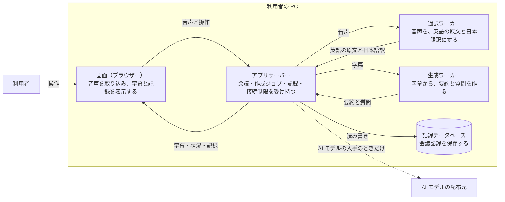

# 基本設計書

## 目次

- [このアプリがすること](#このアプリがすること)
- [主要な設計判断](#主要な設計判断)
- [設計書の一覧](#設計書の一覧)
- [要件トレーサビリティ](#要件トレーサビリティ)
  - [機能要件](#機能要件)
  - [画面とデータ](#画面とデータ)
  - [非機能と運用の要件](#非機能と運用の要件)
  - [設計で加えた要素](#設計で加えた要素)
- [未決定・要確認](#未決定要確認)

## このアプリがすること

英語の会議の音声を、利用者の PC の中だけで日本語の字幕にします。会議のあとは、字幕から 4 項目の要約と、英語と日本語の質問を作り、会議記録として残します。

- 図は、音声が字幕・要約・質問になるまでの流れを示します。コンポーネントの内訳は、[システム構成設計書の全体構成](architecture.md#全体構成)にあります。
- 要件は、[要件定義書](../requirements/README.md)にあります。

## 主要な設計判断

| 番号 | 設計判断 | なぜ | 判断の記録 |
|---|---|---|---|
| 1 | アプリを 1 つのコンテナにまとめます。AI 処理は、会議中だけ動く通訳ワーカーと、作成中だけ動く生成ワーカーに分けます | 会議をしていない間は、AI モデルをメモリに読み込まないためです。接続先が 1 つになり、接続制限を 1 か所で守れます | [ADR-01](adr.md#adr-01-1-つのコンテナと-1-つの接続先にまとめる)、[ADR-02](adr.md#adr-02-ai-処理を必要なときだけ動くワーカーに分ける) |
| 2 | 文字起こし・翻訳・文章生成に、それぞれ専用の小型の AI モデルを使います（Whisper small.en、FuguMT、Qwen3-4B） | GPU の無い PC の約 8GB のメモリに収め、字幕の遅れを 10 秒以内にするためです。どれも、業務で使えるライセンスです。この選定は仮置きです | [ADR-04](adr.md#adr-04-文字起こしは-whisper-smallen-を使う)、[ADR-05](adr.md#adr-05-字幕の翻訳は専用の翻訳モデル-fugumt-で行う)、[ADR-06](adr.md#adr-06-要約と質問は小型の文章生成モデル-qwen3-4b-で作る) |
| 3 | 発話を無音で区切り、区切り 1 つを字幕 1 件にします。字幕は、保存が確定してから画面に表示します | 話の切れ目で区切ると、訳の質を保てます。区切りの長さの上限が、字幕の遅れの上限を決めます。画面に出た字幕は、必ず記録に残ります | [ADR-07](adr.md#adr-07-発話を無音で区切って字幕を作る) |
| 4 | 要約は会議のあとに、字幕をブロックへ分けて段階的に作ります | 2 時間の会議の字幕は、小型の文章生成モデルが一度に読める量を超えるためです。会議中に作ると、字幕が遅れます | [ADR-08](adr.md#adr-08-要約は会議後に分割して段階的に作る) |
| 5 | 接続元を、ポートの公開範囲・要求の宛先・要求の送り元で制限します。自動テストのときも、アプリの設定を変えません | ログインが無いため、接続元の制限が唯一の入口の守りです。テストのための設定は、テストを実行する側にだけ置きます | [ADR-11](adr.md#adr-11-接続元をループバックと-host-と-origin-で制限する)、[ADR-13](adr.md#adr-13-自動テストはテスト側のブラウザー設定で音声を取り込む) |

## 設計書の一覧

| 設計書 | 定めること |
|---|---|
| [システム構成設計書](architecture.md) | コンポーネントの構成と責務、配置と公開範囲、技術スタック、AI 処理の流れ |
| [機能設計書](functional.md) | 17 個の機能の一覧、業務フロー、機能ごとの動作と例外 |
| [画面設計書](screen.md) | 4 つの画面の遷移、領域の構成、項目とデータの対応、入力チェック、エラーの表示 |
| [データモデル設計書](data_model.md) | 5 つのエンティティの属性、区分コード、機能とデータの対応、業務用語辞書 |
| [非機能要件設計書](nonfunctional.md) | 可用性、性能、運用、セキュリティ、環境、アクセシビリティの方針と目標値 |
| [横断設計規約](cross_cutting.md) | エラー、接続制限、ログ、保存の単位、命名、日時、会議の状態の遷移など、全体で共通の規約 |
| [設計判断の記録](adr.md) | 17 件の設計判断の理由と却下案、利用者に確認する事項 |

- 外部のシステムとの連携、ほかのシステムへ公開する API、帳票、定期的に動く処理は、この案件にありません。そのため、これらの設計書は作っていません。

## 要件トレーサビリティ

### 機能要件

要件の[機能一覧](../requirements/README.md#機能一覧)の 15 個の機能は、すべて同じ番号で機能設計書に割り当てています。

| 要件の機能 | 機能設計書 | 画面 | 読み書きするエンティティ | 担うコンポーネント |
|---|---|---|---|---|
| F-01 PC で再生される音声の取り込み | [F-01](functional.md#f-01-pc-で再生される音声の取り込み) | S-02、S-03 | なし | 音声取り込み部 |
| F-02 マイク音声の取り込み | [F-02](functional.md#f-02-マイク音声の取り込み) | S-02、S-03 | なし | 音声取り込み部 |
| F-03 会議の開始と終了 | [F-03](functional.md#f-03-会議の開始と終了) | S-02、S-03 | 会議、字幕 | 会議管理部 |
| F-04 英語の文字起こし | [F-04](functional.md#f-04-英語の文字起こし) | なし | なし | 会議管理部、通訳ワーカー |
| F-05 日本語への翻訳 | [F-05](functional.md#f-05-日本語への翻訳) | なし | 会議、字幕 | 会議管理部、通訳ワーカー |
| F-06 字幕の表示 | [F-06](functional.md#f-06-字幕の表示) | S-03 | 会議、字幕 | 画面表示部、通知部 |
| F-07 会議後の要約 | [F-07](functional.md#f-07-会議後の要約) | S-04 | 会議、字幕、要約 | 作成ジョブ管理部、生成ワーカー |
| F-08 質問の作成 | [F-08](functional.md#f-08-質問の作成) | S-03、S-04 | 会議、字幕、要約、質問のまとまり、質問 | 作成ジョブ管理部、生成ワーカー |
| F-09 会議記録の保存 | [F-09](functional.md#f-09-会議記録の保存) | なし | 5 つすべて | 記録保存部、記録データベース |
| F-10 会議の一覧と閲覧 | [F-10](functional.md#f-10-会議の一覧と閲覧) | S-01、S-04 | 5 つすべて | 画面表示部、記録保存部 |
| F-11 記録の削除 | [F-11](functional.md#f-11-記録の削除) | S-01、S-04 | 5 つすべて | 会議管理部、作成ジョブ管理部、記録保存部 |
| F-12 記録のコピー | [F-12](functional.md#f-12-記録のコピー) | S-03、S-04 | 5 つすべて | 画面表示部 |
| F-13 テキストファイルの取り出し | [F-13](functional.md#f-13-テキストファイルの取り出し) | S-04 | 5 つすべて | 画面表示部 |
| F-14 操作の案内 | [F-14](functional.md#f-14-操作の案内) | S-01 から S-04 | なし | 画面表示部 |
| F-15 処理状況とエラーの表示 | [F-15](functional.md#f-15-処理状況とエラーの表示) | S-01 から S-04 | 会議 | 画面表示部、通知部、記録保存部 |

- 読み書きの内訳は、[データモデル設計書の機能とデータの対応](data_model.md#機能とデータの対応)にあります。
- コンポーネントの責務は、[システム構成設計書のコンポーネントの責務](architecture.md#コンポーネントの責務)にあります。
- F-11 では、会議管理部が削除の条件を確かめ、作成ジョブ管理部が作成ジョブの有無を答え、記録保存部が削除します。

### 画面とデータ

| 要件 | 設計での割り当て | 設計書 |
|---|---|---|
| [画面一覧](../requirements/screens.md#画面一覧)の S-01 から S-04 | 同じ番号と名前の 4 つの画面 | [画面設計書の画面一覧](screen.md#画面一覧) |
| [画面遷移図](../requirements/screens.md#画面遷移図) | 確認の表示・取り込みの失敗・会議の中断の経路を加えた遷移 | [画面設計書の画面遷移](screen.md#画面遷移) |
| [画面レイアウトイメージ](../requirements/screens.md#画面レイアウトイメージ) | 共通の枠と、画面ごとの領域の構成 | [画面設計書のワイヤーフレーム概略](screen.md#ワイヤーフレーム概略) |
| [概念 ER 図](../requirements/db.md)の 5 つのエンティティ | 同じ 5 つのエンティティと、同じ関連 | [データモデル設計書のエンティティ定義](data_model.md#エンティティ定義) |
| [会議の状態](../requirements/README.md#会議の状態) | 保存する 5 つの状態と、遷移の規則。準備中は保存しません | [区分コード](data_model.md#区分コード)、[会議の状態の遷移規則](cross_cutting.md#会議の状態の遷移規則)、[ADR-09](adr.md#adr-09-会議記録は開始の時点で作る) |
| [保存しないもの](../requirements/db.md#保存しないもの)と[削除](../requirements/db.md#削除) | 音声と映像を保存しません。会議の削除で、その会議の記録をすべて消します | [保存しないデータ](data_model.md#保存しないデータ)、[関連](data_model.md#関連) |

### 非機能と運用の要件

| 要件 | 設計での受け止め | 設計書 |
|---|---|---|
| [達成目標](../requirements/README.md#達成目標) | 字幕の遅れ・要約・質問の 3 つを、機能と性能の目標へ割り当てます | [機能設計書](functional.md#機能一覧)、[性能と拡張性](nonfunctional.md#性能と拡張性) |
| [初版の対象外](../requirements/README.md#初版の対象外) | 対象外の機能を作りません。あとから足す場所を定めます | [拡張の受け口](architecture.md#拡張の受け口) |
| [異常時の動き](../requirements/README.md#異常時の動き) | 6 つの動きを、機能の例外フローとして定めます | [F-01](functional.md#f-01-pc-で再生される音声の取り込み)、[F-02](functional.md#f-02-マイク音声の取り込み)、[F-03](functional.md#f-03-会議の開始と終了)、[F-07](functional.md#f-07-会議後の要約)、[F-16](functional.md#f-16-ai-モデルの入手)、[F-17](functional.md#f-17-起動時の復旧) |
| [実装形態](../requirements/README.md#実装形態) | ブラウザーで開く画面と、コンテナで動くアプリサーバーで作ります | [技術スタック](architecture.md#技術スタック) |
| [処理する場所とデータの扱い](../requirements/README.md#処理する場所とデータの扱い) | 外向きの通信を、AI モデルの入手だけに限ります。音声を保存しません。ログに会議の内容を書きません | [セキュリティ](nonfunctional.md#セキュリティ)、[保存しないデータ](data_model.md#保存しないデータ)、[ログの種別と項目](cross_cutting.md#ログの種別と項目) |
| [利用できる人の制限](../requirements/README.md#利用できる人の制限) | 接続元を、PC の中に限ります | [接続制限の判定](cross_cutting.md#接続制限の判定)、[ADR-11](adr.md#adr-11-接続元をループバックと-host-と-origin-で制限する) |
| [セキュリティ](../requirements/README.md#セキュリティ) | 会議の内容を文字として表示します。部品と AI モデルを、版を固定して入手します | [セキュリティ](nonfunctional.md#セキュリティ)、[ADR-14](adr.md#adr-14-ai-モデルは起動時に入手し外向きの通信をその入手に限る)、[ADR-15](adr.md#adr-15-会議の内容は文字として表示し取り出す文面は画面で組み立てる) |
| [配布形態とライセンス](../requirements/README.md#配布形態とライセンス) | 業務で使えるライセンスの AI モデルと部品を選びます | [技術スタック](architecture.md#技術スタック) |
| [技術要件・制約](../requirements/README.md#技術要件制約) | 言語・フレームワーク・AI モデルを選びます。対象外の機能を足せる作りにします | [技術スタック](architecture.md#技術スタック)、[拡張の受け口](architecture.md#拡張の受け口) |
| [対応環境](../requirements/README.md#対応環境) | Edge と Chrome を対象にします。対応していないブラウザーでは、案内を表示します | [システム環境とエコロジー](nonfunctional.md#システム環境とエコロジー)、[F-14](functional.md#f-14-操作の案内) |
| [性能の目標](../requirements/README.md#性能の目標) | 目標ごとに、守る手立てと測る区間を定めます。字幕の遅れを、段ごとに配分します | [性能と拡張性](nonfunctional.md#性能と拡張性)、[字幕の遅れの配分](nonfunctional.md#字幕の遅れの配分) |
| [訳と要約の品質](../requirements/README.md#訳と要約の品質) | AI モデルを入れ替えられる差し替え口を持ちます。見本の結果を、利用者が判定します | [アーキテクチャパターン](architecture.md#アーキテクチャパターン)、[確認事項 3](adr.md#未決定要確認運用要人間判断) |
| [稼働の継続](../requirements/README.md#稼働の継続) | 稼働率の目標を置きません。自動で再起動し、途中だった会議を直します | [可用性](nonfunctional.md#可用性)、[F-17](functional.md#f-17-起動時の復旧) |
| [動かす PC の前提](../requirements/README.md#動かす-pc-の前提) | メモリを場面ごとに配分します。会議をしていない間は、ワーカーを止めます | [メモリの配分](nonfunctional.md#メモリの配分)、[プロセスと AI モデルの読み込み](architecture.md#プロセスと-ai-モデルの読み込み) |
| [テスト環境と完成の基準](../requirements/README.md#テスト環境と完成の基準) | テスト側のブラウザーの設定で、音声を取り込みます。アプリの設定は変えません。性能の目標は、実際に使う状態で測って報告します | [自動テスト時の構成](architecture.md#自動テスト時の構成)、[ADR-13](adr.md#adr-13-自動テストはテスト側のブラウザー設定で音声を取り込む)、[実際に使う状態での測定](nonfunctional.md#実際に使う状態での測定) |
| [運用・移行要件](../requirements/README.md#6-運用移行要件)と[運用・移行・デプロイの要求](../requirements/devops.md) | 自動の起動、更新時の記録の保持、ログ、監視とバックアップを設けないことを、方針として定めます。移行はありません | [運用と保守性](nonfunctional.md#運用と保守性)、[移行性](nonfunctional.md#移行性)、[配置と公開範囲](architecture.md#配置と公開範囲) |

### 設計で加えた要素

要件の機能一覧と概念 ER 図に無い要素は、次のとおりです。どれも、要件の記述を実現するために加えています。

| 加えた要素 | 設計書 | 根拠の要件 |
|---|---|---|
| F-16 AI モデルの入手 | [機能設計書](functional.md#f-16-ai-モデルの入手) | [AI モデルの入手](../requirements/devops.md#ai-モデルの入手)、[会議の開始と終了](../requirements/README.md#会議の開始と終了f-03) |
| F-17 起動時の復旧 | [機能設計書](functional.md#f-17-起動時の復旧) | [異常時の動き](../requirements/README.md#異常時の動き)、[稼働の継続](../requirements/README.md#稼働の継続) |
| 会議の属性「要約の失敗理由」 | [データモデル設計書](data_model.md#会議) | [操作の案内と状況の表示](../requirements/README.md#操作の案内と状況の表示f-14f-15)。画面を開き直しても、何が起きたかを表示するためです |
| 会議番号と、順番による主キー | [データモデル設計書](data_model.md#エンティティ定義) | [概念 ER 図](../requirements/db.md)。エンティティを一意に見分けるためです |
| 保存しない区分（字幕の状況、AI モデルの準備状況、作成ジョブの種類と状況） | [データモデル設計書](data_model.md#保存しない区分) | [操作の案内と状況の表示](../requirements/README.md#操作の案内と状況の表示f-14f-15) |
| 作成ジョブと、1 件ずつの実行 | [横断設計規約](cross_cutting.md#ai-処理の同時実行) | [動かす PC の前提](../requirements/README.md#動かす-pc-の前提)、[アーキテクトの分析](../requirements/README.md#アーキテクトの分析) |
| 接続ログ | [横断設計規約](cross_cutting.md#ログの種別と項目) | [利用できる人の制限](../requirements/README.md#利用できる人の制限) |
| 終了の確認 | [画面設計書](screen.md#画面一覧) | [会議の状態](../requirements/README.md#会議の状態)。終了した会議は、通訳中へ戻せないためです |
| 最新の字幕へ戻るボタン | [画面設計書](screen.md#s-03-会議中の項目と操作) | [同時通訳](../requirements/README.md#同時通訳f-04f-05f-06)。過去の字幕へ戻っている間は、自動で進めないためです |
| 取り込みをやり直す操作、入手をやり直す操作 | [画面設計書](screen.md#画面入出力項目とデータの対応) | [異常時の動き](../requirements/README.md#異常時の動き) |
| 字幕の話された時刻の表示 | [画面設計書](screen.md#複数の画面で使う項目) | 概念 ER 図の[エンティティと主要属性](../requirements/db.md#エンティティと主要属性) |

## 未決定・要確認

利用者に判断または確認をお願いする事項は 11 件、要件の仮置きを引き継いだ事項は 4 件です。内容と仮置きの値は、[設計判断の記録の未決定・要確認](adr.md#未決定要確認運用要人間判断)にあります。次の表は、利用者に判断または確認をお願いする 11 件です。番号 9 から 12 は、要件の仮置きを引き継いだ事項のため、載せていません。

| 番号 | 事項 |
|---|---|
| 1 | 性能の目標に届かない場合の対応 |
| 2 | 長い会議の途中で作る質問が読む範囲 |
| 3 | AI モデルの選定 |
| 4 | AI モデルのライセンスの確認 |
| 5 | 開発用コンテナからの接続 |
| 6 | PC の起動時の自動起動 |
| 7 | ディスクの保護 |
| 8 | ログを残す量 |
| 13 | 作成ジョブの実行順と、待ちで作成時間の目標を超える場面 |
| 14 | 実際に使う状態での性能の測定 |
| 15 | 更新前の控えと、前の版へ戻すときの既定 |
