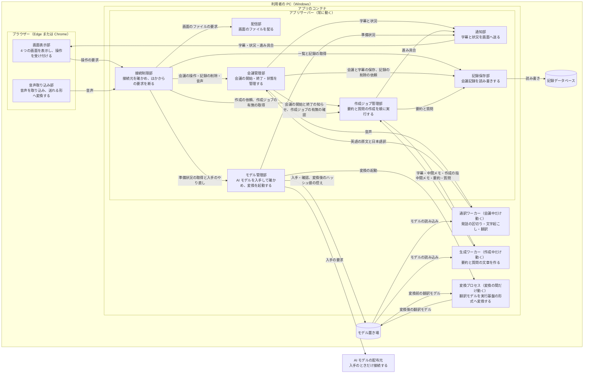
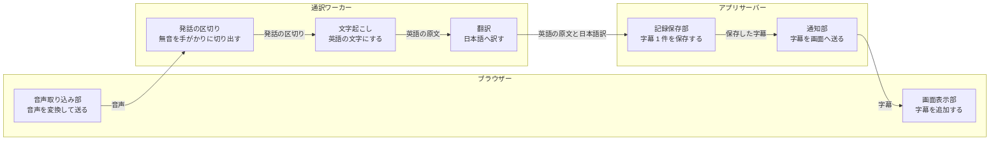
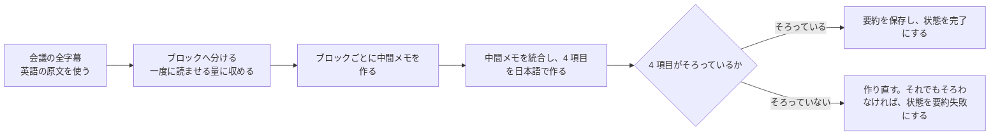

# システム構成設計書

## 目次

- [全体構成](#全体構成)
- [コンポーネントの責務](#コンポーネントの責務)
- [画面とアプリサーバーのやり取り](#画面とアプリサーバーのやり取り)
- [配置と公開範囲](#配置と公開範囲)
- [アーキテクチャパターン](#アーキテクチャパターン)
- [技術スタック](#技術スタック)
- [AI 処理の流れ](#ai-処理の流れ)
- [プロセスと AI モデルの読み込み](#プロセスと-ai-モデルの読み込み)
- [アプリを開始できない状態](#アプリを開始できない状態)
- [拡張の受け口](#拡張の受け口)
- [自動テスト時の構成](#自動テスト時の構成)

## 全体構成

アプリは、利用者の PC の中だけで動きます。ブラウザーで動く画面と、コンテナで動くアプリサーバー・2 つのワーカーで構成します。PC の外と通信するのは、AI モデルを入手するときだけです。

## コンポーネントの責務

| コンポーネント | 動く場所 | 責務 | 受け取るもの | 渡すもの | 関係する機能と画面 |
|---|---|---|---|---|---|
| 画面表示部 | ブラウザー | 4 つの画面を表示し、利用者の操作を受け付けます。コピーと取り出しの文面を組み立てます | 利用者の操作、字幕・状況・記録 | 操作の要求、表示、クリップボードの文字、Markdown のファイル | S-01 から S-04、F-06、F-10、F-12 から F-15 |
| 音声取り込み部 | ブラウザー | 画面共有またはマイクから音声を取り込み、16kHz・モノラルの音声へ変換します。映像は使わずに捨てます | 画面共有の音声、マイクの音声 | 変換した音声 | F-01、F-02 |
| 接続制限部 | アプリサーバー | すべての要求の接続元を確かめ、条件を満たさない要求を断ります | すべての HTTP の要求と WebSocket の接続 | 通した要求、断った記録 | 全機能 |
| 配信部 | アプリサーバー | 画面のファイルを配ります。ファイルはアプリに同梱し、外部から読み込みません。画面の読み込み先と通信先をアプリ自身に限るよう、ブラウザーへ指示します。[開始できない状態](#アプリを開始できない状態)では、画面のファイル以外の要求に、アプリを開始できないことを返します | 画面のファイルの要求。開始できない状態では、通したすべての要求 | 画面のファイル、アプリを開始できないことを示すエラー | S-01 から S-04、F-17 |
| 会議管理部 | アプリサーバー | 会議の開始・終了・中断と、状態の遷移を管理します。通訳ワーカーを起動し、止めます。字幕の遅れと無音を見張ります。記録の削除の条件を確かめ、記録保存部へ削除を依頼します。起動時に、途中だった会議の状態を直します | 会議の操作、記録の削除の要求、音声、英語の原文と日本語訳 | 会議と字幕、字幕の状況、記録の削除の依頼、会議の開始と終了の知らせ | F-03、F-04、F-05、F-11、F-17 |
| 通知部 | アプリサーバー | 字幕・会議の状態・進み具合・警告を、開いている画面へ送ります | 字幕、状況、進み具合 | 通知 | F-06、F-15 |
| 作成ジョブ管理部 | アプリサーバー | 要約と質問の作成を受け付け、[実行順の規約](cross_cutting.md#ai-処理の同時実行)に従って 1 件ずつ実行します。生成ワーカーを起動し、止めます。要約は、ブロックごとに生成ワーカーへ依頼し、できた中間メモを統合まで持ちます。会議の作成ジョブが残っているかを、会議管理部へ答えます。会議の一覧を表示するときも、会議ごとの作成ジョブの有無を画面へ返します | 作成の依頼、作成ジョブの有無の取得の要求、会議の開始と終了の知らせ、中間メモ、要約と質問 | 作成の指示、進み具合、保存する結果、作成ジョブの有無 | F-07、F-08、F-10、F-11 |
| 記録保存部 | アプリサーバー | 会議記録の読み書きと削除を行います。起動時に、記録データベースの構造の版を確かめます。構造が古い場合は、[更新前の控え](nonfunctional.md#前の版へ戻すとき)を残してから、新しい構造へ更新します。記録の削除では、更新前の控えがあれば先に控えからその会議を消し、消せた場合だけ記録データベースから消します。ディスクの空きを確かめます | 保存する内容、読み出しの要求、記録の削除の依頼 | 会議記録 | F-09、F-10、F-11、F-15、F-17 |
| モデル管理部 | アプリサーバー | AI モデルを配布元から入手し、配布元のファイルと一致することを確かめます。翻訳モデルは、入手と確認のあとに変換プロセスを起動して、実行基盤の形式へ変換させます。変換が済んだら、変換後のハッシュ値の控えをモデル置き場に置きます。準備状況を持ちます | モデルの定義、準備状況の取得の要求、入手のやり直しの要求、変換の結果 | 準備状況、確認済みの AI モデル、変換の起動 | F-16 |
| 通訳ワーカー | アプリのコンテナ | 音声を発話の区切りへ切り出し、英語の文字にして、日本語へ訳します | 音声 | 英語の原文と日本語訳、無音の知らせ | F-04、F-05 |
| 生成ワーカー | アプリのコンテナ | 字幕から、要約と質問の文章を作ります | 字幕、中間メモ、作成の指示 | 中間メモ、要約、質問、進み具合 | F-07、F-08 |
| 変換プロセス | アプリのコンテナ | 入手した翻訳モデルを読み込み、実行基盤の形式へ変換します。モデル管理部が起動し、変換が終わると成功しても失敗しても止まります（[ADR-16](adr.md#adr-16-翻訳モデルの変換は起動時に変換の間だけ動くプロセスで行う)） | 変換前の翻訳モデル | 変換後の翻訳モデル、変換の結果 | F-16 |
| 記録データベース | 名前付きボリューム | 会議記録を保存します。構造を更新する前の更新前の控えも、同じボリュームに 1 世代だけ置きます | 記録保存部の書き込み | 記録保存部への読み出し | F-09 |
| モデル置き場 | 名前付きボリューム | 入手した AI モデルのファイルと、変換した翻訳モデルのファイルと、変換後のハッシュ値の控えを保存します。変換後のハッシュ値の控えは、変換した翻訳モデルのファイルから求めた値で、変換し直すかどうかの判定に使います | モデル管理部と変換プロセスの書き込み | 2 つのワーカーと変換プロセスへの読み込み、モデル管理部への控えの読み出し | F-16 |

- 横断の方式（エラー処理・ログ・接続制限・保存の順序）は、[横断設計規約](cross_cutting.md)にあります。
- 各コンポーネントの内部の作りは、実装で確定します。

## 画面とアプリサーバーのやり取り

外部のシステムとの連携と、ほかのシステムへ公開する API はありません。画面とアプリサーバーの間のやり取りは次の 6 種類です。

| やり取り | 向き | 方式 | やり取りするデータ |
|---|---|---|---|
| 画面の配信 | アプリサーバーから画面 | HTTP | 画面のファイル |
| 会議と記録の操作 | 画面からアプリサーバー | HTTP（JSON） | 会議の開始と終了、一覧と記録の取得、記録の削除 |
| 作成の依頼 | 画面からアプリサーバー | HTTP（JSON） | 要約と質問の作成の依頼、受け付けた作成ジョブ、会議ごとの作成ジョブの有無 |
| 音声の送信 | 画面からアプリサーバー | WebSocket（バイナリ） | 16kHz・モノラルの音声、取り込みの停止と再開の知らせ |
| 字幕と状況の通知 | アプリサーバーから画面 | WebSocket（JSON） | 字幕、会議の状態、字幕の状況、作成ジョブの進み具合、警告 |
| AI モデルの準備状況 | 双方向 | HTTP（JSON）と通知 | 準備状況の取得、入手のやり直しの依頼 |

- 音声を送る WebSocket が切れたことを、画面との接続が切れた合図として扱います。
- 経路の名前と項目の定義は、実装で確定します。項目名とコード値は[横断設計規約の命名の規則](cross_cutting.md#命名の規則)に従います。

## 配置と公開範囲

| 層 | 置き場所 | 通信相手 | プロトコル | 公開範囲 |
|---|---|---|---|---|
| 画面 | 利用者のブラウザー | アプリサーバー | HTTP と WebSocket。接続先は `http://localhost:3001` | PC の中 |
| アプリサーバー | アプリのコンテナ | 画面 | HTTP と WebSocket。ポート 3001 | PC のループバック（`127.0.0.1`）と、同じ PC のコンテナ網 |
| 通訳ワーカー、生成ワーカー、変換プロセス | アプリのコンテナ | アプリサーバー | コンテナの中のプロセス間通信 | コンテナの中 |
| 記録データベース | 名前付きボリューム | 記録保存部 | ファイルの読み書き | コンテナの中 |
| モデル置き場 | 名前付きボリューム | モデル管理部、変換プロセス、2 つのワーカー | ファイルの読み書き | コンテナの中 |
| AI モデルの配布元 | インターネット | モデル管理部 | HTTPS。アプリから外向きだけ | AI モデルの入手のときだけ |

開発環境が割り当てる名前は次のとおりです。

| 項目 | 値 |
|---|---|
| アプリのコンテナ名 | `toshiakimamada-blip-mmd-output-system` |
| コンテナ網の名前 | `toshiakimamada-blip-mmd-network` |
| 利用者が開く接続先 | `http://localhost:3001` |
| 自動テストのブラウザーが開く接続先 | `http://toshiakimamada-blip-mmd-output-system:3001` |

- コンテナは 1 つです。開発環境が割り当てるもう 1 つのコンテナ名とポート 3002 は使いません。
- 同じ PC のコンテナ網からは、開発用のコンテナがアプリサーバーへ届きます。ほかの PC からは届きません。
- 接続元を確かめる条件は、[横断設計規約の接続制限の判定](cross_cutting.md#接続制限の判定)にあります。
- 社内のネットワークの証明書がある場合は、コンテナの証明書の置き場へ登録します。証明書が無い環境でも、同じ手順でコンテナを作れます。

## アーキテクチャパターン

| パターン | 当てはめる場所 | 選んだ根拠 |
|---|---|---|
| モジュラモノリス | アプリサーバー。責務ごとの 7 つの部を 1 つのプロセスにまとめます | 利用者が 1 人で、共同利用への拡張を考慮しません（[技術要件・制約](../requirements/README.md#技術要件制約)）。導入と更新を 1 つのコンテナの入れ替えで済ませます |
| ワーカープロセスの分離 | 通訳ワーカーと生成ワーカー、変換プロセス | 会議をしていない間は、AI モデルをメモリに読み込みません（[動かす PC の前提](../requirements/README.md#動かす-pc-の前提)）。プロセスを止めると、メモリが確実に戻ります。字幕の処理と質問の作成が同じ CPU を使うため、割り当てを別々に決めます |
| 差し替え口を持つ AI エンジン | 文字起こし・翻訳・文章生成の 3 つ | 訳と要約の品質が足りない場合に、AI モデルを入れ替えます（[訳と要約の品質](../requirements/README.md#訳と要約の品質)）。対象外の機能をあとから足します |

判断の経緯は、[ADR-01](adr.md#adr-01-1-つのコンテナと-1-つの接続先にまとめる) と [ADR-02](adr.md#adr-02-ai-処理を必要なときだけ動くワーカーに分ける)、[ADR-16](adr.md#adr-16-翻訳モデルの変換は起動時に変換の間だけ動くプロセスで行う) にあります。

## 技術スタック

AI モデルと部品の版は、実装時に固定します。却下した案の詳しい理由は、各行の判断の記録にあります。

| 区分 | 採用する技術 | 選定理由 | 却下した代替案 | 根拠の要件 | 判断の記録 |
|---|---|---|---|---|---|
| 画面 | TypeScript と React。1 つのページの中で画面を切り替える方式 | 会議中にページを読み込み直さないため、音声の取り込みが途切れません。表示する内容を、既定で文字として扱います | サーバーで画面を作る方式（画面を移るたびに取り込みが切れます） | [実装形態](../requirements/README.md#実装形態)、[セキュリティ](../requirements/README.md#セキュリティ) | [ADR-03](adr.md#adr-03-サーバーは-python-と-fastapi-で画面は-typescript-と-react-で作る) |
| 音声の取り込み | ブラウザーの標準の機能（画面共有、マイク、音声の加工） | 要件が、画面共有の仕組みを使うと定めています。利用者が追加のソフトを入れる必要がありません | 音声を圧縮して送る方式（アプリサーバーで元へ戻す処理が増え、字幕が遅れます） | [音声の取り込み](../requirements/README.md#音声の取り込みf-01f-02) | [ADR-07](adr.md#adr-07-発話を無音で区切って字幕を作る) |
| アプリサーバー | Python と FastAPI | 3 つの AI エンジンの実行基盤を、すべて Python から呼べます。HTTP と WebSocket を 1 つのサーバーで扱えます | Node.js（AI エンジンを呼ぶために Python のプロセスが別に要り、構成が増えます） | [技術要件・制約](../requirements/README.md#技術要件制約) | [ADR-03](adr.md#adr-03-サーバーは-python-と-fastapi-で画面は-typescript-と-react-で作る) |
| 画面との通信 | HTTP と WebSocket | 音声を途切れずに送り、字幕をできた順に受け取れます | 一定の間隔で問い合わせる方式（問い合わせの間隔の分だけ字幕が遅れます） | [性能の目標](../requirements/README.md#性能の目標) | [ADR-07](adr.md#adr-07-発話を無音で区切って字幕を作る) |
| 文字起こし | Whisper small.en。実行基盤は faster-whisper（CTranslate2）で、8 ビットへ量子化して動かします。発話の区切りには Silero VAD を使います | GPU の無い CPU で、字幕の遅れの目標に収まる見込みがあります。MIT ライセンスです | Whisper の大型のモデル（この CPU では処理が追いつかない見込みです）、ブラウザー内蔵の音声認識（既定で音声を外部のサービスへ送ります） | [動かす PC の前提](../requirements/README.md#動かす-pc-の前提)、[処理する場所とデータの扱い](../requirements/README.md#処理する場所とデータの扱い) | [ADR-04](adr.md#adr-04-文字起こしは-whisper-smallen-を使う) |
| 翻訳 | FuguMT（英語から日本語）。実行基盤は CTranslate2 | 1 文を 1 秒前後で訳せる見込みがあり、字幕の遅れの目標に収まります。CC BY-SA 4.0 で、業務に使えます | 文章生成モデルによる翻訳（1 文に数秒以上かかる見込みです）、NLLB-200（非商用に限るライセンスです） | [性能の目標](../requirements/README.md#性能の目標)、[配布形態とライセンス](../requirements/README.md#配布形態とライセンス) | [ADR-05](adr.md#adr-05-字幕の翻訳は専用の翻訳モデル-fugumt-で行う) |
| 文章生成 | Qwen3-4B。4 ビットへ量子化した GGUF 形式を、llama.cpp で動かします | 約 8GB のメモリに、文字起こしと翻訳のモデルと合わせて収まります。Apache 2.0 ライセンスで、開発元が GGUF 形式を配布しています | より大きいモデル（メモリに収まりません）、Ollama（常に動くサービスが 1 つ増えます） | [動かす PC の前提](../requirements/README.md#動かす-pc-の前提)、[配布形態とライセンス](../requirements/README.md#配布形態とライセンス) | [ADR-06](adr.md#adr-06-要約と質問は小型の文章生成モデル-qwen3-4b-で作る) |
| 記録の保存 | SQLite | 利用者が 1 人で、書き込むプロセスが 1 つです。サーバーを別に動かす必要がなく、メモリを使いません | PostgreSQL（コンテナとメモリが増えます）、ファイルへの保存（字幕の保存と状態の変更をまとめて確定できません） | [会議記録の保存](../requirements/README.md#会議記録の保存閲覧削除f-09f-10f-11) | [ADR-10](adr.md#adr-10-記録は-sqlite-に保存し名前付きボリュームに置く) |
| 実行基盤 | Docker のコンテナ 1 つ。Ubuntu 24.04 を土台にし、Docker Compose で起動します。自動で再起動する設定と、名前付きボリューム 2 つを使います | 要件が、PC の中のコンテナで動かすと定めています。開発環境と同じ土台にそろえます | 複数のコンテナへの分割（接続先が 2 つになり、接続制限を守る場所が増えます） | [動かす場所](../requirements/devops.md#動かす場所)、[起動と停止](../requirements/devops.md#起動と停止) | [ADR-01](adr.md#adr-01-1-つのコンテナと-1-つの接続先にまとめる) |
| テスト | pytest（アプリサーバーとワーカー）、Vitest（画面）、Playwright（画面を通したテスト） | 開発環境に Playwright と Chromium が入っています | 該当なし | [テスト環境と完成の基準](../requirements/README.md#テスト環境と完成の基準) | [ADR-13](adr.md#adr-13-自動テストはテスト側のブラウザー設定で音声を取り込む) |

- AI モデルの選定は仮置き（AI 推奨）です。見本の英語音声の結果を利用者が見て、確定します（[確認事項 3](adr.md#未決定要確認運用要人間判断)）。
- 文章生成モデルの呼び出し方（プログラムへ組み込むか、付属のサーバーを子プロセスで動かすか）は、実装で確定します。
- 翻訳モデルは、入手したあとに実行基盤の形式へ 1 回だけ変換します。変換は、モデル管理部が起動する変換プロセスで行います。変換に使う部品は、コンテナのイメージに含めます（[ADR-16](adr.md#adr-16-翻訳モデルの変換は起動時に変換の間だけ動くプロセスで行う)）。変換の時機と、失敗したときの動きは、[F-16](functional.md#f-16-ai-モデルの入手) にあります。変換の手段は実装で確定します。

## AI 処理の流れ

### 同時通訳

音声は、次の段を順に通って字幕になります。段ごとの遅れの配分は、[非機能要件設計書の字幕の遅れの配分](nonfunctional.md#字幕の遅れの配分)にあります。

- 発話は、無音になった所で区切ります。無音が来ないまま長さの上限に達した場合は、そこで区切ります。
- 音声は、文字起こしが終わった区切りから順に破棄します。
- 処理が追いつかない場合も、音声を捨てません。届いた順に字幕にし、遅れていることを画面に表示します。

### 要約

2 時間の会議の字幕は、文章生成モデルが一度に読む量として多すぎます。そのため、字幕を分けて段階的にまとめます。

- 字幕が 1 ブロックに収まる会議では、中間メモを作らずに 4 項目を作ります。
- 文章生成モデルの出力は、決めた形（4 項目）に沿うように制約をかけて受け取ります。
- 進み具合は、処理したブロックの数で画面に示します。

### 質問

| 作成する場面 | 文章生成モデルへ渡す内容 |
|---|---|
| 会議中 | その時点までの字幕（英語の原文）。量の上限を超える場合は、直近の字幕を優先します |
| 会議後で、要約がある | 要約と、直近の字幕 |
| 会議後で、要約が無い | 字幕。量の上限を超える場合は、直近の字幕を優先します |

- 出力は、英語と日本語の組が 5 つそろう形に制約をかけて受け取ります。
- 直近を優先する理由は、[ADR-08](adr.md#adr-08-要約は会議後に分割して段階的に作る) にあります。

## プロセスと AI モデルの読み込み

| 場面 | アプリサーバー | 通訳ワーカー | 生成ワーカー | 変換プロセス | メモリに読み込む AI モデル |
|---|---|---|---|---|---|
| 会議をしていない | 動く | 止まっている | 止まっている | 止まっている | なし |
| AI モデルを入手している | 動く | 止まっている | 止まっている | 止まっている | なし |
| 翻訳モデルを変換している | 動く | 止まっている | 止まっている | 動く | 変換前の翻訳モデル（変換プロセスだけが読み込みます） |
| 翻訳モデルの変換中に、会議後の要約または質問を作っている | 動く | 止まっている | 動く | 動く | 変換前の翻訳モデル、文章生成モデル |
| 会議中 | 動く | 動く | 止まっている | 止まっている | 文字起こしモデル、翻訳モデル |
| 会議中に質問を作っている | 動く | 動く | 動く | 止まっている | 3 つすべて |
| 会議後に要約または質問を作っている | 動く | 止まっている | 動く | 止まっている | 文章生成モデル |

- 通訳ワーカーは、会議の開始で起動し、会議の終了または中断で止めます。
- 生成ワーカーは、作成ジョブの開始で起動し、実行できる作成ジョブが無くなった時点で止めます。会議中に後回しにした要約だけが残っている間は、止めたままにします（[AI 処理の同時実行](cross_cutting.md#ai-処理の同時実行)）。
- 変換プロセスは、モデル管理部が入手と確認のあとに起動し、変換が終わると止まります。
- 会議を開始した時点で、ほかの会議の要約がブロックの途中だった場合は、その区切りまで「会議中に質問を作っている」と同じ構成になります。
- 場面ごとのメモリの配分は、[非機能要件設計書のメモリの配分](nonfunctional.md#メモリの配分)にあります。

翻訳モデルの変換と、要件の「会議をしていない間は、AI モデルをメモリに読み込みません」（[動かす PC の前提](../requirements/README.md#動かす-pc-の前提)）との関係は、次のとおりです。

- 変換が起きるのは、初回の入手のあとと、変換し直すときだけです。変換し直すのは、変換後のファイルが無い場合と、変換後のハッシュ値の控えが無い場合と、控えと一致しない場合です（[F-16](functional.md#f-16-ai-モデルの入手)）。
- 準備完了になるまで、利用者は会議を開始できません。そのため、変換は会議と重なりません。
- 変換が終わると変換プロセスを止めるため、AI モデルを読み込んでいない状態へ戻ります。この設計は、要件を「使っていない間に AI モデルをメモリに残さない」という趣旨と解釈しています。会議後の要約と質問の作成で、文章生成モデルを読み込むのと同じ扱いです。
- 変換の間に、過去の会議の要約または質問を作ることはできます。その場合は、変換プロセスと生成ワーカーが同時に動きます。
- 判断の理由と却下案は、[ADR-16](adr.md#adr-16-翻訳モデルの変換は起動時に変換の間だけ動くプロセスで行う) にあります。

## アプリを開始できない状態

アプリサーバーは、起動時に記録データベースを使えなかった場合も止まりません。「開始できない状態」で動き続け、画面へ理由を返します。アプリサーバーが止まると、コンテナが再起動を繰り返し、画面へ理由を返せないためです。

| アプリサーバーの状態 | なる条件 | 動かす部 | 動かさない部 | 要求への応答 |
|---|---|---|---|---|
| 通常 | 起動時に、記録保存部が記録データベースの構造を確かめ、必要な更新に成功した | 7 つすべて | なし | それぞれの部が、通常どおり応答します |
| 開始できない状態 | 起動時に、記録保存部が次のどちらかを見つけた。記録データベースの構造の更新に失敗した（更新の前に更新前の控えを残せなかった場合を含む）。記録データベースの構造が、アプリの版が知っている構造より新しい | 接続制限部、配信部 | 会議管理部、通知部、作成ジョブ管理部、記録保存部、モデル管理部 | 配信部が、画面のファイルを配ります。そのほかの要求には、アプリを開始できないことを示すエラーコードを返します |

- 起動時の順序は、記録データベースの構造の確認と更新（構造が古い場合は、更新前の控えを残してから更新）、途中だった会議の復旧（[F-17](functional.md#f-17-起動時の復旧)）、AI モデルの確認と入手（[F-16](functional.md#f-16-ai-モデルの入手)）です。開始できない状態になった場合は、後ろの 2 つを行いません。
- アプリの版より新しい構造を見つける場面は、構造を更新した版から、前の版のイメージへ戻した場合です。前の版のアプリが、自分の知らない構造の記録を書き換えないために、開始できない状態にします。
- 開始できない状態では、記録データベースを書き換えません。2 つのワーカーと変換プロセスも起動しません。
- 開始できない状態でも、接続制限部は、すべての要求の接続元を確かめます。
- 開始できない状態は、アプリサーバーを起動し直すまで続きます。戻し方は、[非機能要件設計書の前の版へ戻すとき](nonfunctional.md#前の版へ戻すとき)にあります。
- 画面の表示は、[画面設計書のエラー表示パターン](screen.md#エラー表示パターン)にあります。

## 拡張の受け口

[初版の対象外](../requirements/README.md#初版の対象外)の機能を、次の場所へ足せる作りにします。

| 対象外の機能 | 足す場所 | 既存の部分への影響 |
|---|---|---|
| 日本語の音声による読み上げ | 通訳ワーカーに読み上げの段を足し、通知部が音声を画面へ送ります | 字幕の保存と表示は変わりません |
| 話者の区別 | 通訳ワーカーに話者を見分ける段を足します | 字幕に話者の属性を足します |
| 用語集 | 翻訳の前後に、用語を置き換える段を足します | 用語のエンティティと登録の画面を足します |
| Word での出力 | 画面表示部の文面の組み立てに、形式を足します | Markdown の取り出しは変わりません |
| 英語版の要約 | 生成ワーカーへの作成の指示を足します | 要約に言語の属性を足します |
| 日本語の発言の記録 | 文字起こしモデルを、複数の言語に対応するものへ差し替えます | 字幕に言語の属性を足します |
| 期間による自動削除、バックアップ、一括削除 | 記録保存部に機能を足します | 既存の保存と削除は変わりません |
| タスクトレイに常駐するネイティブアプリ | 画面とコンテナを包む外枠を足します | 画面とアプリサーバーは変わりません |
| 外部の AI サービスの利用 | AI エンジンの差し替え口の裏側を入れ替えます | 外部へ送らない方針と、接続の制限を見直す必要があります |

- 共同利用とログインへの拡張は考慮しません。要件が対象外と定めています。

## 自動テスト時の構成

自動テストのための設定は、テストを実行する側にだけ置きます。アプリは、利用時と同じ設定のまま動かします。

| 項目 | 利用時 | 自動テスト時 | アプリの違い |
|---|---|---|---|
| ブラウザー | 利用者の PC の Edge | 開発用のコンテナで動く Chromium | なし |
| 接続先 | `http://localhost:3001` | アプリのコンテナ名とポート 3001 | なし。アプリのコンテナ名は常に通します |
| 安全な接続としての扱い | `localhost` のため、ブラウザーが安全な接続として扱います | テスト側のブラウザーの起動設定で、接続先を安全な接続として扱わせます | なし |
| 音声の入力 | 画面共有、またはマイク | テスト側のブラウザーの起動設定で、用意した英語の音声ファイルを入力として流します | なし |
| 共有と許可の確認 | 利用者が選びます | テスト側のブラウザーの起動設定で、自動で通します | なし |
| AI モデル | 入手済みのもの | 同じもの | なし |

テスト側のブラウザーに与える起動設定は次の 4 つです。

| 目的 | 起動設定 |
|---|---|
| 接続先を安全な接続として扱う | `--unsafely-treat-insecure-origin-as-secure` に接続先を指定します |
| 共有と許可の確認を自動で通す | `--use-fake-ui-for-media-stream` |
| 擬似的な音声の入力を使う | `--use-fake-device-for-media-stream` |
| 用意した音声ファイルを入力として流す | `--use-file-for-fake-audio-capture` に音声ファイルを指定します |

- この 4 つの設定で、画面共有とマイクの両方から音声付きで取り込めることを、開発環境の Chromium で確認しています。
- Playwright が既定で使う画面なし専用のブラウザーでは、安全な接続として扱う設定が効きません。そのため、通常版の Chromium を画面なしで動かします。
- 実際の PC の音声を取り込む動作は、自動テストの対象にしません。利用者が Windows の Edge で確認します。
- アプリに、テスト専用の入口と切り替えの設定を作りません。
- 自動テストの間は、開発用のコンテナとテスト用のブラウザーが、アプリと同じ PC のメモリを使います。この分を引いた配分は、[非機能要件設計書のメモリの配分](nonfunctional.md#メモリの配分)にあります。
