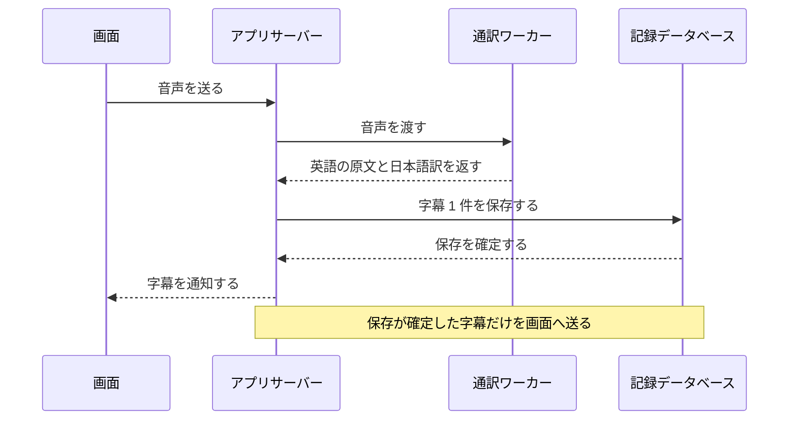
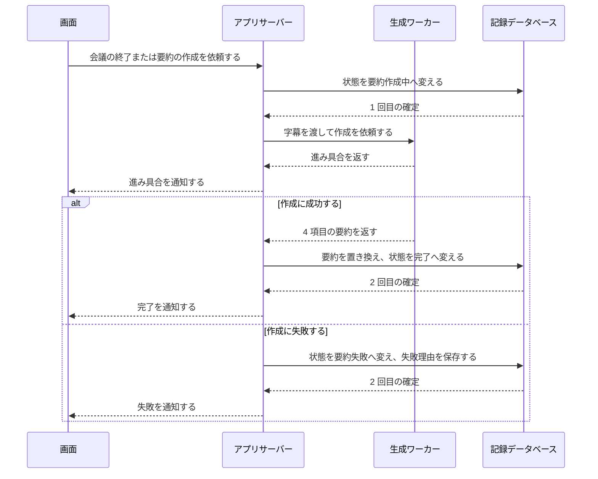

# 横断設計規約

## 目次

- [規約の一覧](#規約の一覧)
- [エラーの分類と見せ方](#エラーの分類と見せ方)
- [接続制限の判定](#接続制限の判定)
- [ログの種別と項目](#ログの種別と項目)
- [保存の単位と順序](#保存の単位と順序)
- [重複を防ぐ規約](#重複を防ぐ規約)
- [命名の規則](#命名の規則)
- [日時の扱い](#日時の扱い)
- [会議の状態の遷移規則](#会議の状態の遷移規則)
- [AI 処理の同時実行](#ai-処理の同時実行)
- [設定の持ち方](#設定の持ち方)

## 規約の一覧

すべての機能とコンポーネントが、次の方式に従います。この表は、規約の要点だけを示します。内訳が要る規約は、後ろの節に表と図で示し、その節の記述を正とします。

| 項目 | 本案件で固定する方式 | 適用範囲 | 整合先 | 未決定・要確認 |
|---|---|---|---|---|
| エラー処理 | エラーを入力エラー・業務エラー・システムエラーの 3 つに分けます。画面へ返すエラーは、共通の形にそろえます。分類と形の内訳は、[エラーの分類と見せ方](#エラーの分類と見せ方)にあります | 全機能 | [画面設計書のエラー表示パターン](screen.md#エラー表示パターン)、F-15 | なし |
| 認証と認可 | ログインと権限の区別を置きません。代わりに、接続制限部がすべての要求の接続元を確かめます | すべての HTTP の要求と WebSocket の接続 | [非機能要件設計書のセキュリティ](nonfunctional.md#セキュリティ)、[ADR-11](adr.md#adr-11-接続元をループバックと-host-と-origin-で制限する) | [確認事項 5（開発用コンテナからの接続）](adr.md#未決定要確認運用要人間判断) |
| ログ | 処理ログ・エラーログ・接続ログの 3 種別を、コンテナの標準出力へ 1 行 1 件で出します。会議の内容は書きません | アプリサーバーと 2 つのワーカー | [非機能要件設計書の運用と保守性](nonfunctional.md#運用と保守性)、要件の[ログ](../requirements/devops.md#ログ) | [確認事項 8（ログを残す量）](adr.md#未決定要確認運用要人間判断) |
| トランザクション境界と整合性 | 保存は記録データベースの中だけで完結させます。1 回の業務上の出来事を 1 回の確定にまとめます。AI の処理は確定の外で行います | 記録保存部を通るすべての書き込み | [データモデル設計書](data_model.md) | なし |
| 冪等性 | 同じ操作が 2 回届いても、結果を 1 回分にします。判定には、会議番号・字幕の順番・作成ジョブの種類を使います | 会議の開始と終了、作成の依頼、削除、AI モデルの入手 | [機能設計書](functional.md) | なし |
| 命名規約 | プログラムの識別子は英語、画面の文言は日本語にします。区分のコード値とエラーコードは、英語の単語をアンダースコアでつなぎます | プログラム、設定、ログ、テスト | [データモデル設計書の区分コード](data_model.md#区分コード) | なし |
| 日時とタイムゾーン | 協定世界時（UTC）で保存し、画面が PC の時刻へ変換して表示します | 全機能 | [データモデル設計書](data_model.md) | なし |
| 通貨と金額 | 該当しません。金額を扱う機能がありません | — | — | なし |
| 状態管理 | 会議の状態は、記録データベースの値を唯一の正とします。状態を変えられるのは会議管理部と作成ジョブ管理部だけです。遷移の条件を確かめる部は、[会議の状態の遷移規則](#会議の状態の遷移規則)にあります | 会議の状態を読む全機能 | [データモデル設計書の区分コード](data_model.md#区分コード)、要件の[会議の状態](../requirements/README.md#会議の状態) | なし |
| 画面をまたぐ一時的な状態 | 画面は会議の内容をブラウザーの保存領域へ書きません。画面を開くたびにアプリサーバーから読み直します | 画面 | [非機能要件設計書のセキュリティ](nonfunctional.md#セキュリティ) | なし |
| AI 処理の同時実行 | 進行できる会議を 1 件、同時に実行する作成ジョブを 1 件に限ります。質問を要約より先に実行します。会議中は字幕の処理を優先します。実行順の内訳は、[AI 処理の同時実行](#ai-処理の同時実行)にあります | 会議管理部、作成ジョブ管理部、2 つのワーカー | [システム構成設計書](architecture.md#プロセスと-ai-モデルの読み込み) | [確認事項 13（作成ジョブの実行順と待ち）](adr.md#未決定要確認運用要人間判断) |
| 設定管理 | 動かす場所で変わる値を環境変数で渡します。AI モデルの定義と調整値は、アプリに同梱するファイルで持ちます | アプリサーバーと 2 つのワーカー | [システム構成設計書](architecture.md#配置と公開範囲) | なし |

## エラーの分類と見せ方

| 分類 | 当てはまる例 | 捕まえる場所 | 画面への見せ方 | ログ |
|---|---|---|---|---|
| 入力エラー | タイトルが 100 文字を超える。音声の出どころを選んでいない | 画面が入力の時点で確かめ、アプリサーバーが受け取った時点でもう一度確かめます | 項目のすぐ下に表示します | 出しません |
| 業務エラー | 進行中の会議があるのに、新しい会議を開始する。通訳中の会議を削除する。字幕が 0 件の会議で要約を作る | 会議管理部（会議の開始と終了、記録の削除）と、作成ジョブ管理部（要約と質問の作成） | お知らせ帯に、何が起きたかと次に行う操作を表示します | エラーログに、警告のレベルで出します |
| システムエラー | AI の処理に失敗する。保存に失敗する。AI モデルの入手に失敗する。ワーカーが止まる | 起きたコンポーネントが捕まえ、アプリサーバーがエラーコードへ変換します | お知らせ帯、または該当する欄に、何が起きたかと次に行う操作を表示します | エラーログに種類と発生場所を出します |

- 画面へ返すエラーは、分類・エラーコード・何が起きたか・次に行う操作の 4 項目を持つ共通の形にします。
- エラーコードは `領域_出来事` の形にします。領域は `AUDIO`・`MEETING`・`SUBTITLE`・`SUMMARY`・`QUESTION`・`RECORD`・`MODEL`・`ACCESS`・`SYSTEM` の 9 つです（例: `MEETING_ALREADY_RUNNING`、`MODEL_DOWNLOAD_FAILED`）。
- プログラムの例外の文面は、画面へ出しません。会議の内容や内部の構成が混ざるおそれがあるためです。
- エラーコードごとの文言は、実装で確定します。

システムエラーが起きたときの続け方は、次の規約に従います。

| 起きたこと | アプリの続け方 |
|---|---|
| 発話の区切り 1 つの文字起こしに失敗する | その区切りを飛ばし、会議を続けます |
| 字幕 1 件の翻訳に失敗する | 日本語訳が空の字幕を保存し、会議を続けます |
| 字幕 1 件の保存に失敗する | その字幕を画面へ送らず、エラーを表示します。会議は続けます |
| 通訳ワーカーが止まる | アプリサーバーが通訳ワーカーを起動し直し、会議を続けます。起動し直せない場合は、会議を中断にします |
| 生成ワーカーが止まる | 実行中の作成ジョブを失敗にします。要約の場合は、会議の状態を要約失敗にします |
| アプリサーバーが止まる | コンテナが自動で再起動します。起動時に[起動時の復旧（F-17）](functional.md#f-17-起動時の復旧)を行います |
| 起動時に、記録データベースの構造の更新に失敗する。または、アプリの版より新しい構造を見つける | アプリサーバーを止めずに、[開始できない状態](architecture.md#アプリを開始できない状態)で動かします。会議と作成の機能を開始せず、接続制限部と配信部だけを動かします。画面には、アプリを開始できないことを、エラーコード（例: `SYSTEM_STARTUP_FAILED`）とともに返します |

- アプリサーバーを止めない理由は、止めるとコンテナが再起動を繰り返し、画面へエラーコードを返せなくなるためです。

## 接続制限の判定

接続制限部は、すべての要求を処理の前に確かめます。1 つでも満たさない要求は、内容を処理せずに断ります。

| 確かめる対象 | 通す条件 | 防ぐもの |
|---|---|---|
| 公開するポート | PC のループバック（`127.0.0.1`）にだけ公開します | ほかの PC からの接続 |
| 要求の宛先（Host ヘッダー） | `localhost`・`127.0.0.1`・アプリのコンテナ名のいずれかです | 別の名前を使ってアプリへ届く要求 |
| 要求の送り元（Origin ヘッダー） | 付いている場合は、宛先と同じ接続先です。状態を変える要求と WebSocket の接続では、必ず付いている必要があります | ブラウザーで開いているほかのサイトからの要求 |
| ほかのサイトへの読み取りの許可 | 許可を出しません | ほかのサイトによる応答の読み取り |

- 通す条件は、利用時も自動テスト時も同じです。テストのために切り替える設定を、アプリに持たせません。
- アプリのコンテナ名を通す理由と、その影響は [ADR-11](adr.md#adr-11-接続元をループバックと-host-と-origin-で制限する) にあります。

## ログの種別と項目

| 種別 | 出す契機 | 必ず含める項目 | レベル |
|---|---|---|---|
| 処理ログ | 会議の開始と終了、発話の区切りの処理、作成ジョブの受け付け・開始・順番を譲った時点・再開・終了、AI モデルの入手、記録の削除、起動時の復旧 | 日時、処理の種類、会議番号、処理の識別子、かかった時間、件数または文字数 | 通常 |
| エラーログ | システムエラーと業務エラー | 日時、エラーコード、発生したコンポーネント、会議番号、処理の識別子 | 業務エラーは警告、システムエラーは異常 |
| 接続ログ | 接続制限部が要求を断ったとき | 日時、断った理由の種類、宛先と送り元の名前 | 警告 |

- 利用者の項目は持ちません。利用者が 1 人で、ログインが無いためです。
- 処理の識別子は、1 回の要求または 1 つの発話の区切りに 1 つ振ります。コンポーネントをまたいで同じ値を引き継ぎます。
- 次の内容はログへ書きません。字幕・要約・質問の本文、会議のタイトル、文章生成モデルへ渡す指示と受け取った出力、音声のデータです。
- 監査のためのログは設けません。利用者が 1 人で、操作した人を区別する必要が無いためです。
- 性能の目標を測る値は、アプリが処理ログへ記録します。記録する値は、次の 4 つです。
  - 発話の区切りごとの字幕の遅れ
  - 会議を開始してから、最初の字幕を画面へ送るまでの時間
  - 作成ジョブごとの、受け付けから終了までの時間と、そのうち順番を待った時間
  - 会議の終了と作成ジョブの終了の時点の、プロセスごとのメモリの使用量
- 記録した値を集計する担い手と手順は、[非機能要件設計書の実際に使う状態での測定](nonfunctional.md#実際に使う状態での測定)にあります。

## 保存の単位と順序

1 回の確定にまとめる単位は次のとおりです。

| 業務上の出来事 | 1 回の確定に含める書き込み | 失敗したとき |
|---|---|---|
| 会議の開始 | 会議 1 件の作成（状態は通訳中） | 会議を作らず、エラーを表示します |
| 字幕の作成 | 字幕 1 件の作成 | その字幕を表示しません |
| 会議の終了 | 終了日時の記録と、状態の変更 | 状態を変えず、エラーを表示します |
| 要約の完成 | 要約の作成または置き換えと、状態の完了への変更 | 前の要約を残し、状態を要約失敗にします |
| 質問の完成 | 質問のまとまり 1 件と、質問 5 件の作成 | 1 件も保存しません |
| 記録の削除 | 会議と、その字幕・要約・質問のまとまり・質問の削除 | 1 件も削除しません |

- 複数の保存先にまたがる処理はありません。保存先は記録データベース 1 つです。
- 文章生成モデルと翻訳モデルの処理は、確定の外で行います。処理に数秒から数十分かかるためです。
- 排他の強さは、実装で確定します。

字幕は、保存が確定してから画面へ送ります。この順序によって、画面に出た字幕が必ず記録に残ります。

要約は、作成の前と後の 2 回に分けて確定します。作成の途中でアプリが止まっても、状態から失敗を判断できます。

## 重複を防ぐ規約

| 対象の処理 | 重複を見分ける手がかり | 2 回目が届いたときの扱い |
|---|---|---|
| 会議の開始 | 通訳中の会議の有無 | 業務エラーにします。通訳中の会議は 1 件だけです |
| 会議の終了 | 会議番号と状態 | 状態が通訳中でなければ、何も変えずに現在の状態を返します |
| 字幕の作成 | 会議番号と順番 | 順番はアプリサーバーが振ります。画面は、同じ順番の字幕を 1 回だけ表示します |
| 要約の作成の依頼 | 会議番号と作成ジョブの種類 | 待機中または作成中のジョブがあれば、新しく作らずにそのジョブを返します |
| 質問の作成の依頼 | 会議番号と作成ジョブの種類 | 待機中または作成中のジョブがあれば、新しく作らずにそのジョブを返します |
| 記録の削除 | 会議番号 | 会議がすでに無ければ、成功として扱います |
| AI モデルの入手 | モデルの定義にあるファイルごとのハッシュ値 | 一致を確認できたファイルは入手し直しません。やり直しは何回でも行えます |
| 翻訳モデルの変換 | 変換後のハッシュ値の控え。変換が済んだ時点で、モデル管理部が変換後のファイルから求め、モデル置き場に置きます | 控えと一致する場合は、変換し直しません。変換後のファイルが無い場合と、控えが無い場合と、控えと一致しない場合は、入手済みのファイルから変換し直します |

- この規約は、[会議の状態の遷移規則](#会議の状態の遷移規則)より先に当てはめます。この規約に当てはまる要求は、遷移規則で業務エラーにせず、この表の扱いで応答します。
- 再実行して安全とみなす処理は、要約の作成・質問の作成・AI モデルの入手・翻訳モデルの変換・起動時の復旧です。
- 変換後のファイルは、配布元のハッシュ値と照合できません。配布元との一致は、変換の前のファイルで確かめます。変換の前のファイルは、モデル置き場に残します。
- 変換後のハッシュ値の控えは、会議記録ではありません。記録データベースには置きません（[データモデル設計書の保存しないデータ](data_model.md#保存しないデータ)）。
- 文字起こしと翻訳は再実行しません。音声を保存しないためです。
- やり直しの回数と間隔は、実装で確定します。

## 命名の規則

| 対象 | 規則 | 例 |
|---|---|---|
| 要件と設計の識別子 | 機能は `F-` と 2 桁の番号、画面は `S-` と 2 桁の番号です。テストの名前にも同じ識別子を入れます | `F-07`、`S-03` |
| プログラムの識別子 | 英語で書きます。書き方は、それぞれの言語の標準の慣習に従います | — |
| 画面とアプリサーバーの間のデータの項目名 | 英語の小文字をアンダースコアでつなぎます | `started_at` |
| 区分のコード値 | 英語の小文字をアンダースコアでつなぎます。値は[データモデル設計書の区分コード](data_model.md#区分コード)が正です | `summary_failed` |
| エラーコード | 英語の大文字をアンダースコアでつなぎ、`領域_出来事` の形にします | `MODEL_DOWNLOAD_FAILED` |
| 通知の名前 | `対象.出来事` の形にします。対象は単数形、出来事は過去形です | `subtitle.created` |
| 環境変数 | 英語の大文字をアンダースコアでつなぎ、アプリを表す共通の接頭辞を付けます | — |
| 画面の文言 | 日本語で書きます。用語は[業務用語辞書](data_model.md#業務用語辞書)に合わせます | — |

- 保存先の表と列の名前は、実装で確定します。

## 日時の扱い

| 項目 | 方式 |
|---|---|
| 保存する日時 | 協定世界時（UTC）で、ミリ秒まで保存します |
| 日時を記録する場所 | アプリサーバーの時計で記録します。画面の時計は、表示と経過時間の計算にだけ使います |
| 画面の表示 | 画面が、PC に設定されたタイムゾーンへ変換して表示します |
| コピーと取り出しの文面 | 画面が組み立てるため、画面の表示と同じ時刻になります |
| タイトルの既定値 | 画面が、PC の時刻で開始日時の文字列を作ります |
| 経過時間と会議の長さ | 開始日時からの差で求めます。通訳中は、画面が 1 秒ごとに表示を進めます |
| 日付の境界 | 設けません。日をまたぐ会議も 1 件の会議として扱います |
| 通貨と端数の処理 | 該当しません |

- アプリサーバーと画面は同じ PC で動きます。そのため、2 つの時計のずれを補正する仕組みは設けません。

## 会議の状態の遷移規則

状態の値は[データモデル設計書の区分コード](data_model.md#区分コード)、遷移の全体像は要件の[会議の状態](../requirements/README.md#会議の状態)にあります。ここでは、誰が何を契機に遷移させられるかを定めます。

| 遷移元 | 遷移先 | 契機 | 遷移させる主体 | 満たすべき条件 | 機能 |
|---|---|---|---|---|---|
| 記録なし | 通訳中 | 会議を開始する | 利用者 | AI モデルが準備完了である。通訳中の会議が無い。音声を取り込めた | F-03 |
| 通訳中 | 要約作成中 | 会議を終了する | 利用者 | 字幕が 1 件以上ある | F-03、F-07 |
| 通訳中 | 完了 | 会議を終了する | 利用者 | 字幕が 0 件である | F-03 |
| 通訳中 | 中断 | 画面との接続が切れる | アプリ | なし | F-03 |
| 通訳中 | 中断 | 通訳ワーカーを起動し直せない | アプリ | なし | F-03 |
| 通訳中 | 中断 | アプリの起動時に、通訳中の会議が残っている | アプリ | なし | F-17 |
| 中断 | 要約作成中 | 要約を作る | 利用者 | 字幕が 1 件以上ある | F-07 |
| 要約作成中 | 完了 | 要約ができる | アプリ | 4 項目がそろっている | F-07 |
| 要約作成中 | 要約失敗 | 要約の作成に失敗する | アプリ | なし | F-07 |
| 要約作成中 | 要約失敗 | アプリの起動時に、要約作成中の会議が残っている | アプリ | なし | F-17 |
| 要約失敗 | 要約作成中 | 要約を作る | 利用者 | 字幕が 1 件以上ある | F-07 |
| 完了 | 要約作成中 | 要約を作り直す | 利用者 | 字幕が 1 件以上ある | F-07 |
| 中断、完了、要約失敗 | 記録なし | 記録を削除する | 利用者 | その会議の作成ジョブが残っていない | F-11 |

- 表に無い遷移は受け付けません。受け取った場合は業務エラーにします。ただし、[重複を防ぐ規約](#重複を防ぐ規約)に当てはまる要求は、この規則より先に重複を防ぐ規約で扱います。たとえば、通訳中でない会議への終了の要求には、現在の状態を返します。すでに無い会議の削除の要求は、成功として扱います。
- 条件を確かめて遷移させる部は、次のとおりです。会議の開始・終了・中断、記録の削除、起動時の遷移は、会議管理部です。要約の作成の依頼と結果による遷移は、作成ジョブ管理部です。
- 記録の削除では、会議管理部が会議の状態を確かめ、作成ジョブ管理部に作成ジョブの有無を確かめます。条件を満たす場合に、記録保存部へ削除を依頼します。記録保存部は、条件を確かめません。
- 中断した会議の通訳は再開しません。
- 状態ごとに行える操作は、[画面設計書の状態別の表示と操作](screen.md#状態別の表示と操作)にあります。

## AI 処理の同時実行

| 対象 | 規約 | 理由 |
|---|---|---|
| 進行できる会議 | 同時に 1 件です | 利用者が 1 人で、CPU が 2 件分の字幕を処理できないためです |
| 実行する作成ジョブ | 同時に 1 件です。ほかの作成ジョブは、待機中にして待たせます | 文章生成モデルを 2 つ同時に動かすメモリが無いためです |
| 作成ジョブの実行順 | 質問を要約より先に実行します。同じ種類の作成ジョブは、受け付けた順に実行します | 質問は、質疑応答に間に合わせるために、ボタンを押してから 3 分以内に作る目標があるためです |
| 要約の作成中に届いた質問 | 作成中の要約は、ブロックの区切りで質問へ順番を譲り、待機中へ戻ります。質問ができたあとに、続きのブロックから再開します | 要約を最初から作り直さずに、質問が待つ時間を短くするためです |
| 会議中の、ほかの会議の要約 | 通訳中の会議がある間は、要約の新しいブロックを始めません。作成中の要約は、ブロックの区切りで止めて後回しにし、待機中へ戻します。会議が終了または中断したあとに、続きのブロックから再開します | 字幕の遅れの目標を優先するためです。利用者が了承している字幕の遅れは、会議中に質問を作っている間の遅れだけです |
| 同じ会議の同じ種類の作成ジョブ | 待機中と作成中を合わせて 1 件までです | 同じ結果を二重に作らないためです |
| 会議中の質問 | 字幕の処理を優先します。会議中は、生成ワーカーが使う CPU の割り当てを減らします | 字幕の遅れの目標を最優先にするためです |
| 会議の終了の直後 | 通訳ワーカーを止めてから、要約の作成を始めます。後回しにした要約も、このあとに再開します | 2 つのワーカーのメモリが重ならないようにするためです |
| ブラウザーを閉じたあとの作成ジョブ | 最後まで実行し、結果を保存します | 利用者があとで記録を開いたときに、結果を読めるようにするためです |

- 順番を譲った要約と、後回しにした要約の中間メモは、作成ジョブ管理部がメモリの上で持ちます。再開のときに、処理済みのブロックを作り直しません。
- 後回しにした要約だけが残っている間は、生成ワーカーを止めます。会議中のメモリを空けるためです。
- 会議を開始した時点で、ほかの会議の要約がブロックの途中だった場合は、その区切りまで要約が動きます。この間は、字幕が遅れることがあります。
- 順番を待つ時間は、作成時間の目標に含めて測ります（[目標ごとの手立てと測り方](nonfunctional.md#目標ごとの手立てと測り方)）。待ちで目標を超える場面は、[確認事項 13](adr.md#未決定要確認運用要人間判断)に挙げています。
- CPU の割り当ての値は、利用者の PC で測った結果をもとに実装で確定します。

## 設定の持ち方

| 設定の種類 | 持ち方 | 含むもの |
|---|---|---|
| 動かす場所で変わる値 | 環境変数。コンテナの起動の定義に書きます | 通す宛先の名前、待ち受けるポート、記録データベースとモデル置き場の場所 |
| AI モデルの定義 | アプリに同梱するファイル | モデルの名前、配布元、固定した版、ファイルごとのハッシュ値 |
| 調整値 | アプリに同梱するファイル。環境変数で上書きできます | 発話の区切りの長さの上限、警告を出すしきい値、文章生成モデルへ一度に渡す量、CPU の割り当て |
| 秘密の情報 | 持ちません | ログインと外部サービスの利用が無いため、パスワードや鍵がありません |

- 調整値の既定値は、利用者の PC で測った結果をもとに実装で確定します。
- 設定を画面から変える機能は設けません。
