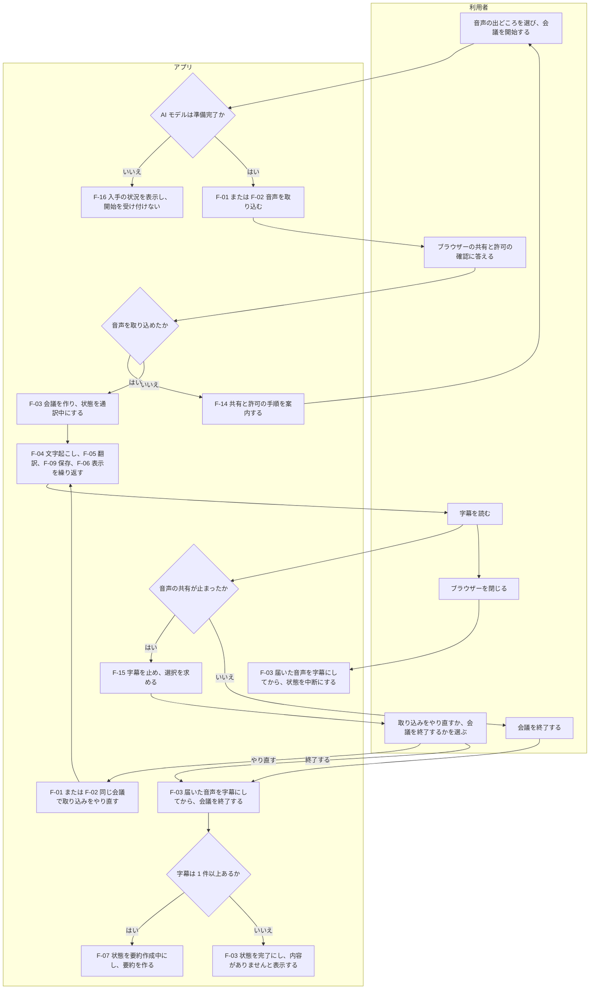
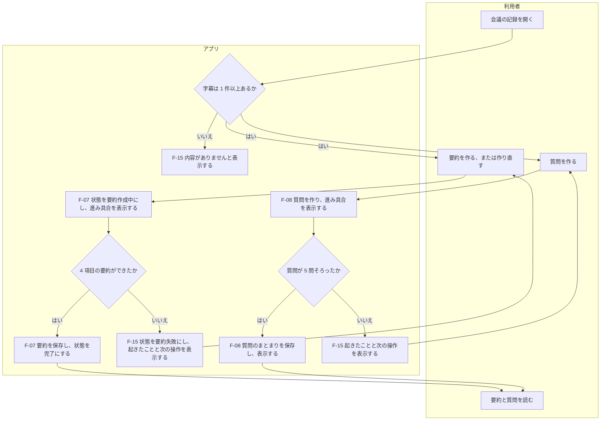
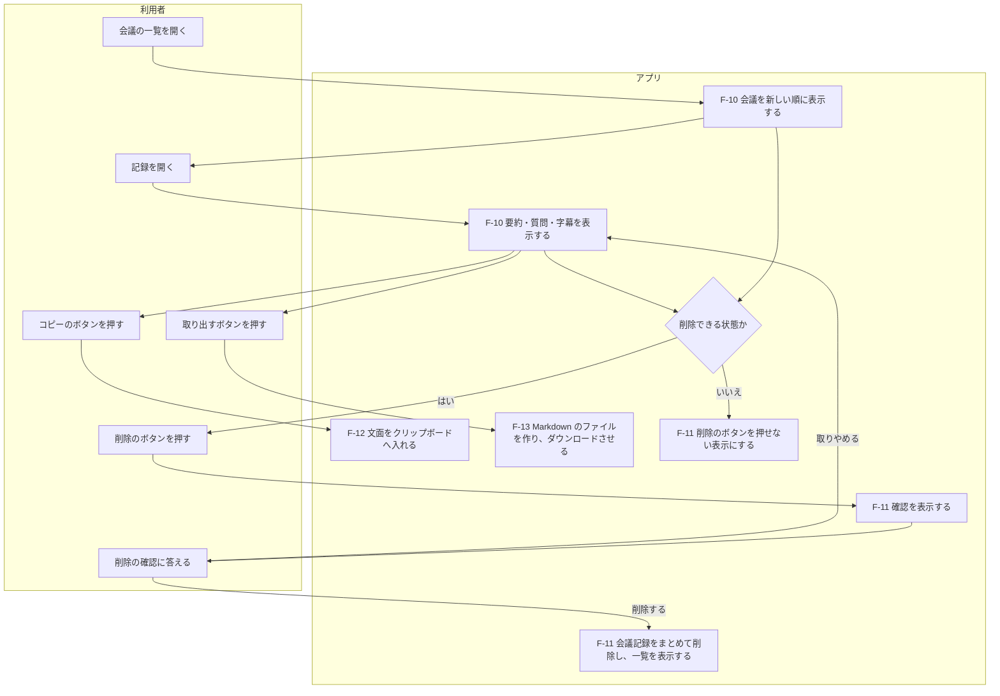
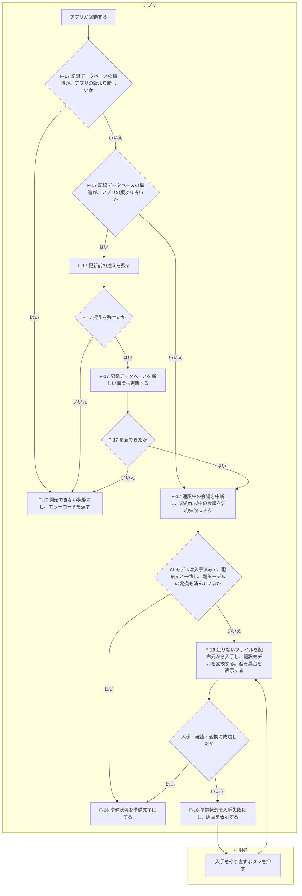

# 機能設計書

## 目次

- [機能一覧](#機能一覧)
- [機能の過不足の確認](#機能の過不足の確認)
- [業務フロー](#業務フロー)
  - [会議の開始から終了まで](#会議の開始から終了まで)
  - [会議後の要約と質問](#会議後の要約と質問)
  - [記録の閲覧と取り出しと削除](#記録の閲覧と取り出しと削除)
  - [AI モデルの入手と起動時の復旧](#ai-モデルの入手と起動時の復旧)
- [各機能の動作仕様](#各機能の動作仕様)
  - [F-01 PC で再生される音声の取り込み](#f-01-pc-で再生される音声の取り込み)
  - [F-02 マイク音声の取り込み](#f-02-マイク音声の取り込み)
  - [F-03 会議の開始と終了](#f-03-会議の開始と終了)
  - [F-04 英語の文字起こし](#f-04-英語の文字起こし)
  - [F-05 日本語への翻訳](#f-05-日本語への翻訳)
  - [F-06 字幕の表示](#f-06-字幕の表示)
  - [F-07 会議後の要約](#f-07-会議後の要約)
  - [F-08 質問の作成](#f-08-質問の作成)
  - [F-09 会議記録の保存](#f-09-会議記録の保存)
  - [F-10 会議の一覧と閲覧](#f-10-会議の一覧と閲覧)
  - [F-11 記録の削除](#f-11-記録の削除)
  - [F-12 記録のコピー](#f-12-記録のコピー)
  - [F-13 テキストファイルの取り出し](#f-13-テキストファイルの取り出し)
  - [F-14 操作の案内](#f-14-操作の案内)
  - [F-15 処理状況とエラーの表示](#f-15-処理状況とエラーの表示)
  - [F-16 AI モデルの入手](#f-16-ai-モデルの入手)
  - [F-17 起動時の復旧](#f-17-起動時の復旧)

## 機能一覧

機能は 17 個です。F-01 から F-15 は、要件の[機能一覧](../requirements/README.md#機能一覧)と同じ番号です。F-16 と F-17 は、要件の記述をもとに、アプリが自動で行う処理を機能として切り出しました。

| グループ | 機能 ID | 機能名 | 概要 | 主なアクター | 起動契機 |
|---|---|---|---|---|---|
| 音声の取り込み | F-01 | PC で再生される音声の取り込み | 画面共有で得た音声を、アプリサーバーへ送ります | 利用者 | 会議を開始する。取り込みをやり直す |
| 音声の取り込み | F-02 | マイク音声の取り込み | マイクの音声を、アプリサーバーへ送ります | 利用者 | 会議を開始する。取り込みをやり直す |
| 同時通訳 | F-03 | 会議の開始と終了 | 会議を作り、通訳を始めます。終了を受けて通訳を止めます | 利用者 | 開始と終了のボタンを押す |
| 同時通訳 | F-04 | 英語の文字起こし | 発話の区切りを、英語の文字にします | アプリ | 発話の区切りができる |
| 同時通訳 | F-05 | 日本語への翻訳 | 英語の原文を日本語へ訳し、字幕 1 件にします | アプリ | 英語の原文ができる |
| 同時通訳 | F-06 | 字幕の表示 | 保存した字幕を、話された順に画面へ追加します | アプリ | 字幕を保存する |
| 要約と質問 | F-07 | 会議後の要約 | 字幕から 4 項目の要約を日本語で作ります | アプリ、利用者 | 会議を終了する。要約を作るボタンを押す |
| 要約と質問 | F-08 | 質問の作成 | 字幕から、英語と日本語の質問を 5 問作ります | 利用者 | 質問を作るボタンを押す |
| 記録の管理 | F-09 | 会議記録の保存 | 会議・字幕・要約・質問を記録データベースへ保存します | アプリ | ほかの機能が書き込みを求める |
| 記録の管理 | F-10 | 会議の一覧と閲覧 | 過去の会議を一覧にし、選んだ会議の記録を表示します | 利用者 | 一覧を開く。記録を開く |
| 記録の管理 | F-11 | 記録の削除 | 選んだ会議の記録をまとめて削除します | 利用者 | 削除のボタンを押す |
| 記録の管理 | F-12 | 記録のコピー | 要約・字幕・質問を、文字としてクリップボードへ入れます | 利用者 | コピーのボタンを押す |
| 記録の管理 | F-13 | テキストファイルの取り出し | 記録を Markdown 形式のファイルにして、ダウンロードさせます | 利用者 | 取り出すボタンを押す |
| 案内と状況 | F-14 | 操作の案内 | 迷いやすい操作の手順と注意を、画面に表示します | アプリ | 画面を表示する |
| 案内と状況 | F-15 | 処理状況とエラーの表示 | 字幕の状況・作成の進み具合・警告・エラーを表示します | アプリ | 状況が変わる。エラーが起きる |
| 自動の処理 | F-16 | AI モデルの入手 | AI モデルを配布元から入手し、一致を確かめます。翻訳モデルを、実行基盤の形式へ変換します | アプリ、利用者 | アプリが起動する。入手をやり直すボタンを押す |
| 自動の処理 | F-17 | 起動時の復旧 | 止まる前に途中だった会議の状態を、正しい状態へ直します | アプリ | アプリが起動する |

- 画面との対応は[画面設計書の画面一覧](screen.md#画面一覧)、データとの対応は[データモデル設計書の機能とデータの対応](data_model.md#機能とデータの対応)にあります。
- 各機能を担うコンポーネントは、[システム構成設計書のコンポーネントの責務](architecture.md#コンポーネントの責務)にあります。

## 機能の過不足の確認

| 観点 | 確認の結果 | 根拠 |
|---|---|---|
| 要件の機能がすべて載っているか | F-01 から F-15 のすべてを載せています | 要件の[機能一覧](../requirements/README.md#機能一覧) |
| 要件の本文にあり、機能一覧に無い処理 | AI モデルの入手を F-16、止まったあとの会議の扱いを F-17 として加えました | 要件の[異常時の動き](../requirements/README.md#異常時の動き)、[AI モデルの入手](../requirements/devops.md#ai-モデルの入手) |
| 登録に対する照会・更新・削除 | 会議記録は、作成（F-03・F-05・F-07・F-08）、照会（F-10）、削除（F-11）がそろっています。字幕と質問を利用者が書き換える機能は設けません | 要件に、記録を編集する機能がありません |
| 運用管理の機能 | 再実行にあたる機能は、要約を作り直す（F-07）と入手をやり直す（F-16）です。監視・通知・ログを見る画面は設けません | 要件が、監視の仕組みを作らないと定めています（[監視](../requirements/devops.md#監視)） |
| マスタ管理の機能 | 該当しません | 登録して使い回すデータがありません。用語集は対象外です |
| 権限とアカウントの管理 | 該当しません | 利用者が 1 人で、ログインを求めません |
| 区分値の保守 | 該当しません | 区分の値はプログラムで固定します。利用者が変える値がありません |

## 業務フロー

要件の[利用の流れ](../requirements/README.md#利用の流れ)を、機能 ID と分岐で具体化します。画面の移り変わりは[画面設計書の画面遷移](screen.md#画面遷移)にあります。

### 会議の開始から終了まで

### 会議後の要約と質問

- 会議を終了した直後の要約は、利用者の操作を待たずにアプリが始めます。
- 会議中の質問の作成も、同じ流れです。その場合、利用者は「会議中」の画面で質問を作ります。

### 記録の閲覧と取り出しと削除

### AI モデルの入手と起動時の復旧

- 開始できない状態になると、途中だった会議の復旧と、AI モデルの入手を行いません。状態の内容は、[システム構成設計書のアプリを開始できない状態](architecture.md#アプリを開始できない状態)にあります。
- 記録データベースの構造がアプリの版より新しくなるのは、構造を更新した版から前の版へ戻した場合です（[前の版へ戻すとき](nonfunctional.md#前の版へ戻すとき)）。

## 各機能の動作仕様

すべての機能に共通する前提は次のとおりです。

- 利用者は、対応するブラウザーで `http://localhost:3001` を開いています。
- 権限の区別はありません。接続制限を通った要求を、すべて利用者の操作として扱います。
- エラーの見せ方は[横断設計規約のエラーの分類と見せ方](cross_cutting.md#エラーの分類と見せ方)に従います。
- 仮置きと書いた値は AI 推奨の値です。利用者の PC で測った結果をもとに、実装で見直します。

### F-01 PC で再生される音声の取り込み

| 項目 | 内容 |
|---|---|
| 起動契機 | 利用者が「会議の準備」で PC で再生される音声を選び、会議を開始します。会議中に取り込みをやり直すときも同じです |
| 事前条件 | AI モデルの準備状況が準備完了です |
| 入力 | ブラウザーの画面共有で得る音声。利用者が画面全体を選び、音声の共有をオンにします |
| 正常系の処理内容 | 音声取り込み部が音声を受け取り、16kHz・モノラルへ変換して、アプリサーバーへ送り続けます。画面共有の映像は、受け取った直後に捨てます |
| 出力 | 取り込み中であることの表示 |
| 事後条件 | 音声がアプリサーバーへ届いています。音声と映像は、どこにも保存されていません |

| 代替フローと例外フロー | アプリの動き |
|---|---|
| 利用者が共有を取りやめる、または拒否する | 会議を開始しません。「会議の準備」で共有の手順を案内します |
| 共有に音声が含まれない | 会議を開始しません。画面全体を選ぶことと、音声の共有をオンにすることを案内します |
| 会議中に音声の共有が止まる | F-03 の例外フローに従います |

### F-02 マイク音声の取り込み

| 項目 | 内容 |
|---|---|
| 起動契機 | 利用者が「会議の準備」でマイクを選び、会議を開始します。会議中に取り込みをやり直すときも同じです |
| 事前条件 | AI モデルの準備状況が準備完了です |
| 入力 | マイクの音声。利用者がブラウザーの確認で、マイクの利用を許可します |
| 正常系の処理内容 | 音声取り込み部が音声を受け取り、16kHz・モノラルへ変換して、アプリサーバーへ送り続けます |
| 出力 | 取り込み中であることの表示 |
| 事後条件 | 音声がアプリサーバーへ届いています。音声は、どこにも保存されていません |

| 代替フローと例外フロー | アプリの動き |
|---|---|
| 利用者がマイクの利用を拒否する | 会議を開始しません。「会議の準備」で許可の手順を案内します |
| マイクが見つからない | 会議を開始しません。マイクをつなぐことを案内します |
| 会議中にマイクの音声が止まる | F-03 の例外フローに従います |

### F-03 会議の開始と終了

会議の開始は次のとおりです。

| 項目 | 内容 |
|---|---|
| 起動契機 | 利用者が「会議の準備」で、会議を開始するボタンを押します |
| 事前条件 | AI モデルの準備状況が準備完了です。通訳中の会議がありません。F-01 または F-02 で音声を取り込めています |
| 入力 | タイトル（任意、最大 100 文字）、音声の出どころ（必須） |
| 正常系の処理内容 | 会議を 1 件作り、状態を通訳中にします。通訳ワーカーを起動します。タイトルが空の場合は、開始日時から作った文字列をタイトルにします |
| 出力 | 「会議中」の画面。タイトル・経過時間・字幕の状況を表示します |
| 事後条件 | 会議が通訳中の状態で保存されています。通訳ワーカーが動いています |

会議の終了は次のとおりです。

| 項目 | 内容 |
|---|---|
| 起動契機 | 利用者が「会議中」で会議を終了するボタンを押し、確認に答えます |
| 事前条件 | 会議の状態が通訳中です |
| 入力 | 会議番号 |
| 正常系の処理内容 | 音声の取り込みを止めます。届いている音声を最後まで字幕にします。終了日時を記録し、通訳ワーカーを止めます。字幕が 1 件以上あれば状態を要約作成中にして、F-07 を始めます。字幕が 0 件であれば状態を完了にします |
| 出力 | 「会議の記録」の画面 |
| 事後条件 | 会議の状態が要約作成中または完了です。通訳ワーカーが止まり、AI モデルがメモリから外れています |

| 代替フローと例外フロー | アプリの動き |
|---|---|
| AI モデルが準備完了でない | 会議を開始するボタンを押せません。準備状況を表示します |
| 通訳中の会議がすでにある | 会議を開始しません。進行中の会議があることを表示します |
| ほかの会議の要約を作成中に、会議を開始する | 会議を開始します。作成中の要約を、ブロックの区切りで止めて後回しにします。止まるまでの間は、字幕が遅れることがあると表示します。止めた要約は、会議が終了または中断したあとに、続きから再開します（[AI 処理の同時実行](cross_cutting.md#ai-処理の同時実行)） |
| 会議が 2 時間を超える | 警告を表示し、会議を続けます |
| 無音が 10 秒続く（仮置き） | 字幕の状況を無音の待機にし、会議を続けます |
| 会議中に音声の共有が止まる | 字幕の状況を取り込み停止にします。それまでの字幕を残し、取り込みのやり直しか会議の終了かを利用者に選ばせます |
| 利用者がブラウザーを閉じる。または、画面との接続が切れる | 届いている音声を字幕にしてから、状態を中断にします。通訳ワーカーを止めます |
| 通訳ワーカーが止まる | アプリサーバーが通訳ワーカーを起動し直し、会議を続けます。起動し直せない場合は、状態を中断にしてエラーを表示します |
| 終了の要求が 2 回届く | 2 回目は何も変えず、現在の状態を返します |

- 中断した会議の通訳は再開しません。利用者は、それまでの字幕から要約を作れます。

### F-04 英語の文字起こし

| 項目 | 内容 |
|---|---|
| 起動契機 | 通訳ワーカーが、発話の区切りを 1 つ切り出します |
| 事前条件 | 会議の状態が通訳中です。文字起こしモデルを読み込んでいます |
| 入力 | 発話の区切り 1 つ分の音声 |
| 正常系の処理内容 | 音声を英語の文字にします。処理が終わった音声を破棄します |
| 出力 | 英語の原文。F-05 へ渡します |
| 事後条件 | その区切りの音声が、メモリに残っていません |

| 代替フローと例外フロー | アプリの動き |
|---|---|
| 区切りに声が含まれない。または、文字にならない | 字幕を作りません |
| 文字起こしに失敗する | その区切りを飛ばし、エラーを表示します。会議は続けます |
| 日本語の発言が混じる | 英語か日本語かを判別せず、そのまま処理します。意味の通らない字幕が出ることを、F-14 で案内します |
| 処理が音声に追いつかない | 音声を捨てずに、届いた順に処理します。字幕の状況を遅れにします |

- 発話は無音になった所で区切ります。無音が来ない場合は、長さの上限で区切ります。上限の値は[非機能要件設計書の字幕の遅れの配分](nonfunctional.md#字幕の遅れの配分)に従います。

### F-05 日本語への翻訳

| 項目 | 内容 |
|---|---|
| 起動契機 | F-04 が英語の原文を出します |
| 事前条件 | 翻訳モデルを読み込んでいます |
| 入力 | 英語の原文 |
| 正常系の処理内容 | 英語の原文を日本語へ訳します。英語の原文と日本語訳を組にして、字幕 1 件として F-09 で保存します |
| 出力 | 保存した字幕。F-06 へ渡します |
| 事後条件 | 字幕が 1 件増えています。順番は、会議の中で話された順です |

| 代替フローと例外フロー | アプリの動き |
|---|---|
| 翻訳に失敗する | 日本語訳が空の字幕を保存します。画面は、訳を作れなかったことを英語の原文と並べて表示します |

- 用語集による訳し分けは行いません。

### F-06 字幕の表示

| 項目 | 内容 |
|---|---|
| 起動契機 | 字幕の保存が確定します |
| 事前条件 | 「会議中」の画面を開いています |
| 入力 | 保存した字幕（順番、英語の原文、日本語訳、話された時刻） |
| 正常系の処理内容 | 字幕を、話された順に一覧の末尾へ追加します。英語の原文と日本語訳を並べて表示します。一覧を最新の字幕まで自動で進めます |
| 出力 | 字幕の一覧、字幕の状況 |
| 事後条件 | 画面に出ている字幕は、すべて保存されています |

| 代替フローと例外フロー | アプリの動き |
|---|---|
| 利用者が過去の字幕へ戻っている | 一覧を自動で進めません。最新の字幕へ戻るボタンを表示します |
| 字幕の遅れが 10 秒を超える | 字幕の状況を遅れにします |
| 同じ順番の字幕が 2 回届く | 1 回だけ表示します |

- 話者は区別しません。
- 字幕は、英語の原文と日本語訳がそろってから表示します。

### F-07 会議後の要約

| 項目 | 内容 |
|---|---|
| 起動契機 | 利用者が会議を終了します。または、利用者が「会議の記録」で要約を作るボタン、もしくは作り直すボタンを押します |
| 事前条件 | 会議の状態が、通訳中からの終了・中断・完了・要約失敗のいずれかです。字幕が 1 件以上あります |
| 入力 | その会議のすべての字幕（英語の原文） |
| 正常系の処理内容 | 状態を要約作成中にします。生成ワーカーが、字幕から 4 項目の要約を日本語で作ります。要約を保存し、状態を完了にします。前の要約がある場合は置き換えます |
| 出力 | 進み具合。全体の概要・話題ごとの要点・決定事項・宿題の 4 項目。該当する内容が無い項目は「該当なし」です |
| 事後条件 | 会議の状態が完了です。要約は 1 つだけです |

| 代替フローと例外フロー | アプリの動き |
|---|---|
| 字幕が 0 件である | 要約を作りません。「内容がありません」と表示します。要約を作るボタンを表示しません |
| 要約の作成に失敗する | 状態を要約失敗にし、失敗理由を保存します。起きたことと、要約を作るボタンを表示します |
| 作り直しに失敗する | 前の要約を残したまま、状態を要約失敗にします。画面は、失敗したことと前の要約を表示します |
| 同じ会議の要約の依頼が 2 回届く | 新しく作らず、作成中の作成ジョブを返します |
| ほかの作成ジョブが作成中である。または、通訳中の会議がある | 待機中と表示し、順番が来てから作ります。順番は[横断設計規約の AI 処理の同時実行](cross_cutting.md#ai-処理の同時実行)に従います |
| 作成の途中で、質問の作成の依頼が届く | ブロックの区切りで質問へ順番を譲り、待機中と表示します。質問ができたあとに、続きのブロックから再開します |
| 作成の途中で、利用者がほかの会議を開始する | ブロックの区切りで作成を止め、待機中と表示します。その会議が終了または中断したあとに、続きのブロックから再開します |
| 作成の途中で、利用者がブラウザーを閉じる | 作成を続け、結果を保存します |
| 作成の途中で、アプリが止まる | 起動時に F-17 が状態を要約失敗にします |

- 宿題の担当者は、会話に名前が出た場合だけ書きます。
- 作成の方式は、[システム構成設計書の要約](architecture.md#要約)にあります。

### F-08 質問の作成

| 項目 | 内容 |
|---|---|
| 起動契機 | 利用者が「会議中」または「会議の記録」で、質問を作るボタンを押します |
| 事前条件 | 字幕が 1 件以上あります。同じ会議の質問の作成ジョブが、待機中でも作成中でもありません |
| 入力 | その時点までの字幕。会議後で要約がある場合は、要約も使います。文章生成モデルへ渡す範囲は、[システム構成設計書の質問](architecture.md#質問)にあります |
| 正常系の処理内容 | 生成ワーカーが、質問を英語と日本語の組で 5 問作ります。5 問を 1 つの質問のまとまりとして保存し、画面に表示します |
| 出力 | 進み具合。英語の質問と日本語の質問の組 5 つ |
| 事後条件 | 質問のまとまりが 1 つ増えています。作成した時点（会議中または会議後）を記録しています |

| 代替フローと例外フロー | アプリの動き |
|---|---|
| 字幕が 0 件である | 質問を作るボタンを押せません |
| 質問の作成に失敗する。または、5 問がそろわない | 1 問も保存しません。起きたことを表示します。利用者は、もう一度ボタンを押せます |
| 会議中に作成する | 字幕が遅れることがあると表示します。字幕の処理を優先して動かします |
| 同じ会議の質問の依頼が 2 回届く | 新しく作らず、作成中の作成ジョブを返します |
| 要約が作成中である | 待機中と表示します。要約がブロックの区切りで順番を譲ったあとに作ります。要約の完成は待ちません |
| ほかの会議の質問が作成中、または待機中である | 待機中と表示し、受け付けた順に作ります |

- 長い会議の途中で作る質問は、直近の字幕を優先して読みます（[確認事項 2](adr.md#未決定要確認運用要人間判断)）。

### F-09 会議記録の保存

| 項目 | 内容 |
|---|---|
| 起動契機 | F-03・F-05・F-07・F-08・F-11・F-17 が書き込みを求めます |
| 事前条件 | 記録データベースへ書き込めます |
| 入力 | 会議、字幕、要約、質問のまとまりと質問 |
| 正常系の処理内容 | 記録データベースへ保存します。保存の単位は[横断設計規約の保存の単位と順序](cross_cutting.md#保存の単位と順序)に従います |
| 出力 | 保存の結果 |
| 事後条件 | 保存した内容は、ブラウザーを閉じても、アプリを更新しても残ります |

| 代替フローと例外フロー | アプリの動き |
|---|---|
| 保存に失敗する | 保存できなかった内容を画面へ出さず、エラーを表示します |
| ディスクの空きが少ない | F-15 が警告を表示します。保存は続けます |

- 音声と、画面共有の映像は保存しません。
- 保存する件数に上限を置きません。

### F-10 会議の一覧と閲覧

| 項目 | 内容 |
|---|---|
| 起動契機 | 利用者が「会議の一覧」を開きます。または、一覧から記録を開きます |
| 事前条件 | なし |
| 入力 | 記録を開く場合は、会議番号 |
| 正常系の処理内容 | 一覧では、すべての会議を開始日時の新しい順に表示します。記録では、選んだ会議の要約・質問・字幕を表示します |
| 出力 | 一覧は、タイトル・開始日時・会議の長さ・状態と、会議ごとの作成ジョブの有無。記録は、要約の 4 項目・質問のまとまり・字幕 |
| 事後条件 | 記録は変わりません |

| 代替フローと例外フロー | アプリの動き |
|---|---|
| 会議が 1 件も無い | 記録がまだ無いことと、新しい会議の始め方を表示します |
| 開こうとした会議が無い | 記録が見つからないことを表示し、「会議の一覧」へ戻します |
| 通訳中の会議を開く | それまでの字幕と質問を表示します。要約の欄には、会議中であることを表示します |

- 状態ごとの表示は、[画面設計書の状態別の表示と操作](screen.md#状態別の表示と操作)にあります。
- 作成ジョブの有無は、その会議に待機中または作成中の作成ジョブがあるかを示します。作成ジョブ管理部が、メモリの上で持つ作成ジョブの状況から答えます。画面は、この値を表示せず、削除のボタンを押せなくする判定に使います（[F-11](#f-11-記録の削除)）。

### F-11 記録の削除

| 項目 | 内容 |
|---|---|
| 起動契機 | 利用者が「会議の一覧」または「会議の記録」で削除のボタンを押し、確認に答えます |
| 事前条件 | 会議の状態が、中断・完了・要約失敗のいずれかです。その会議の作成ジョブが残っていません |
| 入力 | 会議番号 |
| 正常系の処理内容 | [更新前の控え](nonfunctional.md#前の版へ戻すとき)がある場合は、はじめに控えから、その会議と、その字幕・要約・質問のまとまり・質問を消します。続いて、記録データベースから同じものをまとめて削除します |
| 出力 | 「会議の一覧」の画面。削除した会議は表示されません |
| 事後条件 | その会議の記録が、記録データベースにも更新前の控えにも残っていません |

| 代替フローと例外フロー | アプリの動き |
|---|---|
| 状態が通訳中または要約作成中である | 削除のボタンを押せません |
| その会議の作成ジョブが残っている | 削除のボタンを押せません |
| 利用者が確認で取りやめる | 何も削除しません |
| 削除の要求が 2 回届く。または、削除する会議がすでに無い | 成功として扱い、「会議の一覧」を表示します（[重複を防ぐ規約](cross_cutting.md#重複を防ぐ規約)） |
| 更新前の控えから会議を消せない | 記録データベースから何も削除せずに、エラーを返します。エラーログを出します。画面は、削除できなかったことをお知らせ帯に表示します |
| 控えから消したあとで、記録データベースからの削除に失敗する | 記録データベースから 1 件も削除せずに、エラーを返します。控えから消した会議は戻しません。利用者は、削除をやり直せます |

- 控えから先に消す理由は、控えを消せなかったときに、削除した会議が控えに残らないようにするためです。消し残しが生まれないため、起動時に控えを消し直す処理は要りません。判断の記録は [ADR-17](adr.md#adr-17-記録データベースの構造を更新する前に更新前の控えを-1-世代だけ残す) にあります。
- 控えは、構造を更新する前の構造のままです。記録保存部は、控えの構造に合わせて会議を消します。
- 確認の表示では、削除した記録を元に戻せないことを伝えます。
- 複数の会議をまとめて削除する機能と、期間による自動削除は設けません。

### F-12 記録のコピー

| 項目 | 内容 |
|---|---|
| 起動契機 | 利用者が、要約・字幕・質問のいずれかのコピーのボタンを押します |
| 事前条件 | コピーする内容が 1 件以上あります |
| 入力 | コピーする対象（要約、字幕、質問） |
| 正常系の処理内容 | 画面表示部が対象の文面を組み立て、文字としてクリップボードへ入れます |
| 出力 | コピーしたことの表示 |
| 事後条件 | クリップボードに文面が入っています。記録は変わりません |

| 代替フローと例外フロー | アプリの動き |
|---|---|
| コピーする内容が無い | コピーのボタンを押せません |
| ブラウザーがクリップボードへの書き込みを断る | コピーできなかったことと、文面を選んで手でコピーする方法を表示します |

- 「会議中」の画面には、質問のコピーのボタンだけを置きます。

### F-13 テキストファイルの取り出し

| 項目 | 内容 |
|---|---|
| 起動契機 | 利用者が「会議の記録」で、取り出すボタンを押します |
| 事前条件 | 会議の記録を表示しています |
| 入力 | 表示している会議記録 |
| 正常系の処理内容 | 画面表示部が Markdown 形式の文面を組み立て、ファイルとしてダウンロードさせます |
| 出力 | Markdown 形式のファイル 1 つ。内容は、タイトル・開始日時・会議の長さ・要約の 4 項目・質問のまとまり・字幕です |
| 事後条件 | 記録は変わりません |

| 代替フローと例外フロー | アプリの動き |
|---|---|
| 要約が無い | 要約の欄に、要約がまだ無いことを書きます |
| タイトルに、ファイル名に使えない文字がある | その文字を置き換えて、ファイル名にします |

- ファイル名は、開始日時とタイトルから作ります。
- 字幕・要約・質問・タイトルに含まれる記号は、Markdown と HTML の記法として働かない形へ変換します。
- Word 形式での出力は設けません。

### F-14 操作の案内

| 項目 | 内容 |
|---|---|
| 起動契機 | 画面を表示します。または、取り込みに失敗します |
| 事前条件 | なし |
| 入力 | 表示している画面、選んでいる音声の出どころ |
| 正常系の処理内容 | 画面ごとに決めた案内を表示します |
| 出力 | 案内の文章 |
| 事後条件 | 記録は変わりません |

表示する案内は次のとおりです。

| 案内 | 表示する画面 | 表示する契機 |
|---|---|---|
| 使い方の流れ | 会議の一覧 | 常に表示します |
| PC で再生される音声の取り込み手順。画面全体を選ぶことと、音声の共有をオンにすること | 会議の準備 | PC で再生される音声を選んだとき。取り込みに失敗したとき |
| マイクの許可の手順 | 会議の準備 | マイクを選んだとき。取り込みに失敗したとき |
| 会議を記録することを、相手へ伝えるかどうかの注意 | 会議の準備 | 常に表示します |
| 英語の発言だけが対象であること。日本語が混じると、意味の通らない字幕が出ること | 会議の準備、会議中 | 常に表示します |
| 会議中はブラウザーを開いたままにすること。閉じると会議が中断し、再開できないこと | 会議の準備、会議中 | 常に表示します |
| 質問を作っている間は、字幕が遅れることがあること | 会議中 | 常に表示します |
| 残したい記録は、テキストファイルで取り出すこと | 会議の記録 | 常に表示します |
| Edge または Chrome で開くこと | すべての画面 | 対応していないブラウザーで開いたとき |

- 案内の文言は、実装で確定します。

### F-15 処理状況とエラーの表示

| 項目 | 内容 |
|---|---|
| 起動契機 | 状況が変わります。または、エラーが起きます |
| 事前条件 | 画面を開いています |
| 入力 | 字幕の状況、会議の状態、作成ジョブの状況、AI モデルの準備状況、ディスクの空き、エラー |
| 正常系の処理内容 | 通知部が状況を画面へ送り、画面が決めた場所に表示します |
| 出力 | 状況の表示、警告、エラー |
| 事後条件 | 記録は変わりません |

表示する状況は次のとおりです。

| 状況 | 表示する画面 | 表示する契機 |
|---|---|---|
| 字幕の状況 | 会議中 | 状況が変わるたびに表示します。字幕の遅れが 10 秒を超えると遅れ、無音が 10 秒続くと無音の待機にします（無音の秒数は仮置き） |
| 会議が 2 時間を超えたことの警告 | 会議中 | 経過時間が 2 時間を超えたとき |
| 要約の作成状況 | 会議の記録 | 作成ジョブの状況と進み具合が変わるたび |
| 質問の作成状況 | 会議中、会議の記録 | 作成ジョブの状況と進み具合が変わるたび |
| AI モデルの準備状況 | 会議の準備 | 準備状況と進み具合が変わるたび |
| ディスクの空きが少ないことの警告 | 会議の一覧、会議の準備 | 画面を開いた時点で、記録データベースの置き場の空きが 1GB を下回っているとき（仮置き） |
| エラー | すべての画面 | エラーが起きたとき。何が起きたかと、次に行う操作を表示します |

- 区分の値は、[データモデル設計書の区分コード](data_model.md#区分コード)にあります。
- 表示する場所と消し方は、[画面設計書のエラー表示パターン](screen.md#エラー表示パターン)にあります。

### F-16 AI モデルの入手

| 項目 | 内容 |
|---|---|
| 起動契機 | アプリが起動します。または、利用者が「会議の準備」で入手をやり直すボタンを押します |
| 事前条件 | 入手するときは、インターネットへ接続できます |
| 入力 | アプリに同梱する AI モデルの定義（名前、配布元、固定した版、ファイルごとのハッシュ値） |
| 正常系の処理内容 | モデル置き場のファイルが定義と一致するかを確かめます。足りないファイルを公式の配布元から入手し、ハッシュ値が一致することを確かめます。翻訳モデルは、入手と確認のあとに、実行基盤の形式へ 1 回だけ変換します。変換が済んだら、変換後のハッシュ値の控えをモデル置き場に置きます。変換の間は、準備状況を変換中にします。3 つの AI モデルがそろうと、準備状況を準備完了にします |
| 出力 | AI モデルの準備状況と、入手の進み具合 |
| 事後条件 | 準備完了のあとは、アプリが外部と通信しません |

| 代替フローと例外フロー | アプリの動き |
|---|---|
| 入手済みで、定義と一致する。変換後のファイルも、変換後のハッシュ値の控えと一致する | 入手も変換もせずに、準備状況を準備完了にします |
| 入手に失敗する | 準備状況を入手失敗にします。原因の種類と、入手をやり直すボタンを表示します |
| 入手したファイルが配布元と一致しない | そのファイルを使わずに捨て、準備状況を入手失敗にします |
| 入手の途中でアプリが止まる | 次の起動で、足りないファイルから入手を続けます |
| 翻訳モデルの変換に失敗する | 変換の途中のファイルを捨て、準備状況を入手失敗にします。原因の種類と、入手をやり直すボタンを表示します |
| 変換後のファイルか、変換後のハッシュ値の控えが無い。または、変換後のファイルが控えと一致しない | 入手済みのファイルから、変換し直します。入手はやり直しません |
| 変換の途中でアプリが止まる | 次の起動で、入手済みのファイルから変換し直します |
| 社内のネットワークで、通信を検査する証明書が要る | コンテナに登録した証明書を使って入手します |

- 表示する原因の種類は 6 つです。ネットワークにつながらない、証明書を確かめられない、配布元が応答しない、入手したファイルが配布元と一致しない、ディスクの空きが足りない、翻訳モデルを変換できない、のいずれかです。
- 変換は、モデル管理部が起動する変換プロセスで、PC の中だけで行います。変換が終わると、変換プロセスは止まります（[ADR-16](adr.md#adr-16-翻訳モデルの変換は起動時に変換の間だけ動くプロセスで行う)）。変換のために、外部と通信しません。
- 変換後のファイルは、配布元のハッシュ値と照合できません。そのため、一致の確認を 2 つに分けます。変換の前のファイルは、定義のハッシュ値と照合します。変換後のファイルは、変換後のハッシュ値の控えと照合します（[重複を防ぐ規約](cross_cutting.md#重複を防ぐ規約)）。
- 変換後のハッシュ値の控えは、変換が済んだ時点で、モデル管理部が変換後のファイルから求めます。控えはモデル置き場に置き、記録データベースには置きません（[データモデル設計書の保存しないデータ](data_model.md#保存しないデータ)）。
- 準備完了になるまで、利用者は会議を開始できません。

### F-17 起動時の復旧

| 項目 | 内容 |
|---|---|
| 起動契機 | アプリが起動します。PC の起動と、アプリが止まったあとの自動の再起動の両方を含みます |
| 事前条件 | 記録データベースを読めます |
| 入力 | 記録データベースの構造の版。状態が通訳中または要約作成中の会議 |
| 正常系の処理内容 | はじめに、記録データベースの構造の版を確かめます。構造が古い場合は、[更新前の控え](nonfunctional.md#前の版へ戻すとき)を同じ名前付きボリュームへ 1 世代だけ残してから、新しい構造へ更新します。続いて、通訳中の会議を中断にし、終了日時を記録します。要約作成中の会議を要約失敗にし、失敗理由を記録します |
| 出力 | 復旧した件数のログ |
| 事後条件 | 通訳中と要約作成中の会議が残っていません。保存済みの字幕・要約・質問は変わりません |

| 代替フローと例外フロー | アプリの動き |
|---|---|
| 途中だった会議が無い | 何も変えません |
| 記録データベースの構造が、アプリの版より新しい | 記録を書き換えずに、エラーログを出します。アプリサーバーは止めずに、[開始できない状態](architecture.md#アプリを開始できない状態)にします。前の版へ戻した場合に起きます（[前の版へ戻すとき](nonfunctional.md#前の版へ戻すとき)） |
| 更新前の控えを残せない | 構造を更新せずに、記録を更新の前のまま残します。エラーログを出し、開始できない状態にします |
| 記録データベースの構造の更新に失敗する | 記録を更新の前のまま残し、エラーログを出します。アプリサーバーは止めずに、開始できない状態にします |

- 開始できない状態では、会議と作成の機能、途中だった会議の復旧、AI モデルの入手を始めません。利用者が開いた画面には、アプリを開始できないことを、エラーコードとともに表示します。
- 構造の確認と、更新前の控えを残すことと、構造の更新は記録保存部が受け持ちます。途中だった会議の復旧は会議管理部が受け持ちます。
- 中断にした会議の終了日時の決め方は、[データモデル設計書の会議](data_model.md#会議)にあります。
