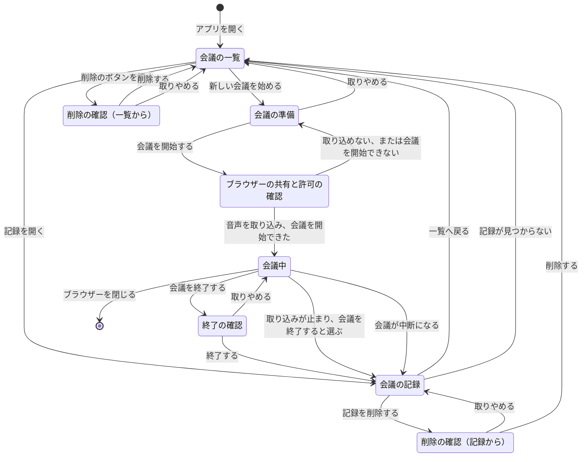
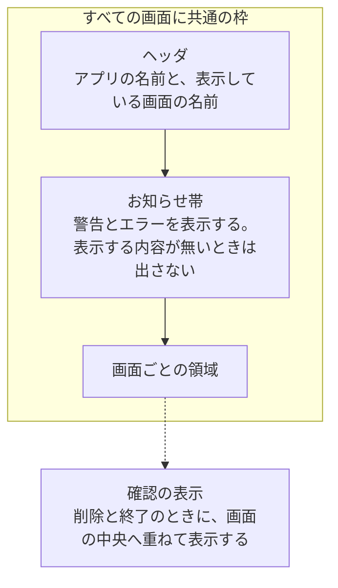
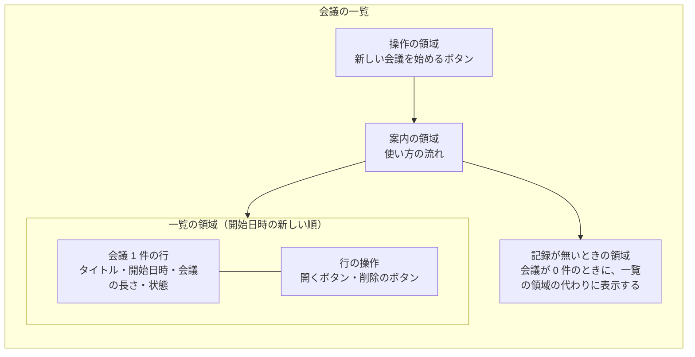
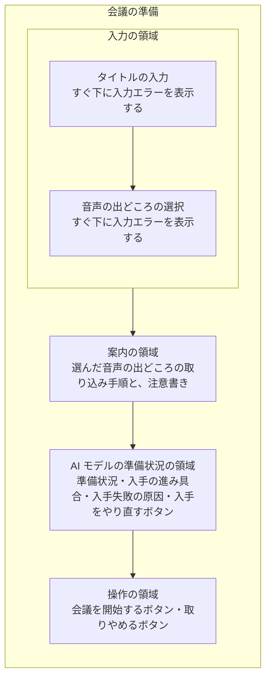
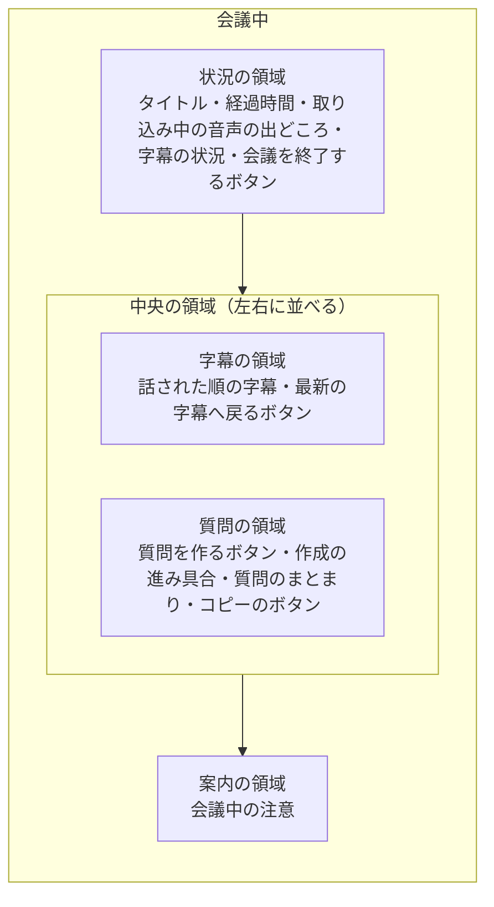
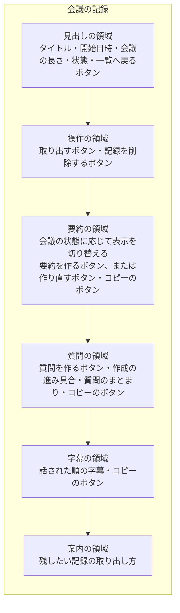

# 画面設計書

## 目次

- [画面一覧](#画面一覧)
- [画面遷移](#画面遷移)
- [画面共通の枠](#画面共通の枠)
- [ワイヤーフレーム概略](#ワイヤーフレーム概略)
  - [S-01 会議の一覧の領域](#s-01-会議の一覧の領域)
  - [S-02 会議の準備の領域](#s-02-会議の準備の領域)
  - [S-03 会議中の領域](#s-03-会議中の領域)
  - [S-04 会議の記録の領域](#s-04-会議の記録の領域)
- [画面入出力項目とデータの対応](#画面入出力項目とデータの対応)
  - [複数の画面で使う項目](#複数の画面で使う項目)
  - [S-01 会議の一覧の項目と操作](#s-01-会議の一覧の項目と操作)
  - [S-02 会議の準備の項目と操作](#s-02-会議の準備の項目と操作)
  - [S-03 会議中の項目と操作](#s-03-会議中の項目と操作)
  - [S-04 会議の記録の項目と操作](#s-04-会議の記録の項目と操作)
- [状態別の表示と操作](#状態別の表示と操作)
- [入力チェック方針](#入力チェック方針)
- [エラー表示パターン](#エラー表示パターン)

## 画面一覧

画面は 4 つです。画面の番号と名前は、要件の[画面一覧](../requirements/screens.md#画面一覧)と同じです。ここでは、利用者・権限・機能との対応を定めます。

| 画面 ID | 画面名 | 目的 | 利用者 | アクセス権限 | 関連機能 | 関連する業務フロー |
|---|---|---|---|---|---|---|
| S-01 | 会議の一覧 | 新しい会議を始めます。過去の会議記録を開く、または削除します | 利用者 | 制限なし | F-10、F-11、F-14、F-15 | [記録の閲覧と取り出しと削除](functional.md#記録の閲覧と取り出しと削除) |
| S-02 | 会議の準備 | 音声の出どころとタイトルを決め、会議を開始します | 利用者 | 制限なし | F-01、F-02、F-03、F-14、F-15、F-16 | [会議の開始から終了まで](functional.md#会議の開始から終了まで)、[AI モデルの入手と起動時の復旧](functional.md#ai-モデルの入手と起動時の復旧) |
| S-03 | 会議中 | 字幕を読み、質問を作り、会議を終了します | 利用者 | 制限なし | F-01、F-02、F-03、F-06、F-08、F-12、F-14、F-15 | [会議の開始から終了まで](functional.md#会議の開始から終了まで) |
| S-04 | 会議の記録 | 要約・質問・字幕を読み、取り出します。要約と質問を作ります | 利用者 | 制限なし | F-07、F-08、F-10、F-11、F-12、F-13、F-14、F-15 | [会議後の要約と質問](functional.md#会議後の要約と質問)、[記録の閲覧と取り出しと削除](functional.md#記録の閲覧と取り出しと削除) |

- 利用者の種類は 1 つです。ログインと権限の区別が無いため、画面ごとのアクセス権限はありません。接続制限を通った要求は、すべての画面を開けます（[接続制限の判定](cross_cutting.md#接続制限の判定)）。
- 機能の内容は、[機能設計書の機能一覧](functional.md#機能一覧)にあります。
- F-04・F-05・F-09・F-17 は、利用者が操作する画面を持ちません。F-04 と F-05 の結果は、F-06 が「会議中」に表示します。F-17 の結果は、「会議の一覧」の状態に表れます。

画面に重ねて表示するものは、次の 3 つです。

| 表示 | 出す画面 | 目的 | 関連機能 |
|---|---|---|---|
| 削除の確認 | 会議の一覧、会議の記録 | 記録を削除してよいかを確かめます。削除した記録を元に戻せないことを伝えます | F-11 |
| 終了の確認 | 会議中 | 会議を終了してよいかを確かめます。終了した会議の通訳を再開できないことを伝えます | F-03 |
| ブラウザーの共有と許可の確認 | 会議の準備、会議中 | ブラウザーが、画面共有の対象またはマイクの利用の許可を利用者に尋ねます。アプリは、この表示の中身を変えられません | F-01、F-02 |

## 画面遷移

要件の[画面遷移図](../requirements/screens.md#画面遷移図)に、確認の表示・取り込みの失敗・会議の中断の経路を加えています。

図に書ききれない遷移の規則は、次のとおりです。

| 場面 | 遷移の規則 | 関連機能 |
|---|---|---|
| 認証と認可による分岐 | ありません。ログインと権限の区別が無いためです | — |
| 時間切れ | ありません。ログインが無く、操作しない時間で画面を切り替える必要が無いためです | — |
| 入力エラーがある状態で、会議を開始する | 「会議の準備」にとどまります。ブラウザーの共有と許可の確認を出しません | F-03 |
| 共有または許可を、利用者が取りやめる、または拒否する | 「会議の準備」へ戻り、取り込みの手順を案内します。入力した内容は残します | F-01、F-02、F-14 |
| 進行中の会議があり、会議を開始できない | 取り込みを止めて「会議の準備」へ戻り、お知らせ帯に理由を表示します | F-03 |
| 会議中に、音声の共有が止まる | 「会議中」にとどまります。取り込みをやり直すか、会議を終了するかを利用者が選びます。やり直す場合は、ブラウザーの共有と許可の確認を出します | F-03 |
| 通訳ワーカーを起動し直せない、またはアプリが止まって、会議が中断になる | 「会議の記録」へ移り、お知らせ帯にエラーを表示します | F-03、F-17 |
| 「会議中」で、ブラウザーを閉じる・再読み込みする・前の画面へ戻る | 画面との接続が切れ、会議は中断になります。通訳は再開できません。開き直すと、その会議は「会議の記録」で表示します | F-03 |
| 会議を終了する | 「会議の記録」へ移ります。字幕が 1 件以上あれば、要約の進み具合を表示します | F-03、F-07 |
| 「会議の一覧」と「会議の記録」を再読み込みする | 同じ画面を表示します。内容は、アプリサーバーから読み直します | F-10 |
| 「会議の準備」を再読み込みする | 入力を初期の状態へ戻して、同じ画面を表示します | — |
| 存在しない会議の「会議の記録」を開く | 「会議の一覧」へ移り、お知らせ帯に記録が見つからないことを表示します | F-10 |
| アプリを開始できない | どの画面も表示せず、画面全体にアプリを開始できないことを表示します | F-17 |

## 画面共通の枠

4 つの画面は、同じ枠の中に表示します。

| 枠の要素 | 方針 |
|---|---|
| ヘッダ | アプリの名前と、表示している画面の名前を表示します。操作のボタンは置きません |
| ナビゲーション | 常に表示するメニューを置きません。画面が 4 つで、移り方が一本道のためです。画面の間は、各画面のボタンで移ります |
| パンくず | 置きません。画面の階層が、一覧と記録の 2 段だけのためです |
| フッタ | 置きません |
| お知らせ帯 | ヘッダのすぐ下に置きます。4 つの画面で同じ位置にし、利用者が探さずに済むようにします。表示する内容は[エラー表示パターン](#エラー表示パターン)に従います |
| 案内の領域 | 画面ごとに、その画面で迷いやすい操作の案内を表示します。表示する案内は、[機能設計書の F-14](functional.md#f-14-操作の案内)にあります |
| 権限による表示の出し分け | ありません。表示と操作は、会議の状態で出し分けます（[状態別の表示と操作](#状態別の表示と操作)） |
| 対応していないブラウザー | すべての画面で、お知らせ帯に Edge または Chrome で開くことを案内します |
| アプリとつながらないとき | すべての画面で、お知らせ帯につながらないことを表示します。画面は、自動でつなぎ直します |

- 「会議中」のヘッダには、ほかの画面へ移るリンクを置きません。画面を離れると、会議が中断になるためです。
- 要件の[画面レイアウトイメージ](../requirements/screens.md#画面レイアウトイメージ)は、「会議中」のエラーの表示を画面の下部に置いています。この設計では、4 つの画面で位置をそろえるため、お知らせ帯へまとめます。

## ワイヤーフレーム概略

要件の[画面レイアウトイメージ](../requirements/screens.md#画面レイアウトイメージ)を出発点に、領域の分け方と並べ方を定めます。図は、共通の枠の「画面ごとの領域」の中を示します。色・寸法・文字の大きさは、実装で確定します。

要件のイメージへ加えた領域は、次のとおりです。

| 画面 | 加えた領域と表示 | 加えた理由 |
|---|---|---|
| S-01 | 記録が無いときの領域 | 初めて使うときに、新しい会議の始め方を案内するためです（F-10） |
| S-02 | 入力エラーの表示、入手の進み具合、入手失敗の原因、入手をやり直すボタン | 要件の[異常時の動き](../requirements/README.md#異常時の動き)を画面で扱うためです（F-16） |
| S-03 | 取り込み中の音声の出どころ、最新の字幕へ戻るボタン、質問の作成の進み具合 | 取り込みの状況と、字幕の自動の進み方を利用者が把握するためです（F-06、F-15） |
| S-04 | 状態で切り替わる要約の領域、まとまりごとの作成日時と作成した時点、字幕の話された時刻 | 会議の状態ごとに、行える操作を示すためです（F-07、F-10） |

### S-01 会議の一覧の領域

### S-02 会議の準備の領域

### S-03 会議中の領域

- 字幕の領域を、質問の領域より広く取ります。利用者が会議中に読み続けるのは、字幕のためです。

### S-04 会議の記録の領域

## 画面入出力項目とデータの対応

表の見方は次のとおりです。

- 「対応するエンティティ.属性」は、[データモデル設計書のエンティティ定義](data_model.md#エンティティ定義)の名前です。型と桁の定義は、データモデル設計書が正です。
- 「保存しない区分」は、[データモデル設計書の保存しない区分](data_model.md#保存しない区分)の値です。
- 日時は、画面が PC のタイムゾーンへ変換して表示します（[日時の扱い](cross_cutting.md#日時の扱い)）。
- 会議の内容は、常に文字として表示します（[ADR-15](adr.md#adr-15-会議の内容は文字として表示し取り出す文面は画面で組み立てる)）。
- 表示だけの項目は、必須と任意の区別がありません。その欄は「—」にしています。

### 複数の画面で使う項目

字幕の行は、「会議中」と「会議の記録」で同じ項目を使います。

| 項目名 | 入出力区分 | 型と桁の概略 | 必須/任意 | 対応するエンティティ.属性 | 備考 |
|---|---|---|---|---|---|
| 話された時刻 | 表示 | 時刻、秒まで | — | 字幕.話された時刻 | — |
| 英語の原文 | 表示 | 文字列、最大 2,000 文字 | — | 字幕.英語の原文 | — |
| 日本語訳 | 表示 | 文字列、最大 2,000 文字 | — | 字幕.日本語訳 | 空のときは、訳を作れなかったことを表示します |
| 順番 | 表示しない | 整数 | — | 字幕.順番 | 並び順と、同じ字幕を 1 回だけ表示する判定に使います |

質問のまとまりも、「会議中」と「会議の記録」で同じ項目を使います。まとまりは、新しい順に並べます。

| 項目名 | 入出力区分 | 型と桁の概略 | 必須/任意 | 対応するエンティティ.属性 | 備考 |
|---|---|---|---|---|---|
| まとまりの作成日時 | 表示 | 日時、分まで | — | 質問のまとまり.作成日時 | — |
| 作成した時点 | 表示 | 区分 | — | 質問のまとまり.作成した時点 | 「会議の記録」でだけ表示します |
| 質問の番号 | 表示 | 整数、1 から 5 | — | 質問.順番 | — |
| 英語の質問 | 表示 | 文字列、最大 500 文字 | — | 質問.英語の質問 | — |
| 日本語の質問 | 表示 | 文字列、最大 500 文字 | — | 質問.日本語の質問 | 英語の質問と並べて表示します |
| まとまりの順番 | 表示しない | 整数 | — | 質問のまとまり.まとまりの順番 | 並び順に使います |
| 質問の作成状況 | 表示 | 区分と進み具合 | — | 保存しない区分「作成ジョブの状況」 | 待機中と作成中の間だけ表示します |

### S-01 会議の一覧の項目と操作

| 項目名 | 入出力区分 | 型と桁の概略 | 必須/任意 | 対応するエンティティ.属性 | 備考 |
|---|---|---|---|---|---|
| 使い方の案内 | 表示 | 固定の文章 | — | — | F-14 |
| 会議の行 | 表示 | 繰り返し、0 件以上 | — | 会議 | 開始日時の新しい順に、すべての会議を表示します |
| タイトル | 表示 | 文字列、最大 100 文字 | — | 会議.タイトル | 行の項目です |
| 開始日時 | 表示 | 日時、分まで | — | 会議.開始日時 | 行の項目です |
| 会議の長さ | 表示 | 時間、秒まで | — | 会議.開始日時、会議.終了日時 | 導出します。終了日時から開始日時を引きます。通訳中の会議では表示しません |
| 状態 | 表示 | 区分 | — | 会議.状態 | 区分の表示名を表示します |
| 会議番号 | 表示しない | 識別子 | — | 会議.会議番号 | 開く会議と、削除する会議を指すために使います |
| 作成ジョブの有無 | 表示しない | 真偽 | — | 保存しない区分「作成ジョブの状況」 | 行の項目です。その会議に、待機中または作成中の作成ジョブがあるかを示します。削除のボタンを押せなくする判定に使います（F-10、F-11） |
| 記録が無いことの案内 | 表示 | 固定の文章 | — | — | 会議が 0 件のときに表示します（F-10） |
| ディスクの空きの警告 | 表示 | 固定の文章 | — | — | お知らせ帯に表示します。記録保存部が確かめた結果です（F-15） |

| 操作 | 行える条件 | 結果 | 関連機能 |
|---|---|---|---|
| 新しい会議を始める | 常に行えます | 「会議の準備」へ移ります | F-03 |
| 開く | 常に行えます | その会議の「会議の記録」へ移ります | F-10 |
| 削除 | [状態別の表示と操作](#状態別の表示と操作)に従います | 削除の確認を出します。削除すると、一覧を表示し直します | F-11 |

### S-02 会議の準備の項目と操作

| 項目名 | 入出力区分 | 型と桁の概略 | 必須/任意 | 対応するエンティティ.属性 | 備考 |
|---|---|---|---|---|---|
| タイトル | 入力 | 文字列、最大 100 文字、1 行 | 任意 | 会議.タイトル | 空のときは、画面が開始日時から作った文字列を入れます |
| 音声の出どころ | 入力 | 区分、2 つから 1 つを選ぶ | 必須 | 会議.音声の出どころ | 初期の状態では、どちらも選んでいません。利用者が会議のたびに選ぶためです |
| 取り込み手順の案内 | 表示 | 固定の文章 | — | — | 選んだ音声の出どころに応じて切り替えます（F-14） |
| 注意書き | 表示 | 固定の文章 | — | — | 相手へ伝えるかの注意、英語の発言だけが対象であること、ブラウザーを開いたままにすること（F-14） |
| AI モデルの準備状況 | 表示 | 区分 | — | 保存しない区分「AI モデルの準備状況」 | F-15、F-16 |
| 入手の進み具合 | 表示 | 割合 | — | — | 準備状況が入手中のときに表示します |
| 入手に失敗した原因 | 表示 | 原因の種類 | — | — | 準備状況が入手失敗のときに表示します。種類は [F-16](functional.md#f-16-ai-モデルの入手) にあります |
| ディスクの空きの警告 | 表示 | 固定の文章 | — | — | お知らせ帯に表示します（F-15） |

| 操作 | 行える条件 | 結果 | 関連機能 |
|---|---|---|---|
| 会議を開始する | AI モデルの準備状況が準備完了です | 入力を確かめ、ブラウザーの共有と許可の確認を出します。音声を取り込めると、「会議中」へ移ります | F-01、F-02、F-03 |
| 取りやめる | 常に行えます | 「会議の一覧」へ移ります。入力した内容は残しません | — |
| 入手をやり直す | AI モデルの準備状況が入手失敗です | AI モデルの入手を始めます | F-16 |

- 会議の開始日時は、入力項目にしません。アプリサーバーが、会議を開始した時点の日時を記録します。

### S-03 会議中の項目と操作

| 項目名 | 入出力区分 | 型と桁の概略 | 必須/任意 | 対応するエンティティ.属性 | 備考 |
|---|---|---|---|---|---|
| タイトル | 表示 | 文字列、最大 100 文字 | — | 会議.タイトル | — |
| 経過時間 | 表示 | 時間、秒まで | — | 会議.開始日時 | 導出します。現在の時刻から開始日時を引きます。画面が 1 秒ごとに進めます |
| 取り込み中の音声の出どころ | 表示 | 区分 | — | 会議.音声の出どころ | 区分の表示名を表示します |
| 字幕の状況 | 表示 | 区分 | — | 保存しない区分「字幕の状況」 | 色だけでなく、文字でも示します（F-15） |
| 字幕の行 | 表示 | 繰り返し、0 件以上 | — | 字幕 | 項目は[複数の画面で使う項目](#複数の画面で使う項目)にあります。話された順に並べ、最新の字幕まで自動で進めます |
| 質問のまとまり | 表示 | 繰り返し、0 件以上 | — | 質問のまとまり、質問 | 項目は[複数の画面で使う項目](#複数の画面で使う項目)にあります |
| 会議中の案内 | 表示 | 固定の文章 | — | — | F-14 |
| 2 時間を超えたことの警告 | 表示 | 固定の文章 | — | — | お知らせ帯に表示します。経過時間から判定します（F-15） |
| 字幕が遅れることの警告 | 表示 | 固定の文章 | — | — | お知らせ帯に表示します。作成ジョブの状況が作成中の間に表示します。会議の開始の時点で作成中だったほかの会議の要約は、ブロックの区切りで待機中へ戻り、警告が消えます（F-03、F-08） |
| 会議番号 | 表示しない | 識別子 | — | 会議.会議番号 | 操作の対象の会議を指すために使います |

| 操作 | 行える条件 | 結果 | 関連機能 |
|---|---|---|---|
| 会議を終了する | 常に行えます | 終了の確認を出します。終了すると、「会議の記録」へ移ります | F-03 |
| 質問を作る | 字幕が 1 件以上あります。この会議の質問の作成ジョブがありません | 作成を依頼し、進み具合を表示します | F-08 |
| 質問をコピーする | 質問のまとまりごとに行えます | そのまとまりの文面を、クリップボードへ入れます | F-12 |
| 最新の字幕へ戻る | 利用者が過去の字幕へ戻っている間だけ表示します | 最新の字幕まで進め、自動で進む状態へ戻します | F-06 |
| 取り込みをやり直す | 字幕の状況が取り込み停止です | 開始時に選んだ音声の出どころで、ブラウザーの共有と許可の確認を出します。同じ会議で字幕を続けます | F-01、F-02 |
| 取り込みが止まったときに、会議を終了する | 字幕の状況が取り込み停止です | 終了の確認を出さずに会議を終了し、「会議の記録」へ移ります。利用者の選択が、確認を兼ねるためです | F-03 |

### S-04 会議の記録の項目と操作

| 項目名 | 入出力区分 | 型と桁の概略 | 必須/任意 | 対応するエンティティ.属性 | 備考 |
|---|---|---|---|---|---|
| タイトル | 表示 | 文字列、最大 100 文字 | — | 会議.タイトル | — |
| 開始日時 | 表示 | 日時、分まで | — | 会議.開始日時 | — |
| 会議の長さ | 表示 | 時間、秒まで | — | 会議.開始日時、会議.終了日時 | 導出します。通訳中の会議では表示しません |
| 状態 | 表示 | 区分 | — | 会議.状態 | 区分の表示名を表示します |
| 全体の概要 | 表示 | 文字列、最大 2,000 文字 | — | 要約.全体の概要 | — |
| 話題ごとの要点 | 表示 | 文字列、最大 4,000 文字 | — | 要約.話題ごとの要点 | 1 行を 1 項目の箇条書きとして表示します |
| 決定事項 | 表示 | 文字列、最大 4,000 文字 | — | 要約.決定事項 | 1 行を 1 項目の箇条書きとして表示します |
| 宿題 | 表示 | 文字列、最大 4,000 文字 | — | 要約.宿題 | 1 行を 1 項目の箇条書きとして表示します |
| 要約の作成日時 | 表示 | 日時、分まで | — | 要約.作成日時 | — |
| 要約の作成状況 | 表示 | 区分と進み具合 | — | 保存しない区分「作成ジョブの状況」 | 進み具合は、処理したブロックの数で示します。待機中の間は、ほかの作成、または進行中の会議が終わったあとに作ることを、固定の文章で添えます（F-07、F-15） |
| 要約に失敗した内容 | 表示 | 何が起きたかと、次に行う操作 | — | 会議.要約の失敗理由 | 保存したエラーコードから、表示する文面を決めます |
| 内容が無いことの表示 | 表示 | 固定の文章 | — | — | 字幕が 0 件の会議で表示します（F-07） |
| 質問のまとまり | 表示 | 繰り返し、0 件以上 | — | 質問のまとまり、質問 | 項目は[複数の画面で使う項目](#複数の画面で使う項目)にあります |
| 字幕の行 | 表示 | 繰り返し、0 件以上 | — | 字幕 | 項目は[複数の画面で使う項目](#複数の画面で使う項目)にあります。話された順に並べます |
| 取り出しの案内 | 表示 | 固定の文章 | — | — | F-14 |
| 会議番号 | 表示しない | 識別子 | — | 会議.会議番号 | 表示する会議を指すために使います |

| 操作 | 行える条件 | 結果 | 関連機能 |
|---|---|---|---|
| 一覧へ戻る | 常に行えます | 「会議の一覧」へ移ります | F-10 |
| 要約を作る、要約を作り直す | [状態別の表示と操作](#状態別の表示と操作)に従います | 作成を依頼し、進み具合を表示します | F-07 |
| 質問を作る | 字幕が 1 件以上あります。この会議の質問の作成ジョブがありません | 作成を依頼し、進み具合を表示します | F-08 |
| 要約をコピーする | 要約があります | 要約の 4 項目の文面を、クリップボードへ入れます | F-12 |
| 質問をコピーする | 質問のまとまりごとに行えます | そのまとまりの文面を、クリップボードへ入れます | F-12 |
| 字幕をコピーする | 字幕が 1 件以上あります | すべての字幕の文面を、クリップボードへ入れます | F-12 |
| 取り出す | 常に行えます | Markdown 形式のファイルを 1 つ、ダウンロードさせます | F-13 |
| 記録を削除する | [状態別の表示と操作](#状態別の表示と操作)に従います | 削除の確認を出します。削除すると、「会議の一覧」へ移ります | F-11 |

- コピーが済むと、押したボタンの近くに、コピーしたことを短い時間だけ表示します。

## 状態別の表示と操作

「会議の一覧」と「会議の記録」は、会議の状態に応じて表示と操作を切り替えます。状態の値は[データモデル設計書の区分コード](data_model.md#区分コード)、遷移の規則は[横断設計規約の会議の状態の遷移規則](cross_cutting.md#会議の状態の遷移規則)にあります。

| 会議の状態 | 字幕の件数 | 削除（一覧と記録） | 記録の要約の領域に表示する内容 | 記録の要約のボタン | 記録の質問を作るボタン |
|---|---|---|---|---|---|
| 通訳中 | 問いません | 押せません | 会議中であること | 表示しません | 字幕が 1 件以上あれば押せます |
| 中断 | 1 件以上 | 押せます | 会議が中断したことと、要約がまだ無いこと | 「要約を作る」を表示します | 押せます |
| 中断 | 0 件 | 押せます | 内容がありません | 表示しません | 押せません |
| 要約作成中 | 1 件以上 | 押せません | 要約の作成状況と進み具合。前の要約がある場合は、併せて表示します | 表示しません | 押せます |
| 完了 | 1 件以上 | 押せます | 要約の 4 項目と、要約の作成日時 | 「要約を作り直す」を表示します | 押せます |
| 完了 | 0 件 | 押せます | 内容がありません | 表示しません | 押せません |
| 要約失敗 | 1 件以上 | 押せます | 要約に失敗した内容。前の要約がある場合は、併せて表示します | 「要約を作る」を表示します | 押せます |

- 削除が押せる状態でも、その会議の作成ジョブが残っている間は押せません。
- 「開く」「一覧へ戻る」「取り出す」は、どの状態でも行えます。
- コピーのボタンは、コピーする内容が 1 件以上ある場合に押せます。
- 質問を作るボタンは、この会議の質問の作成ジョブが待機中または作成中の間、押せません。
- 通訳中の会議を「会議の記録」で開くのは、会議を進めている画面とは別の画面で開いた場合です。開いた時点までの字幕と質問を表示します。
- 押せないボタンは、押せない見た目で表示したまま残します。利用者が、操作の場所を見失わないためです。

## 入力チェック方針

利用者が入力する項目は、「会議の準備」のタイトルと音声の出どころの 2 つです。画面が入力の時点で確かめ、アプリサーバーが受け取った時点でもう一度確かめます（[エラーの分類と見せ方](cross_cutting.md#エラーの分類と見せ方)）。

| 対象 | チェック種別 | 方針 |
|---|---|---|
| タイトル | 必須 | 任意です。空の入力と、空白だけの入力を、未入力として扱います。未入力のときは、開始日時から作った文字列を入れます |
| タイトル | 桁 | 最大 100 文字です。超えた時点で、入力エラーを表示します |
| タイトル | 書式 | 文字の種類を制限しません。改行は受け付けません。記号は、文字として保存し、文字として表示します |
| タイトル | 一意性 | 求めません。同じタイトルの会議を許します。会議は、会議番号で見分けます |
| 音声の出どころ | 必須 | 必須です。選ばずに会議を開始すると、入力エラーを表示します |
| 音声の出どころ | 値域 | [区分「音声の出どころ」](data_model.md#区分コード)の 2 つの値だけを受け付けます |
| 音声の出どころと、取り込みの結果 | 項目間の相関 | 選んだ音声の出どころで、実際に音声を取り込めることを確かめます。PC で再生される音声を選んだ場合は、共有に音声が含まれることを確かめます。取り込めない場合は、会議を開始しません |
| 会議番号 | 存在 | 記録を開く・作成を依頼するときに、アプリサーバーが会議の存在を確かめます。無い場合は、記録が見つからないことを表示します。記録を削除するときは、[重複を防ぐ規約](cross_cutting.md#重複を防ぐ規約)に従い、会議がすでに無ければ成功として扱います |
| 操作の前提となる状態 | 状態との相関 | 操作ごとの条件を、アプリサーバーが確かめます。満たさない場合は業務エラーにします。条件は[会議の状態の遷移規則](cross_cutting.md#会議の状態の遷移規則)にあります |
| ボタンの二度押し | 重複 | 画面は、応答が返るまでボタンを押せなくします。アプリサーバーは、[重複を防ぐ規約](cross_cutting.md#重複を防ぐ規約)に従います |
| 日付・数値・メールアドレスの書式 | 書式 | 該当しません。これらを入力する項目がありません |

- 確かめる処理の書き方と、入力エラーの文言は、実装で確定します。

## エラー表示パターン

エラーと警告は、次の 7 つのパターンで表示します。分類は[横断設計規約のエラーの分類と見せ方](cross_cutting.md#エラーの分類と見せ方)に従います。

| パターン | 表示位置 | 表示する時機 | メッセージ区分 | 使う場面の例 | 利用者への戻し方 | 消し方 |
|---|---|---|---|---|---|---|
| 項目のすぐ下 | 入力項目のすぐ下 | 入力した時点と、会議を開始するボタンを押した時点 | 入力エラー | タイトルが 100 文字を超える。音声の出どころを選んでいない | 同じ画面で入力し直します。入力した内容は残します | 入力を直すと消えます |
| お知らせ帯のエラー | お知らせ帯 | アプリサーバーの応答を受けた時点と、通知を受けた時点 | 業務エラー、システムエラー | 進行中の会議がある。字幕の保存に失敗する。文字起こしに失敗する。クリップボードへ書き込めない | 同じ画面にとどまります。文面に、次に行う操作を示します | 利用者が閉じると消えます。同じ操作が成功した場合も消えます |
| お知らせ帯の警告 | お知らせ帯 | 状況が変わった時点と、画面を開いた時点 | 警告 | 会議が 2 時間を超える。ディスクの空きが少ない。会議中に作成ジョブが作成中で、字幕が遅れる。対応していないブラウザーで開いている | 操作を続けられます | 状況が解消すると消えます。2 時間を超えた警告は、会議の終了まで残します |
| 選択を求めるお知らせ | お知らせ帯。ボタンを 2 つ添えます | 取り込みが止まった時点 | システムエラー | 会議中に、音声の共有が止まる | 取り込みをやり直すか、会議を終了するかを選びます | どちらかを選ぶと消えます |
| 領域の中 | 結果を表示するはずだった領域（要約・質問・AI モデルの準備状況） | 通知を受けた時点と、画面を開いた時点 | システムエラー | 要約の作成に失敗する。質問の作成に失敗する。AI モデルの入手に失敗する | 領域の中の、作る、またはやり直すボタンを押します | やり直しが始まると消えます。要約の失敗は保存しているため、画面を開き直しても表示します |
| つながらないことの表示 | お知らせ帯 | アプリサーバーとの接続が切れた時点 | システムエラー | アプリサーバーが止まる、または再起動している | 画面が自動でつなぎ直します。つながると、内容をアプリサーバーから読み直します | つながると消えます |
| 画面全体 | 画面全体 | アプリを開いた時点 | システムエラー | アプリサーバーが[開始できない状態](architecture.md#アプリを開始できない状態)で動いている | 開発を担う AI へ、表示されたエラーコードを伝えます | アプリサーバーが通常の状態で起動し直すまで残します |

- エラーの文面は、「何が起きたか」と「次に行う操作」の 2 つで組み立てます。末尾に、エラーコードを添えます。利用者が、開発を担う AI へ伝える手がかりにするためです。
- 開始できない状態でも、配信部が画面のファイルとエラーコードを返します。画面は、受け取ったエラーコードを画面全体のパターンで表示します。アプリサーバーとつながらない場合は、つながらないことの表示のパターンを使います。
- プログラムの例外の文面と、会議の内容は、エラーの文面に入れません。
- 削除の確認と終了の確認は、エラーではありません。画面の中央へ重ねて表示し、実行するボタンと取りやめるボタンを置きます。取りやめると、元の画面へ戻ります。
- エラーと警告は、色だけでなく文字でも区別します（[アクセシビリティ](nonfunctional.md#アクセシビリティ)）。
- エラーコードごとの文言は、実装で確定します。
