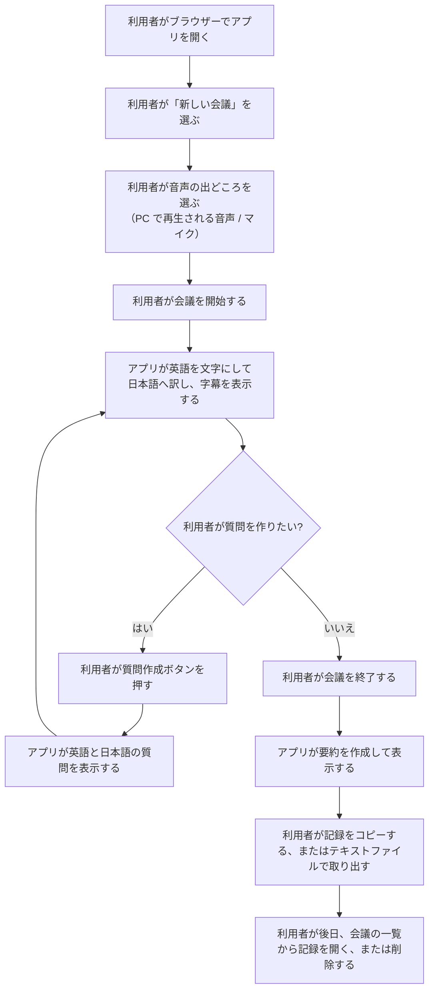
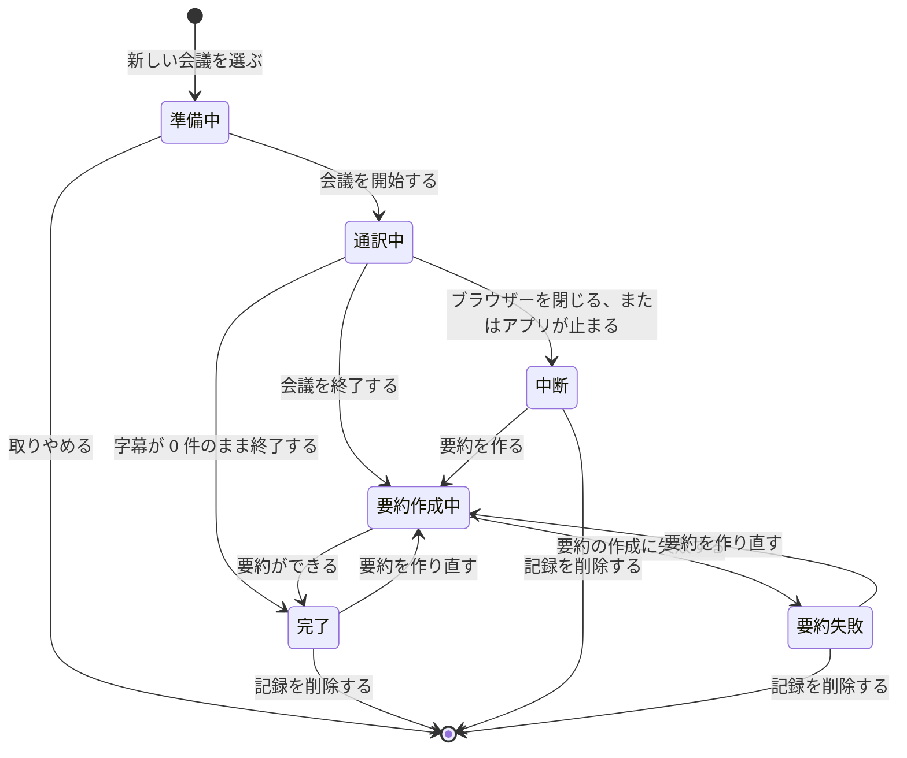

# 要件定義書

英語の会議を日本語の字幕で追い、会議後に要約と質問を得るための Web アプリの要件です。

「（仮置き）」と書いた項目は、仮置き（AI推奨）です。利用者に 1 件ずつ確認していない内容を AI が推奨値で埋め、利用者がまとめて了承しました。利用者があとから見直せる宿題として扱います。一覧は「専門家分析」の「仮置きとした項目」にあります。

## 1. 目的・背景

英語の会話やプレゼンテーションを、その場で日本語で理解できるようにします。会議が終わったあとは、内容を要約として残します。

- 利用者は、英語の会議やプレゼンテーションに参加する日本語話者です。
- 利用者が会議中に内容を追えること、会議後に内容を振り返れることを目指します。
- 利用者が内容をより深く理解できるように、確認用の質問を英語と日本語で用意します。
- 会議の音声と内容は、PC の外へ出しません。

### 達成目標

| 番号 | 目標 | 測り方 |
|---|---|---|
| 1 | 利用者が、会議中に話の流れを日本語の字幕で追える | 話されてから日本語の字幕が出るまでの遅れが 10 秒以内 |
| 2 | 利用者が、会議後に内容を振り返れる | 会議の終了後に、4 項目の要約が日本語で表示される |
| 3 | 利用者が、質疑応答で使える質問を得られる | ボタンを押すと、英語と日本語の質問が表示される |

### 費用と期限

- 期限と予算の指定はありません。（仮置き）
- 外部の AI サービスを使わないため、サービスの利用料は発生しません。
- 高性能な PC を用意するかどうかは、実測の結果を見て利用者が判断します。

### 初版の対象外

次の項目は初版では作りません。

- 日本語の音声による読み上げ
- 話者の区別
- 決まった訳し方を登録する用語集
- Word（.docx）での出力
- 英語版の要約
- 日本語の発言の記録
- チームや全社での共同利用、ログイン
- 期間による記録の自動削除
- 記録のバックアップ機能、記録の一括削除
- Windows のタスクトレイに常駐するネイティブアプリ
- 外部の AI サービス（クラウド）の利用

## 2. ステークホルダ

| 立場 | 人数 | 関わり方 |
|---|---|---|
| 利用者 | 1 人（依頼者本人） | 自分の PC でアプリを使い、英語の会議やプレゼンテーションを日本語で理解します |

- チームや全社での共同利用は対象外です。
- 画面には説明を多めに書きます。利用者がマニュアルなしで使えるようにし、音声の取り込み方などの迷いやすい操作を画面で案内します。
- 利用者は、ブラウザーと会議アプリを日常的に使えます。コマンドの入力やコンテナの操作は行わない前提にします。（仮置き）
- アプリの導入と更新は、開発を担う AI が行います。利用者が行う操作は、ブラウザーでアプリを開くことだけです。（仮置き）

## 3. 業務要件

### 利用の流れ

### 会議の状態

- 「中断」の状態と、「要約を作り直す」操作は（仮置き）です。
- 中断した会議は、通訳を再開できません。それまでの字幕から要約を作れます。（仮置き）

## 4. 機能要件

### 機能一覧

| 番号 | 機能 | 概要 |
|---|---|---|
| F-01 | PC で再生される音声の取り込み | Teams や Zoom などのオンライン会議、動画の音声を取り込みます |
| F-02 | マイク音声の取り込み | 会議室などで話される声を、マイクで取り込みます |
| F-03 | 会議の開始と終了 | 利用者がボタンで会議を開始し、終了します |
| F-04 | 英語の文字起こし | 取り込んだ英語の音声を、英語の文字にします |
| F-05 | 日本語への翻訳 | 文字にした英語を、日本語へ訳します |
| F-06 | 字幕の表示 | 英語の原文と日本語訳を並べて、字幕として表示します |
| F-07 | 会議後の要約 | 会議の終了後に、4 項目の要約を日本語で作ります |
| F-08 | 質問の作成 | 利用者がボタンを押すと、英語と日本語の質問を作ります |
| F-09 | 会議記録の保存 | 字幕・要約・質問を PC の中に保存します |
| F-10 | 会議の一覧と閲覧 | 過去の会議を一覧で表示し、記録を開きます |
| F-11 | 記録の削除 | 利用者が選んだ会議の記録を削除します |
| F-12 | 記録のコピー | 要約・字幕・質問を、ボタンでコピーします |
| F-13 | テキストファイルの取り出し | 記録を Markdown 形式のファイルとしてダウンロードします |
| F-14 | 操作の案内 | 音声の取り込み方などの手順と注意を、画面に表示します |
| F-15 | 処理状況とエラーの表示 | 字幕の遅れ、要約の作成状況、AI モデルの準備状況、エラーの内容と対処を表示します |

画面は [screens.md](screens.md)、データは [db.md](db.md) を参照してください。

### 音声の取り込み（F-01・F-02）

- PC で再生される音声と、マイクで拾う音声の両方に対応します。
- 利用者は、会議のたびにどちらを使うかを選びます。
- PC で再生される音声を取り込むときは、ブラウザーの画面共有の仕組みを使います。利用者は画面全体を共有し、音声の共有をオンにします。アプリは、この手順を画面で案内します。
- 画面共有で得られる映像は使いません。保存も表示も行いません。

### 会議の開始と終了（F-03）

- 利用者は、ボタンで会議を開始し、終了します。
- 利用者は、開始するときに会議のタイトルを入力できます。入力しない場合は、開始した日時をタイトルにします。（仮置き）
- AI モデルの入手が済んでいない間は、会議を開始できません。準備の画面に入手の状況を表示します。（仮置き）
- 会議が 2 時間を超えると、アプリは警告を表示します。会議は止めずに続けます。（仮置き）

### 同時通訳（F-04・F-05・F-06）

- 通訳結果は、日本語の字幕として画面に表示します。
- 字幕には、聞き取った英語の原文と日本語訳を並べて表示します。
- 日本語の音声による読み上げは対象外です。
- 話者は区別しません。話された順に字幕を並べます。
- 英語の発言だけを、字幕と記録の対象にします。日本語の発言は記録に残しません。
- アプリは、発言が英語か日本語かを判別しません。日本語が混じると、意味の通らない字幕が出ることがあります。アプリは、このことを画面で案内します。（仮置き）
- 決まった訳し方を登録する用語集は、初版では作りません。
- 新しい字幕が出ると、画面は最新の字幕まで自動で進みます。利用者が過去の字幕へ戻っている間は、自動で進めません。（仮置き）

### 会議後の要約（F-07）

- 利用者が会議を終了すると、アプリが要約を作ります。
- 要約には次の 4 項目を含めます。
  - 全体の概要
  - 話題ごとの要点
  - 決定事項
  - 宿題（誰が何をするか）。担当者は、会話の中で名前が出た場合だけ書きます。
- 要約は日本語で出力します。英語版は対象外です。
- 該当する内容が無い項目には、「該当なし」と書きます。（仮置き）
- 利用者は、要約を作り直せます。作り直すと、前の要約を置き換えます。（仮置き）
- 字幕が 0 件の会議では、要約を作りません。「内容がありません」と表示します。（仮置き）

### 質問の作成（F-08）

- 利用者が会議中にボタンを押すと、その時点までの内容から質問を作ります。
- 会議が終わったあとも、同じボタンで質問を作れます。
- 質問は、英語と日本語の両方で作ります。
- 1 回の操作で作る質問は 5 問です。（仮置き）

### 会議記録の保存・閲覧・削除（F-09・F-10・F-11）

- 字幕（英語の原文と日本語訳）・要約・質問を、PC の中に保存します。
- 利用者は、過去の会議の一覧から記録を開けます。
- 音声そのものは保存しません。
- 利用者は、会議の一覧から不要な記録を 1 件ずつ削除できます。期間による自動削除は行いません。
- 字幕は、表示するたびに保存します。会議の途中でブラウザーを閉じても、それまでの字幕は残ります。（仮置き）
- 保存する件数に上限は置きません。ディスクの空きが少ないときは、アプリが警告を表示します。（仮置き）

### 記録の取り出し（F-12・F-13）

- 画面にコピーボタンを用意します。
- 記録を、テキストファイル（Markdown 形式）としてダウンロードできます。
- Word（.docx）での出力は対象外です。

### 操作の案内と状況の表示（F-14・F-15）

- 画面には説明を多めに書きます。利用者がマニュアルなしで使えるようにします。
- 字幕が目標より遅れているときは、遅れていることを画面に表示します。（仮置き）
- エラーが起きたときは、何が起きたかと、利用者が次に行う操作を表示します。（仮置き）

### 異常時の動き

次の動きは、すべて（仮置き）です。

| 起きること | アプリの動き |
|---|---|
| 利用者が、音声の共有やマイクの許可を取りやめる、または拒否する | 会議を開始しません。準備の画面で、許可の手順を案内します |
| 会議中に、音声の共有が止まる | 字幕を止めます。それまでの字幕を残し、取り込みのやり直しか会議の終了かを利用者に選ばせます |
| 会議中に、無音が続く | 待機していることを表示し、会議を続けます |
| 会議中に、利用者がブラウザーを閉じる。または、アプリが止まる | 会議を「中断」として一覧に残します。それまでの字幕は残ります |
| 要約の作成に失敗する | 失敗したことを表示します。利用者は要約を作り直せます |
| AI モデルの入手に失敗する | 原因を表示し、利用者が入手をやり直せるようにします |

## 5. 非機能要件

### 実装形態

- Web アプリとして作ります。利用者はブラウザーで開いて使い、会議中はブラウザーを開いたままにします。
- Windows のタスクトレイに常駐するネイティブアプリは対象外です。開発環境で起動確認ができないためです。

### 処理する場所とデータの扱い

- 会議の音声と内容（文字起こし・訳・要約・質問）は、PC の中だけで処理します。外部の AI サービス（クラウド）へは送りません。
- 文字起こし・翻訳・要約・質問作成には、PC の中で動く AI モデルを使います。
- インターネットへの接続は、AI モデルを最初に入手するときだけ使います。
- 音声は保存しません。処理が終わった音声は破棄します。
- アプリの動作ログには、会議の内容（字幕・要約・質問の本文）を書きません。（仮置き）

### 利用できる人の制限

- ログインは求めません。
- アプリは、動かしている PC からだけ開けるようにします。他の PC からは接続できないようにします。
- 保存した記録は、PC 自体のロックで守ります。
- PC は、利用者だけが使う前提にします。同じ PC を使う他の Windows ユーザーからの保護は対象外です。（仮置き）
- ブラウザーで開いている他のサイトからアプリへ届く要求は、拒否します。（仮置き）
- 保存した記録の暗号化は行いません。PC のロックとディスクの保護に頼ります。利用者の PC でディスクの保護が有効かは未確認です。（仮置き）

### セキュリティ

- 字幕・AI の出力・会議のタイトルは、文字として表示します。プログラムとして解釈される形では表示しません。（仮置き）
- AI モデルとオープンソースソフトウェアは、公式の配布元から、版を固定して入手します。入手したファイルが配布元のものと一致することを確認します。（仮置き）
- 利用するオープンソースソフトウェアは、既知の脆弱性が無い版を使います。
- テストのための設定は、テストを実行する側にだけ置きます。アプリ本体の接続の制限は、テストのときも変えません。（仮置き）
- 記録が漏れた、または PC を紛失したときの対応は、利用者が社内の手順に従います。アプリは専用の機能を持ちません。（仮置き）
- 会議を記録することを相手へ伝えるかどうかは、利用者が判断します。アプリは、準備の画面に注意書きを表示します。（仮置き）
- 会議の記録を取ることと保存することが社内の規程に沿うかは、利用者が確認します。（仮置き）

### 配布形態とライセンス

- 利用者が自分の業務で使います。自分以外への配布、社外への公開、販売は行いません。
- 利用するオープンソースソフトウェアと AI モデルは、業務で使えるライセンスのものに限ります。非商用に限定するライセンスのものは使いません。

### 技術要件・制約

- プログラミング言語・フレームワーク・AI モデルは、利用者から指定がありません。基本設計フェーズで AI が選びます。
- 選ぶ基準は、「動かす PC の前提」の構成で動くことと、「配布形態とライセンス」の条件を満たすことです。
- ブラウザーが音声の取り込みを許可するのは、安全な接続（HTTPS、または `localhost`）で開いたページだけです。利用者は `localhost` でアプリを開きます。
- 「初版の対象外」に挙げた機能を、あとから追加できる作りにします。共同利用への拡張は考慮しません。（仮置き）

### 対応環境

- 対応ブラウザーは Chrome と Edge です。PC で再生される音声の取り込みに対応するブラウザーが、この 2 つだけだからです。
- 利用者が普段使うブラウザーは Microsoft Edge です。動作確認は Edge を優先します。
- 対応 OS は Windows です。Windows では、画面全体を共有すると PC 全体の音声を取り込めます。
- Firefox と Safari は対象外です。

### 性能の目標

| 項目 | 目標 | 状態 |
|---|---|---|
| 字幕の遅れ | 話されてから日本語の字幕が出るまで 10 秒以内 | 利用者が決めた目標。達成できるかは未検証 |
| 会議の長さ | 最長 2 時間 | 利用者が決めた想定 |
| 2 時間連続の動作 | 2 時間のあいだ字幕が途切れず、遅れが 10 秒以内を保ち、終了後に要約ができる | （仮置き） |
| 質問の作成時間 | ボタンを押してから 3 分以内 | （仮置き）。AI の概算で未検証 |
| 要約の作成時間 | 会議の長さの 4 分の 1 以内（2 時間の会議で 30 分以内） | （仮置き）。AI の概算で未検証 |
| 会議開始時の待ち時間 | 開始ボタンを押してから字幕が出始めるまで 2 分以内 | （仮置き）。AI の概算で未検証 |

- すべての項目を、実装後に「動かす PC の前提」の PC で測り、利用者へ報告します。
- 測るときは、会議アプリ（Teams など）とブラウザーを同時に動かします。実際に使う状態に合わせるためです。（仮置き）
- 未検証の目標は、測った結果を見て利用者と見直します。
- 要約と質問の作成中は、進み具合を画面に表示します。
- 会議中に質問を作っている間は、字幕が遅れる可能性があります。利用者はこれを了承しています。

### 訳と要約の品質

- 訳・要約・質問の品質に、数値の合格基準は置きません。（仮置き）
- 見本の英語音声をアプリで処理し、その字幕・要約・質問を利用者が見て、使えるかどうかを判定します。（仮置き）
- 見本の結果は、実装の早い段階で利用者へ示します。（仮置き）

### 稼働の継続

- 稼働率の目標は置きません。個人で使うアプリのためです。（仮置き）
- アプリが止まったときは、自動で再起動します。（仮置き）

### 動かす PC の前提

- 利用者が現在使っている PC で動かします。調べた時点の構成は次のとおりです。

| 項目 | 値 |
|---|---|
| CPU | Intel Core i7-1185G7（8 スレッド） |
| アプリが使えるメモリ | 約 8GB |
| AI 処理用の GPU（NVIDIA） | なし |

- AI モデルは、この構成で動く小型のものを使います。GPU を前提にしません。
- 字幕の遅れと、訳・要約の品質が足りない場合は、その時点で利用者と対応を相談します。
- 会議をしていない間は、AI モデルをメモリに読み込みません。

### テスト環境と完成の基準

- 自動テストは、開発環境のコンテナで動くブラウザー（Chromium）で行います。（仮置き）
- 自動テストでは、実際の PC の音声を取り込めません。あらかじめ用意した英語の音声を、擬似的な入力として使います。（仮置き）
- 実際の PC の音声を取り込む動作は、利用者が Windows の Microsoft Edge で確認します。
- 部品ごとのテスト（単体テスト）は、プログラムの 80% 以上を通るようにします。（仮置き）
- 画面を通したテストは、機能一覧のすべての機能の正常な動きと、「異常時の動き」の表の動きを対象にします。（仮置き）
- 会議中にアプリが外部へ通信しないことを、テストで確認します。（仮置き）
- 利用者が説明書を読まずに、会議の開始から要約の表示までを操作できることを、利用者の確認で判定します。（仮置き）
- 次の 3 つがそろったときに、完成とします。（仮置き）
  - 自動テストがすべて合格する
  - 利用者が、Windows の Microsoft Edge で実際の音声を使って動作を確認する
  - 「性能の目標」の各項目を測った結果を、利用者へ報告する

## 6. 運用・移行要件

- PC を起動すると、アプリも自動で立ち上がります。利用者は、ブラウザーで開けばすぐ使えます。
- 自動で立ち上がるかどうかは、実装後に利用者の PC で確認します。立ち上がらない場合は、設定の手順を利用者へ案内します。（仮置き）
- 新規のアプリのため、移行するデータはありません。
- 保存した記録のバックアップ機能は作りません。残したい記録は、利用者がテキストファイルで取り出します。（仮置き）
- アプリを更新しても、保存した記録が残るようにします。（仮置き）
- 監視の仕組みは作りません。異常は、画面のエラー表示で利用者へ伝えます。（仮置き）

詳細は [devops.md](devops.md) を参照してください。

## 7. 用語定義

| 用語 | 意味 |
|---|---|
| 会議 | アプリで開始してから終了するまでの 1 回の利用。会話、プレゼンテーション、講演を含みます |
| 字幕 | 聞き取った英語の原文と、その日本語訳の組 |
| 要約 | 会議の終了後にアプリが作る、4 項目のまとめ |
| 質問 | 内容をより詳しく理解するために、利用者が話し手へ尋ねる問い。英語と日本語の組で作ります |
| 会議記録 | 1 回の会議について保存する、字幕・要約・質問のまとまり |
| PC で再生される音声 | オンライン会議や動画など、PC のスピーカーやイヤホンから出る音声 |
| AI モデル | 文字起こし・翻訳・要約・質問作成を行うプログラム。PC の中で動かします |
| 中断 | 会議中にブラウザーを閉じた、またはアプリが止まったために、通訳が途中で終わった状態 |
| 仮置き | AI が推奨値で埋め、利用者がまとめて了承した項目。利用者があとから見直せます |

## ドキュメント一覧

| ドキュメント | 内容 |
|---|---|
| [screens.md](screens.md) | 画面一覧・遷移図・レイアウトイメージ |
| [db.md](db.md) | 概念ER図 |
| [devops.md](devops.md) | 運用・移行・デプロイの要求 |

## 専門家分析

### プロダクトオーナーの分析

- 初版の価値は、字幕・要約・質問の 3 つに絞ります。「初版の対象外」に挙げた項目は、使ってみてから追加を判断します。
- 最大のリスクは、小型の AI モデルの訳と要約が、実用に足りない場合です。字幕の遅れと品質を、実装の早い段階でこの PC で測ります。
- 測った結果が足りない場合の選択肢は、高性能な PC の用意、または処理する場所の見直しです。どちらも利用者が判断します。

### アーキテクトの分析

- 文字起こし・翻訳・要約・質問作成の AI モデルを、約 8GB のメモリに収める必要があります。開発中は、開発用のコンテナも同じメモリを使います。
- 字幕の処理と質問の作成は、同じ CPU を使います。同時に動くと字幕が遅れます。
- 2 時間の会議の内容は、小型の AI モデルが一度に読める量を超える可能性があります。分割して要約する方式を、基本設計フェーズで検討します。
- AI モデルの選定では、非商用に限定するライセンスのものを除きます。
- 自動テストのブラウザーは、コンテナ名でアプリへ接続します。この接続は安全な接続として扱われないため、音声の取り込みが無効になります。テストを実行する側の設定で対処する方式を、基本設計フェーズで決めます。

### 品質保証の分析

- AI の出力は毎回変わります。自動テストでは、文面ではなく形を確認します。確認する形は、要約の 4 項目がそろうこと、質問が英語と日本語の組であることです。
- 字幕の遅れ（10 秒以内）と 2 時間連続の動作は、数値で確認します。
- 実際の PC の音声を取り込む動作は自動化できません。利用者の確認手順を用意します。
- 異常時の動きは、「異常時の動き」の表を期待する結果としてテストします。

### セキュリティの分析

- 会議の音声と内容を PC の外へ送らないことを、最も重要な要件として扱います。テストで確認します。
- アプリを他の PC から開けないようにします。ログインが無いため、接続元の制限が唯一の入口の守りです。
- 保存した記録は、PC 自体のロックで守ります。利用者がこの方式を選びました。
- 画面共有で得られる映像は、使わずに破棄します。
- 字幕には、会議の相手が話した内容がそのまま入ります。表示と取り出しのときに、プログラムとして解釈されない形で扱います。

### 仮置きとした項目

利用者があとから見直せる宿題の一覧です。

| 番号 | 項目 | 仮置きの内容 |
|---|---|---|
| 1 | 自動テストの環境 | コンテナのブラウザーと、用意した英語音声で行う |
| 2 | 利用者の習熟度と導入の担い手 | 利用者はコマンド操作をしない。導入と更新は AI が行う |
| 3 | PC 起動時の自動起動 | 実装後に利用者の PC で確認し、無効なら設定手順を案内する |
| 4 | 質問の件数 | 1 回 5 問 |
| 5 | 訳と要約の合格基準 | 数値は置かず、見本の結果を利用者が見て判定する |
| 6 | 要約と質問の作成時間 | 質問 3 分以内、要約は会議の長さの 4 分の 1 以内。未検証 |
| 7 | 会議開始時の待ち時間 | 2 分以内。未検証 |
| 8 | 2 時間連続動作の合格条件 | 字幕が途切れず、遅れ 10 秒以内を保ち、要約ができる |
| 9 | 異常時の動き | 「異常時の動き」の表のとおり |
| 10 | ブラウザーを閉じた場合 | 会議を「中断」として残し、あとから要約を作れる |
| 11 | 要約の作り直し | 作り直しボタンを用意する |
| 12 | 字幕 0 件・2 時間超過 | 0 件なら要約を作らない。2 時間超過は警告して続行する |
| 13 | 日本語が混じったときの判別 | 判別せず、画面で案内する |
| 14 | AI モデルの未入手・入手失敗 | 入手状況を表示し、失敗時は原因と再試行を案内する |
| 15 | 保存容量の上限 | 上限は置かず、ディスクの空きが少ないときに警告する |
| 16 | 会議アプリと同時に動かすときの資源 | 同時に動かした状態で測る |
| 17 | 稼働の継続と復旧 | 稼働率の目標は置かず、止まったら自動で再起動する |
| 18 | 将来の拡張 | 対象外の機能をあとから足せる作りにする |
| 19 | 更新後の記録保持、バックアップ | 更新しても記録を残す。バックアップ機能は作らない |
| 20 | ログと監視 | ログに会議の本文を書かない。監視は作らない |
| 21 | テストの基準と完成の基準 | 単体テストは 80% 以上。完成は 3 条件 |
| 22 | 「マニュアルなしで使える」の確認方法 | 利用者が説明書なしで開始から要約の表示まで操作できる |
| 23 | 費用と期限 | 指定なし |
| 24 | 同じ PC の中からの不正な操作 | PC は利用者専用の前提。他のサイトからの要求は拒否する |
| 25 | 記録の暗号化 | 暗号化しない。ディスクの保護が有効かは未確認 |
| 26 | 表示と出力の無害化、部品の入手元 | 文字として表示する。公式の配布元から版を固定して入手する |
| 27 | 規程・事故対応・安全要件の確認方法 | 注意書きを表示する。社内規程は利用者が確認する。外部へ通信しないことをテストで確認する |
| 28 | 画面の細かい動き | 字幕の自動スクロール、タイトルの既定値は開始日時、該当なしの表記 |

## 開発プロセス設定

- 聞き取り方式: 深掘り対話モード
- コードレビュー: AIレビュー
- 画面設計: AIにお任せ
- 暫定版: 2026-11-16 までに、PBI 14 件（2.3・2.4・3.1〜3.5・5.1〜5.5・6.1・6.3）で「会議を始めて字幕を読み、会議後に要約と質問を読み、記録を開いてコピーできる」暫定版を利用者へ渡す。GitHub の Issue には「暫定版」ラベルを付ける。正式なテスト工程と残りの PBI は、暫定版のあとに行う
- 暫定版までのセキュリティレビュー: PBI 2.3・2.4・3.2・3.3 だけで行う。コードレビューはすべての PBI で行う
