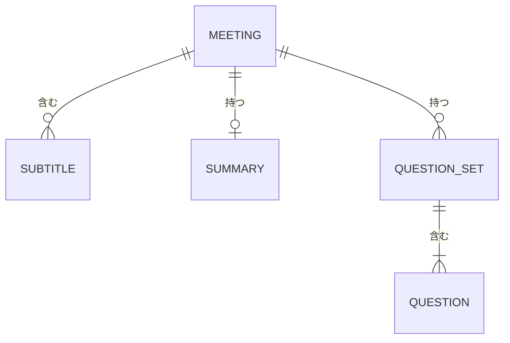

# 概念ER図

要件定義の段階の概念モデルです。項目の型と桁、保存の方式は、基本設計フェーズで確定します。

## 概念ER図

## エンティティと主要属性

| エンティティ | 日本語名 | 主要属性 | 説明 |
|---|---|---|---|
| MEETING | 会議 | タイトル、開始日時、終了日時、音声の出どころ、状態 | 1 回の会議。状態は「準備中・通訳中・中断・要約作成中・完了・要約失敗」のいずれか |
| SUBTITLE | 字幕 | 順番、英語の原文、日本語訳、話された時刻 | 字幕 1 件。英語の原文と日本語訳の組 |
| SUMMARY | 要約 | 全体の概要、話題ごとの要点、決定事項、宿題、作成日時 | 会議後の要約。1 回の会議に 1 つ。作り直すと置き換わります |
| QUESTION_SET | 質問のまとまり | 作成日時、作成した時点（会議中・会議後） | 質問作成ボタン 1 回分の質問のまとまり |
| QUESTION | 質問 | 順番、英語の質問、日本語の質問 | 質問 1 問。英語と日本語の組 |

## 関連

| 関連 | 多重度 | 説明 |
|---|---|---|
| 会議 と 字幕 | 1 対 多（0 件以上） | 会議には、話された順に字幕が増えていきます |
| 会議 と 要約 | 1 対 1（0 または 1 件） | 会議の終了後に、要約が 1 つできます |
| 会議 と 質問のまとまり | 1 対 多（0 件以上） | 利用者がボタンを押すたびに、質問のまとまりが 1 つ増えます |
| 質問のまとまり と 質問 | 1 対 多（1 件以上） | 質問のまとまりには、複数の質問が入ります |

## 保存しないもの

- 音声は保存しません。
- 画面共有で得られる映像は保存しません。

## 削除

- 利用者が会議を削除すると、その会議の字幕・要約・質問もすべて削除します。
