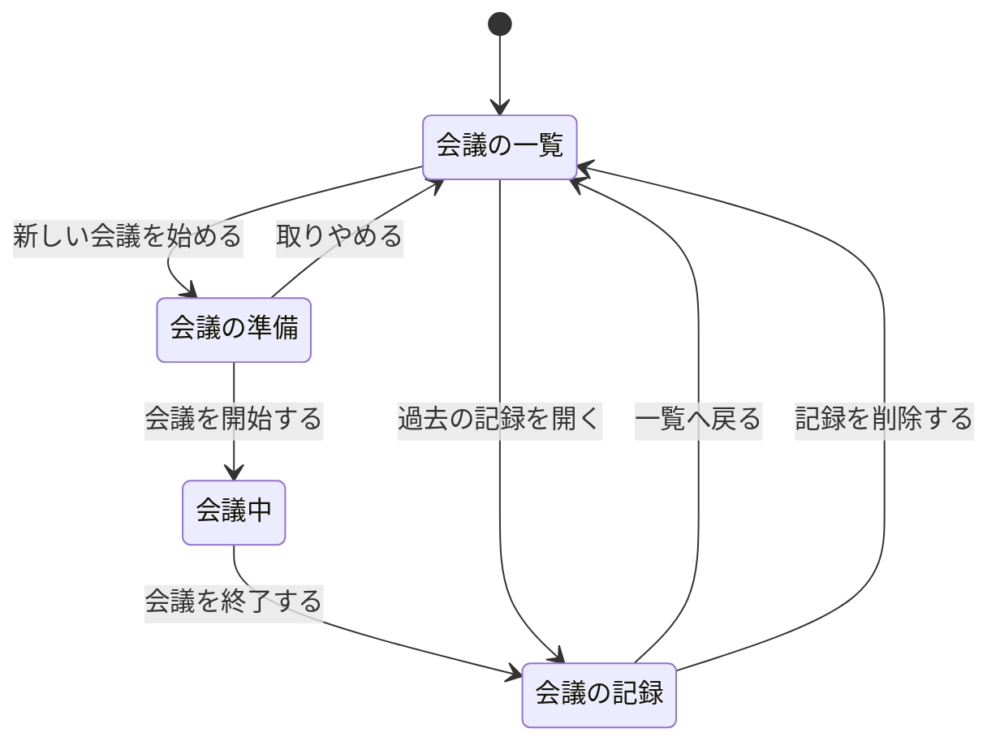
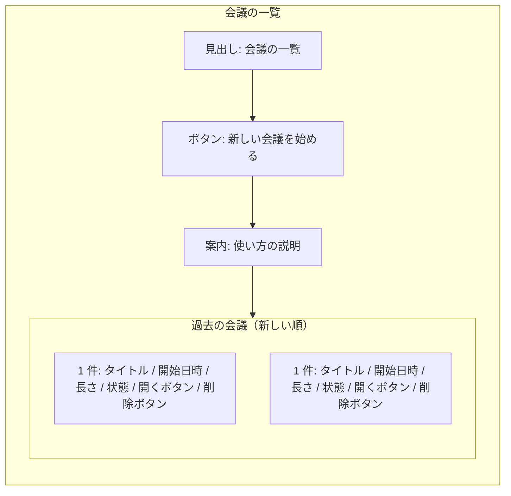
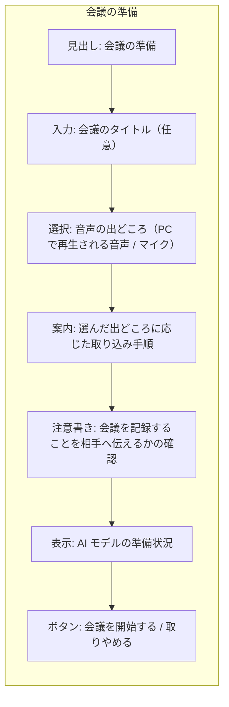
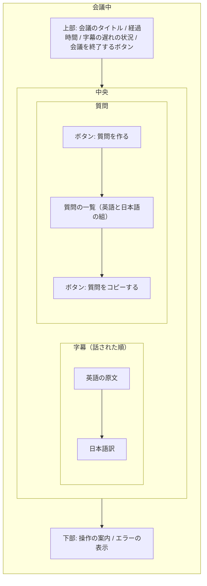
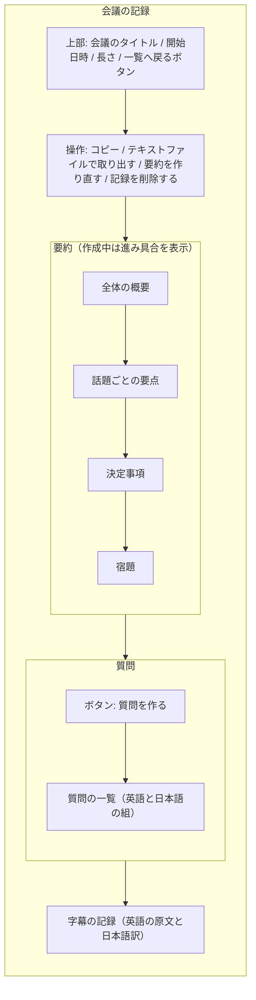

# 画面一覧・遷移図・レイアウトイメージ

要件定義の段階のイメージです。実装する画面の設計は、基本設計フェーズで確定します。

## 画面一覧

| 番号 | 画面 | 利用者が行うこと | 主な表示項目 |
|---|---|---|---|
| S-01 | 会議の一覧 | 新しい会議を始める。過去の記録を開く。記録を削除する | 会議のタイトル、開始日時、会議の長さ、状態 |
| S-02 | 会議の準備 | 音声の出どころを選ぶ。タイトルを入力する。会議を開始する | 音声の出どころの選択、取り込み手順の案内、注意書き、AI モデルの準備状況 |
| S-03 | 会議中 | 字幕を読む。質問を作る。会議を終了する | 字幕（英語の原文と日本語訳）、経過時間、字幕の遅れの状況、質問 |
| S-04 | 会議の記録 | 要約を読む。字幕と質問を見返す。質問を作る。記録を取り出す。記録を削除する | 要約（4 項目）、字幕、質問、要約の作成状況 |

- 画面の数は 4 つです。
- 記録を削除するときは、確認の表示を出します。
- 「会議の一覧」の状態には、通訳中・中断・要約作成中・完了・要約失敗のいずれかを表示します。
- 「会議の準備」では、AI モデルの入手が済むまで、会議を開始するボタンを押せません。
- 「会議中」では、字幕の遅れ、無音の待機、会議が 2 時間を超えたことの警告を表示します。
- 「会議の記録」では、中断した会議と要約に失敗した会議について、要約を作るボタンを表示します。字幕が 0 件の会議では、「内容がありません」と表示します。

## 画面遷移図

## 画面レイアウトイメージ

### S-01 会議の一覧

### S-02 会議の準備

### S-03 会議中

### S-04 会議の記録

