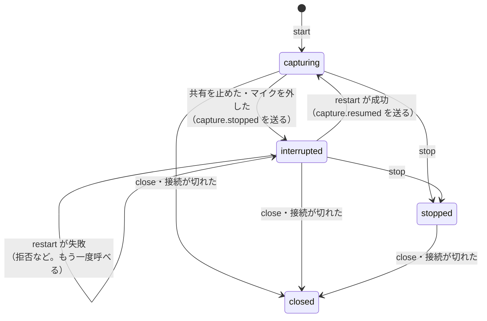

# 音声の取り込み（ブラウザー側）

ブラウザーで音声を取り込み、アプリサーバーへ送る部品です。会議管理部（アプリサーバー側）と、会議の開始の画面は、別の作業で作ります。いまのアプリの画面は、この部品をまだ使っていません。

要件と設計は、基本設計書の `functional.md`「F-01 PC で再生される音声の取り込み」「F-02 マイク音声の取り込み」と、`adr.md` の ADR-07・ADR-13 にあります。

## ファイル（`frontend/src/audio/`）

| ファイル | 役割 |
|---|---|
| `audioInput.ts` | 画面共有（`getDisplayMedia`）とマイク（`getUserMedia`）で、音声のストリームを得る。映像は受け取った直後に止めて取り除く |
| `audioErrors.ts` | 失敗の理由の種類（`AudioCaptureError`）。ブラウザーの例外の名前から分類する |
| `pcmConversion.ts` | モノラル化・16kHz への変換・16 ビット整数化・100 ミリ秒のフレーム化（純粋な計算） |
| `pcmCaptureWorklet.ts` | AudioWorklet の処理部。`pcmConversion.ts` を呼び、できたフレームをメッセージで返す |
| `audioPipeline.ts` | ストリームを処理部へつなぎ、解放する（`AudioContext`・ノード・トラック） |
| `audioSender.ts` | フレームと知らせを、WebSocket へ順番どおりに送る。詰まっても捨てない |
| `audioCaptureSession.ts` | 上を組み合わせた、会議 1 回ぶんの取り込み。停止の検知とやり直しを持つ |
| `browserEnvironment.ts` | 実際のブラウザーの部品の作り方。テストでは偽物に替える（`audioEnvironment.ts` が型） |

## 使い方

```ts
const input = await openAudioInput('system_audio'); // または 'microphone'。ブラウザーの確認が出る
const session = await AudioCaptureSession.start(
  {
    input,
    meetingId,
    handlers: {
      onCaptureStopped: () => { /* 取り込みが途中で止まった。やり直すか、会議を終えるかを選ばせる */ },
      onSocketClosed: (info) => { /* 接続が切れた。会議の中断として扱われる */ },
    },
  },
  createBrowserEnvironment(),
);

await session.restart(); // 途中で止まったあとに、同じ出どころで取り込み直す（確認がもう一度出る）
await session.stop();    // 残りの音声を送りきって止める。接続は閉じない
session.close();         // 接続を閉じる
```

- 会議番号は、会議を作ったあとに分かります。`openAudioInput` を会議の開始の前に済ませ、会議を作れなかったときは `input.stop()` で止めます。
- `start` が失敗したときは、トラック・音声の処理・接続をすべて解放してから失敗を投げます。

## アプリサーバーへ送るもの

宛先は `/ws/audio/{会議番号}` です。ページが https のときは `wss:`、それ以外は `ws:` で、ページと同じ場所へ接続します。

| 種類 | 形 | 内容 |
|---|---|---|
| 音声 | バイナリ | 16kHz・モノラル・16 ビット整数（リトルエンディアン）。圧縮しない。1 フレーム 1,600 サンプル（3,200 バイト、100 ミリ秒）。`stop` と取り込みの停止の直前だけ、100 ミリ秒に満たない最後のフレームが付く |
| 知らせ | テキスト（JSON） | `{"type":"capture.stopped"}`: 共有を止めた・マイクを外したなどで、取り込みが途中で止まった。`{"type":"capture.resumed"}`: 取り込み直せた。このあとに新しい音声が続く |

- 知らせは、前に渡した音声のあとに、同じ待ち行列から送ります。サーバーは、届いた順に読めば、停止の位置を読み違えません。
- 接続が開く前に作ったフレームは持っておき、開いたら順に送ります。ブラウザーの送信待ち（`bufferedAmount`）が 256KB（約 8 秒分）を超えている間は、自分で持ち、減ったら順に送ります。音声を捨てません。
- 利用者が `stop` で止めたときは、`capture.stopped` を送りません。

## 失敗の理由の種類

画面に出す文言は、エラーコードごとに `frontend/src/errors/errorMessages.ts` にあります。コードの意味は [errors.md](errors.md) の「音声の取り込み（AUDIO_*）」にあります。

| 場面 | 理由の種類 |
|---|---|
| 共有に音声が含まれない | `AUDIO_NO_AUDIO_SHARED` |
| 共有の取りやめ・拒否、マイクの利用の拒否 | `AUDIO_PERMISSION_DENIED` |
| マイクが見つからない | `AUDIO_MIC_NOT_FOUND` |
| 上のどれでもない（デバイスが使用中、安全な接続でないページ、処理部を読み込めない、など） | `AUDIO_CAPTURE_FAILED` |

ブラウザーが返す例外の文面は、画面にもログにも出しません。共有していたウィンドウの名前が混ざることがあるためです。

## 停止の検知とやり直し



- 取り込みが途中で止まったと分かった時点で、古い取り込みの資源（トラック・音声の処理・処理部）を解放します。残りの音声は先に送り、そのあとに `capture.stopped` を送ります。
- 接続は閉じません。同じ接続で `restart` し、`capture.resumed` のあとに新しい音声を続けます。
- `restart` は、途中で止まった状態でなければ何もしません。確認の途中で接続が閉じたときは、取り込み直した音声を止めて終わります。
- 取り込みの準備の間に共有が止まっていた場合も、見逃しません（`AudioInput.onEnded` は、登録の前に終わっていた場合、登録の直後に知らせます）。

## 変換（`pcmConversion.ts`）

- チャンネルの平均でモノラルにします。
- 16kHz への変換は、窓をかけた sinc 関数のフィルターで高い音を取り除いてから間引きます。折り返しの雑音が混ざりません（12kHz の音は、4kHz の音として混ざらずに消え、6kHz の音は 9 割以上残ることを、単体テストで確かめています）。
- 出力の位置は、入力の位置を整数の計算で求めます。44.1kHz のような割り切れない比でも、長く続けてずれません。
- 入力を何サンプルずつ渡しても、出力は同じです。AudioWorklet は 128 サンプルずつ渡します。
- 計算は 1 サンプルの出力に約 90 回の積和です（44.1kHz のとき）。リアルタイムで十分に間に合います。

## 実ブラウザーでの確認

自動テスト（Vitest）は、ブラウザーの部品を偽物に替えて確かめます。実ブラウザーでは、次の確認用のページとサーバーで確かめます。出荷するアプリには含まれません。

- ページ: `frontend/test/browser/capture-check/`。取り込みの部品を、ボタンから呼ぶだけです。「共有の停止を再現する」は、トラックを止めて `ended` のイベントを起こします（`track.stop()` だけでは、このイベントは起きないため）
- サーバー: `backend/test/browser/serve_audio_capture_check.py`。本物のアプリ（`create_app`）に、確認用の経路を 2 つ足します。接続制限と応答ヘッダー（CSP）はアプリのものを使い、緩める設定はありません。受け取った音声の要約（フレームの数と大きさ、到着の間隔、最も強い周波数、知らせが届いた位置）を、`/api/check/received/{会議番号}` と、接続が閉じたときの標準出力に出します

手順（開発用コンテナで実行します。`<コンテナ名>` は `hostname` の値）:

```bash
# 1. ページをビルドする（frontend/ で実行。出力先はリポジトリの外）
../tools/with-pinned-node.sh npx vite build test/browser/capture-check --outDir /tmp/mmd-capture-check --emptyOutDir

# 2. 確認用のサーバーを起動する（backend/ で実行）
uv run python test/browser/serve_audio_capture_check.py \
    --static-dir /tmp/mmd-capture-check --port 3102 --app-hostname <コンテナ名> --save-dir /tmp/mmd-capture-out

# 3. 音声ファイル（440Hz のステレオなど）を用意し、ブラウザーを基本設計書 ADR-13 の起動設定で開く
```

`playwright-cli` の設定ファイル（リポジトリの外に置く）の例です。通常版の Chromium または Edge を、画面なしで動かします。

```json
{
  "browser": {
    "browserName": "chromium",
    "isolated": true,
    "launchOptions": {
      "executablePath": "<Chromium または msedge の実行ファイル>",
      "headless": false,
      "chromiumSandbox": false,
      "args": [
        "--headless=new",
        "--no-sandbox",
        "--unsafely-treat-insecure-origin-as-secure=http://<コンテナ名>:3102",
        "--use-fake-ui-for-media-stream",
        "--use-fake-device-for-media-stream",
        "--use-file-for-fake-audio-capture=<音声ファイル.wav>"
      ]
    }
  }
}
```

`playwright-cli open --config=<設定ファイル> http://<コンテナ名>:3102/` で開き、ボタンを押します。`localhost` は安全な接続として扱われるため、設定なしでも開けますが、ADR-13 の構成（コンテナ名で接続）で確かめます。

開発用コンテナに Edge は入っていません。Microsoft の公式の apt リポジトリ（`https://packages.microsoft.com/repos/edge/`）の `Packages` に書かれた `microsoft-edge-stable` の SHA-256 と、取得した .deb の `sha256sum` が一致することを確かめてから、空のフォルダーへ `dpkg -x` で展開します。システムへはインストールしません。

### 確かめた結果

2026-11-05 に、開発用コンテナ（Linux）で、Chromium 156 と Edge 155（155.0.4283.62）の両方で同じ結果でした。入力は 48kHz・ステレオ・440Hz の正弦波です。

| 確認 | 結果 |
|---|---|
| PC の音声（画面共有） | 状態は取り込み中。トラックは音声 1 本、映像 0 本。3,200 バイトのフレームが届き、到着の間隔の中央値は 99.5〜100.1 ミリ秒。最も強い周波数は 440Hz |
| 変換の正確さ | 25.7 秒分を保存して測ると、最も強い周波数は 439.97Hz。取り込んだ時間（約 25.8 秒）と届いた音声の長さ（25.71 秒）が合い、欠落とずれは見られない |
| マイク | PC の音声と同じ結果 |
| 取り込みを止める | 残りの音声（100 ミリ秒に満たないフレーム）が届き、接続は正常に閉じる（`capture.stopped` は届かない） |
| 共有の停止を再現 | 状態が `interrupted` になる。最後のフレームのあとに `capture.stopped` が届く。音声は増えない。接続は 1 本のまま |
| やり直し | 同じ出どころで取り込み直し、`capture.resumed` のあとに音声が続く。接続は 1 本のまま |
| 失敗の分類 | 疑似デバイスなしのマイクで `AUDIO_MIC_NOT_FOUND`、疑似デバイスなしの画面共有で `AUDIO_CAPTURE_FAILED`（`NotReadableError`） |

### 確かめていないこと

- 利用者の Windows の Edge で、実際の PC の音声を取り込む動作。自動の入力では確かめられません（ADR-13）
- 実際のブラウザーの確認で、共有を取りやめたとき（`AUDIO_PERMISSION_DENIED`）と、共有に音声が含まれないとき（`AUDIO_NO_AUDIO_SHARED`）の分類。疑似の入力は常に音声付きで許可されるため、この環境では再現できませんでした。単体テストで、ブラウザーが返す例外の名前から分類することを確かめています
- 会議の開始の画面と、アプリサーバー側で音声を受け取る経路。別の作業で作ります

## ビルドでの扱い

処理部のファイルは、`pcmCaptureWorkletUrl.ts` の `?worker&url` で、別のファイル（`assets/pcmCaptureWorklet-*.js`）として出力されます。アプリサーバーが同じ場所から配信するため、応答ヘッダー（CSP）の `script-src 'self'` のもとで読み込めます。`blob:` の URL と `data:` の URL は、CSP が止めるため使いません。

いまのアプリの画面は、取り込みの部品を読み込んでいないため、`npm run build` の出力（`dist/`）に処理部のファイルは出ません。画面が読み込むと出ます。確認用ページのビルドでは、出力されることを確かめています。
