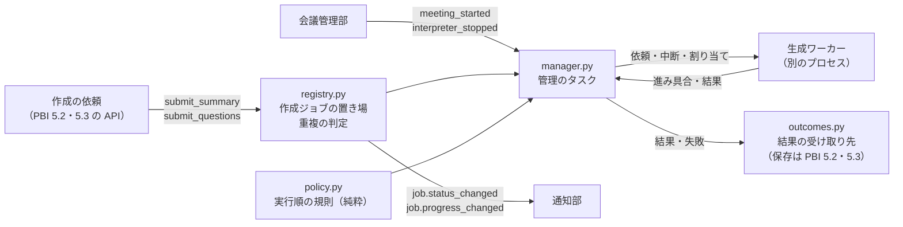

# 作成ジョブ管理部（要約と質問の作成）

要約と質問の作成を受け付け、決めた順に 1 件ずつ、生成ワーカーで実行する部です。コードは `backend/src/meeting_interpreter/jobs/` にあります。実行順の出どころは、基本設計書の横断設計規約「AI 処理の同時実行」と ADR-12 です。

## できること

| やること | 動き |
|---|---|
| 受け付け | `submit_summary(会議番号, ブロック)`・`submit_questions(会議番号, 質問の入力)`。同じ会議の同じ種類で、待機中か作成中のジョブがあれば、新しく作らず、そのジョブを返す（返り値の `created` が `False`） |
| 1 件ずつ実行 | 作成中のジョブは同時に 1 件。ほかは待機中 |
| 実行順 | 質問を要約より先に。同じ種類は受け付けた順 |
| 順番を譲る | 作成中の要約は、質問が待っていれば、ブロックの区切りで止まって待機中へ戻る。質問のあと、続きのブロックから再開する |
| 後回し | 通訳中の会議がある間は、要約の新しいブロックを始めない。作成中の要約は、区切りで止めて待機中へ戻し、会議の終了または中断のあと、続きから再開する |
| 生成ワーカーの起動と停止 | 実行できるジョブが出たら起動し、無くなったら止める。後回しの要約だけが残る間は、止めたまま |
| 失敗 | 生成ワーカーが止まったら、作成中のジョブを失敗にする。待機中のジョブは、新しいワーカーで続く |
| 有無の取得 | `has_active_job(会議番号)`。待機中か作成中のジョブがあれば真。どのスレッドからでも答えられる |

作成ジョブは保存しません（ADR-12）。アプリが止まると消えます。アプリが止まったあとの要約作成中の会議は、起動時の復旧（PBI 7.1）が要約失敗に直します。

## 構成



| ファイル | 役割 |
|---|---|
| `models.py` | 種類・状況・スナップショット・待ち時間の計算（`JobTimeline`） |
| `registry.py` | メモリの上の置き場。鍵で守る。重複の判定と、状況の変更 |
| `notices.py` | 通知 `job.status_changed`・`job.progress_changed` |
| `policy.py` | 実行順の規則。純粋な関数 `pick_next`・`yield_reason`・`needs_worker`。規則を見直すときは、このファイルだけを変える |
| `manager.py` | 管理のタスク。出来事（受け付け・会議の知らせ・ワーカーのメッセージ）のたびに、現在の状態から、やるべきことを決め直す |
| `workers.py` | 生成ワーカーの起動の入口。本番は `ProductionGenerationLauncher`、テストは偽のエンジンの入口を渡す |
| `outcomes.py` | 結果（要約・質問・要約の失敗）の受け取り先の窓口 |
| `errors.py` | `SUMMARY_*`・`QUESTION_*` のエラー（`docs/errors.md`） |

## 会議管理部とのつなぎ

会議管理部（`MeetingManager`）が、次の 2 つを作成ジョブ管理部へ知らせます（`create_app` が配線します）。

| 知らせ | 呼ぶ時点 |
|---|---|
| `meeting_started(会議番号)` | 会議を開始し、通訳ワーカーの起動を始めたあと |
| `interpreter_stopped(会議番号)` | 通訳ワーカーを止めたあと。会議の終了でも中断でも、1 回だけ。**要約を始める呼び出し（`on_meeting_ended`）より先に呼ぶ** |

`interpreter_stopped` が先に届くため、会議の終了の直後は、通訳ワーカーを止めてから、要約を始められます（2 つのワーカーのメモリが重ならない）。この順は `test/meeting_interpreter/jobs/test_job_meeting_integration.py` が確かめます。

## 結果の受け取り先（PBI 5.2・5.3 が足す部分）

結果の保存と、会議の状態の変更は、この部では行いません。`JobOutcomeHandler`（`outcomes.py`）を実装した受け取り先を、`create_app(..., job_outcomes=...)` に渡します。省略すると、結果を捨てます。

| 窓口 | 呼ぶ時点 | 受け取り先がやること |
|---|---|---|
| `summary_ready(会議番号, 要約)` | 要約ができた | 要約を保存し、会議の状態を `completed` にする（PBI 5.2 の Task 5.2.3） |
| `questions_ready(会議番号, 質問の組)` | 質問ができた | 質問のまとまりを保存する（Task 5.3.2） |
| `summary_failed(会議番号, エラーコード)` | 要約が失敗した | 会議の状態を `summary_failed` にし、失敗理由を保存する（Task 5.2.3）。質問の失敗は、会議の状態を変えないため、呼ばない |

窓口の呼び出しが終わってから、ジョブを完了にして `job.status_changed`（`succeeded`）を通知します。窓口が例外を起こしたときは、ジョブを `*_SAVE_FAILED` で失敗にします。

作成を依頼する側（API）は、入力を組み立てて渡します。要約は `generation.inputs.split_into_blocks`、質問は `build_question_input` を使います。会議の状態を先に `summarizing` に変えてから `submit_summary` を呼ぶのは、依頼する側の役目です（Task 5.2.1）。

## 通知

| 通知 | 項目 |
|---|---|
| `job.status_changed` | `meeting_id`・`job_type`（`summary` か `questions`）・`status`（`queued`・`running`・`succeeded`・`failed`）・`done_blocks`・`total_blocks`（質問は `null`） |
| `job.progress_changed` | 同じ項目。要約で、処理したブロックの数が変わったとき |
| `error.occurred` | 失敗したとき。`meeting_id`・`category`・`code`・`message`・`action` |

受け付け・開始・順番を譲った・後回し・再開・完了・失敗のたびに `job.status_changed` が出ます。順番を譲ったときと後回しにしたときは、`queued` に戻ります。待機中の理由（ほかの作成か、進行中の会議か）の項目は、Task 5.2.4 が足します。

## 処理ログ

作成ジョブの記録は、次の `process_type` で処理ログに出ます。どの記録も、会議番号・処理の識別子（受け付けから終了まで同じ）・種類（`job_type`）・その時点の状況（`job_status`）・受け付けからの時間（`duration_ms`）・そのうち順番を待った時間（`wait_ms`）・件数（`item_count`: 要約のブロックの数）・文字数（`char_count`: 入力の合計）を持ちます。本文は入れません。

| `process_type` | 出す時点 |
|---|---|
| `job_accepted` | 受け付けた（重複で既存のジョブを返したときは出さない） |
| `job_started` | 初めて作り始めた。`wait_ms` が、初めて開始するまでに待った時間 |
| `job_yielded` | 質問に順番を譲って、待機中へ戻った |
| `job_postponed` | 通訳中の会議のために後回しにして、待機中へ戻った |
| `job_resumed` | 譲った・後回しにした要約を再開した。`wait_ms` に、待機中へ戻っていた間も入る |
| `job_finished` | 完了または失敗。`duration_ms` が受け付けから終了までの時間、`wait_ms` がそのうち順番を待った時間。このジョブのために生成ワーカーを起動したときは、`startup_ms`（起動の時間。モデルの読み込みを含む）と `load_ms`（そのうち、モデルの読み込みの時間）も入る |
| `generation_worker_started` | 生成ワーカーが準備完了になった。`duration_ms` が起動から準備完了まで、`load_ms` がモデルの読み込み |

区間の切り分け（質問の作成による区間・ほかの会議の要約による区間）は、これらの日時を使って Epic 8 の集計で行います。要約の作成時間の起点は、会議の終了では「届いている音声を字幕にし終えた時点」、会議後では「要約を作るボタンを押した時点」です。いまの記録は、受け付けた時点から数えます（受け付ける側が、起点の時点に受け付けます）。

**まだ記録していないもの**: 作成ジョブの終了時の、プロセスごとのメモリの使用量です。暫定版では PBI 4.1 を後回しにしたため、含めていません。PBI 4.1 の Task 4.1.3 を作るときに、`manager.py` の `_log_job`（`job_finished` のとき）に足します。

## 時間の調整値

| 項目 | 既定 | 意味 |
|---|---|---|
| `generation_start_timeout_seconds` | 300 秒 | 生成ワーカーが準備完了になるまで待つ秒数（モデルの読み込みを含む）。実測は 31〜39 秒 |

## 自動テスト

`backend/` で次を実行します。

```sh
uv run pytest test/meeting_interpreter/jobs
```

生成ワーカーは、同じプロセスの中で動かす偽（`backend/test/job_fakes.py` の `InProcessLauncher`）に替えます。ワーカーの本体とブロックの扱いは本物と同じで、文章生成だけが偽です。`BlockGate` で、要約を決めたブロックで止めて、ブロックの区切りの動きを確かめます。強制終了は、別のプロセスの生成ワーカー（偽のエンジン）に `SIGKILL` を送って確かめます（`ProcessLauncher`）。

## 確かめていないこと

- 本物の AI モデルで、順番を譲る・後回しにする・再開する動き。ブロックの途中で打ち切らず、区切りで譲るため、質問が待つ時間は、ブロック 1 つの処理時間で決まります。質問の作成時間の目標（3 分）に収まるかは、実際の PC での測定（Epic 8）で確かめます
- 会議中に質問を作っている間の字幕の遅れ（CPU の割り当て 2 スレッド・優先度 10 は仮置き）。測定は Task 5.3.3 で行います
