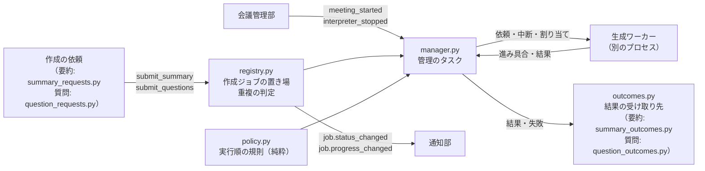
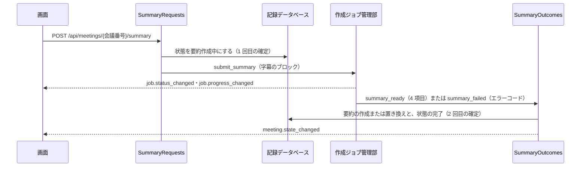
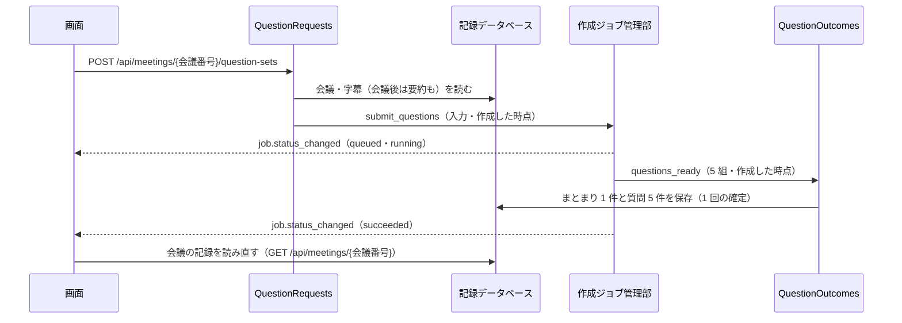

# 作成ジョブ管理部（要約と質問の作成）

要約と質問の作成を受け付け、決めた順に 1 件ずつ、生成ワーカーで実行する部です。コードは `backend/src/meeting_interpreter/jobs/` にあります。実行順の出どころは、基本設計書の横断設計規約「AI 処理の同時実行」と ADR-12 です。

## できること

| やること | 動き |
|---|---|
| 受け付け | `submit_summary(会議番号, ブロック)`・`submit_questions(会議番号, 質問の入力, 作成した時点)`。同じ会議の同じ種類で、待機中か作成中のジョブがあれば、新しく作らず、そのジョブを返す（返り値の `created` が `False`） |
| 1 件ずつ実行 | 作成中のジョブは同時に 1 件。ほかは待機中 |
| 実行順 | 質問を要約より先に。同じ種類は受け付けた順 |
| 順番を譲る | 作成中の要約は、質問が待っていれば、ブロックの区切りで止まって待機中へ戻る。質問のあと、続きのブロックから再開する |
| 後回し | 通訳中の会議がある間は、要約の新しいブロックを始めない。作成中の要約は、区切りで止めて待機中へ戻し、会議の終了または中断のあと、続きから再開する |
| 生成ワーカーの起動と停止 | 実行できるジョブが出たら起動し、無くなったら止める。後回しの要約だけが残る間は、止めたまま |
| 失敗 | 生成ワーカーが止まったら、作成中のジョブを失敗にする。待機中のジョブは、新しいワーカーで続く |
| 有無の取得 | `has_active_job(会議番号)`。待機中か作成中のジョブがあれば真。どのスレッドからでも答えられる |

作成ジョブは保存しません（ADR-12）。アプリが止まると消えます。アプリが止まったあとの要約作成中の会議は、起動時の復旧（PBI 7.1）が要約失敗に直します。

## 構成



| ファイル | 役割 |
|---|---|
| `models.py` | 種類・状況・スナップショット・待ち時間の計算（`JobTimeline`） |
| `registry.py` | メモリの上の置き場。鍵で守る。重複の判定と、状況の変更 |
| `notices.py` | 通知 `job.status_changed`・`job.progress_changed` |
| `policy.py` | 実行順の規則。純粋な関数 `pick_next`・`yield_reason`・`needs_worker`・`wait_reason`（待機中の理由）。規則を見直すときは、このファイルだけを変える |
| `manager.py` | 管理のタスク。出来事（受け付け・会議の知らせ・ワーカーのメッセージ）のたびに、現在の状態から、やるべきことを決め直す |
| `workers.py` | 生成ワーカーの起動の入口。本番は `ProductionGenerationLauncher`、テストは偽のエンジンの入口を渡す |
| `outcomes.py` | 結果（要約・質問・要約の失敗）の受け取り先の窓口（`JobOutcomeHandler`）。要約用と質問用をまとめる `JobOutcomes`。受け取り先が結果を決めた形に合わないとして断る `OutcomeRejected` |
| `summary_requests.py` | 要約を作る・作り直す依頼の受け付け（`SummaryRequests`）。状態を「要約作成中」に確定してから、ジョブを登録する。会議の終了の直後の自動の作成も、ここから行う |
| `summary_outcomes.py` | 要約の結果の保存（`SummaryOutcomes`）。要約と状態の完了を 1 回の確定で保存し、失敗では状態と失敗理由を保存する |
| `question_requests.py` | 質問を作る依頼の受け付け（`QuestionRequests`）。会議の状態を問わず、字幕が 1 件以上あれば受け付ける。会議の状態は変えない |
| `question_outcomes.py` | 質問の結果の保存（`QuestionOutcomes`）。質問のまとまり 1 件と質問 5 件を 1 回の確定で保存する |
| `meeting_state.py` | 作成ジョブ管理部が会議の状態を変えたときの通知 `meeting.state_changed` |
| `errors.py` | `SUMMARY_*`・`QUESTION_*` のエラー（`docs/errors.md`） |

## 会議管理部とのつなぎ

会議管理部（`MeetingManager`）が、次の 2 つを作成ジョブ管理部へ知らせます（`create_app` が配線します）。

| 知らせ | 呼ぶ時点 |
|---|---|
| `meeting_started(会議番号)` | 会議を開始し、通訳ワーカーの起動を始めたあと |
| `interpreter_stopped(会議番号)` | 通訳ワーカーを止めたあと。会議の終了でも中断でも、1 回だけ。**要約を始める呼び出し（`on_meeting_ended`）より先に呼ぶ** |

`interpreter_stopped` が先に届くため、会議の終了の直後は、通訳ワーカーを止めてから、要約を始められます（2 つのワーカーのメモリが重ならない）。この順は `test/meeting_interpreter/jobs/test_job_meeting_integration.py` が確かめます。

## 要約の依頼と保存

要約の作成は、2 回に分けて確定します（横断設計規約「保存の単位と順序」）。作成の途中でアプリが止まっても、状態（要約作成中）から失敗を判断できます。



| 入口 | 動き |
|---|---|
| `POST /api/meetings/{会議番号}/summary`（202） | 中断・要約失敗・完了の会議で、字幕が 1 件以上あるとき受け付ける。同じ会議の要約が待機中か作成中なら、状態も字幕も見ずに、そのジョブを返す（重複を防ぐ規約。遷移規則より先）。字幕が 0 件は `SUMMARY_NO_CONTENT`、遷移規則に無い状態は `MEETING_INVALID_TRANSITION`、会議が無いときは `MEETING_NOT_FOUND`。応答は、会議と作成ジョブ（種類・状況・進み具合・待機中の理由） |
| 会議の終了（`on_meeting_ended`） | 字幕が 1 件以上の会議は、終了の保存で状態が要約作成中になっている。`SummaryRequests.start_after_meeting_end` が、状態は変えずに、ジョブを登録する。字幕が 0 件の会議は完了のままで、要約を作らない。中断した会議は、自動では作らない |

結果の受け取り先は `JobOutcomeHandler`（`outcomes.py`）です。`create_app` は、既定で、`SummaryOutcomes`（要約）と `QuestionOutcomes`（質問）を `JobOutcomes` にまとめて渡します（`create_app(..., job_outcomes=...)` で替えられます）。

| 窓口 | 呼ぶ時点 | `SummaryOutcomes` がやること |
|---|---|---|
| `summary_ready(会議番号, 要約)` | 要約ができた | 要約の作成または置き換えと、状態の `completed` への変更を、1 回の確定で行う。失敗理由も空になる。空の項目は「該当なし」にする。処理ログ `summary_saved`（文字数だけ。本文なし）を出し、`meeting.state_changed` を通知する |
| `summary_failed(会議番号, エラーコード)` | 要約が失敗した | 状態を `summary_failed` にし、失敗理由を保存し、`meeting.state_changed` を通知する。要約には触れないため、作り直しの失敗では、前の要約が残る |

状態を変える前に、遷移規則の表（`meetings/transitions.py`）で確かめます。窓口の呼び出しが終わってから、ジョブを完了にして `job.status_changed`（`succeeded`）を通知します。窓口が例外を起こしたとき（保存の失敗）は、ジョブを `SUMMARY_SAVE_FAILED` で失敗にし、状態を要約失敗にします。ジョブを登録できなかったとき（会議の終了のあとに字幕を読み出せない、など）も、`SUMMARY_GENERATION_FAILED` で要約失敗にして、`error.occurred` を通知します。

## 質問の依頼と保存

質問の作成は、要約と違い、会議の状態を変えません。質問が失敗しても、会議の状態は変わらず、利用者はもう一度押せます。



| 入口 | 動き |
|---|---|
| `POST /api/meetings/{会議番号}/question-sets`（202） | 会議の状態を問わず、字幕が 1 件以上あれば受け付ける。同じ会議の質問が待機中か作成中なら、字幕も見ずに、そのジョブを返す（重複を防ぐ規約）。字幕が 0 件（空白だけを含む）は `QUESTION_NO_CONTENT`（409）、会議が無いときは `MEETING_NOT_FOUND`（404）。応答は、作成ジョブ（`job`）だけ。会議の状態は変わらない |

- 作成した時点は、依頼を受けた時点の会議の状態で決めます。通訳中なら `during_meeting`、それ以外は `after_meeting`。作成が終わる前に会議の状態が変わっても、依頼のときの値を保存します（作成ジョブが持ちます）。
- 入力は 3 つの場面で組み立てます（`generation/inputs.py` の `build_question_input`）。通訳中は、その時点までの字幕（量の上限を超えるときは直近）。会議後で要約があるときは、要約と直近の字幕。会議後で要約が無いときは、字幕（直近）。要約の作り直し中（状態が要約作成中）は、前の要約があればそれを使います。量の上限は調整値 `generation_input_max_chars` です。
- 処理ログの受け付け（`job_accepted`）は、ジョブを登録した時点で出ます。質問の作成時間の目標（ボタンを押してから 3 分以内）は、この受け付けから数えます。
- 保存は `RecordStore.save_question_set`（質問の完成の 1 回の確定）です。まとまりの順番は、同じ確定の中で、その会議の最大 + 1 を振ります（1 から始まり、欠けず重ならない）。5 組に満たない・1 問が 500 文字を超える・確定に失敗する場合は、1 問も保存しません。保存後に、処理ログ `question_set_saved`（件数 5。本文なし）を出し、ジョブを完了にして `job.status_changed`（`succeeded`）を通知します。画面は、この通知で会議の記録を読み直します。
- 失敗の分け方: 5 組に満たない・桁の上限を超える（生成ワーカーの検証をすり抜けた場合）は `QUESTION_GENERATION_FAILED`、保存の失敗は `QUESTION_SAVE_FAILED`、生成ワーカーが止まったときは `QUESTION_WORKER_STOPPED`。どれも `error.occurred` で通知し、ジョブは `failed` です。質問は 1 問も保存せず、会議の状態も変えません。
- 質問は、文字として保存し、文字として返します。HTML や記号の変換はしません。表示は、画面が文字として行います（ADR-15）。

## 会議中の CPU の割り当て

通訳中の会議がある間は、生成ワーカーの CPU の割り当て（スレッド数と nice 値）を「会議中」にして、字幕の処理（通訳ワーカー）を優先します。

| 場面 | 動き |
|---|---|
| 通訳中の会議があるときに、生成ワーカーを起動する | `Start` の `cpu_mode` を「会議中」にして起動する（`manager.py` の `_start_worker`） |
| 作成中に、会議が始まる・終わる（中断を含む） | `meeting_started`・`interpreter_stopped` のあとの決め直し（`_sync_cpu`）で、ワーカーへ `SetCpu` を頼む。ワーカーは、次の文章生成の前に反映する（生成の途中では変えない） |
| 作成が終わり、実行できるジョブが無くなる | ワーカーを止める。次の起動は、そのときの会議の有無で割り当てを決める（会議中の割り当てが残らない） |

会議中に質問を作っているあいだの状況は、`job.status_changed`（`job_type` が `questions`、`status` が `running`）で届きます。画面が「字幕が遅れることがあります」を出す根拠です（表示は会議中の画面の作業）。

自動テスト: `test/meeting_interpreter/jobs/test_question_cpu_allocation.py`（会議管理部と作成ジョブ管理部をつなぎ、本物の uvicorn で動かす結合テスト）。

### 会議中に質問を作ったときの測定

測定道具は `backend/test/measure/measure_question_during_meeting.py`（使い方は先頭の説明）。出荷するコンテナ（本物のモデル）へつなぎ、英語の音声（約 11 秒の短い音声を繰り返し）を実際の速さで 540 秒送り、開始から 60 秒後に質問を 1 回依頼します。割り当ては調整値のまま（通訳ワーカー 6 スレッド、生成ワーカー 2 スレッド・nice 10）です。

2026-11-12 に 1 回測りました。この 1 回の測定では、壁時計が単調増加時計より 22.34 秒進んでいて、測定道具が「字幕の遅れは信用できない」と判定しました。次の値は参考です。

| 項目 | 値 |
|---|---|
| 質問の依頼から作成中になるまで（生成ワーカーの起動を含む） | 63.5 秒 |
| 質問の依頼から完了まで | 228.4 秒（目標は 3 分以内） |
| 字幕の遅れ（依頼の前） | 平均 7.6 秒、最大 10.9 秒 |
| 字幕の遅れ（依頼から完了まで） | 平均 47.8 秒、最大 74.7 秒 |
| 字幕の遅れ（完了のあと） | 平均 38.7 秒、最大 73.9 秒 |
| 完了から、遅れが 10 秒以内の字幕が届くまで | 216.1 秒 |

利用者は、質問の作成中に字幕が遅れることを了承済みです。ただし、この測定では、完了から 216 秒たってようやく遅れが戻りました。戻るまでの時間の確認（確認事項 13）では、時計の飛びが無い状態で測り直してください。原因（スレッド数・nice 値・メモリの競合のどれか）は調べていません。

## 通知

| 通知 | 項目 |
|---|---|
| `job.status_changed` | `meeting_id`・`job_type`（`summary` か `questions`）・`status`（`queued`・`running`・`succeeded`・`failed`）・`done_blocks`・`total_blocks`（質問は `null`）・`wait_reason`（待機中の理由） |
| `job.progress_changed` | 同じ項目。要約で、処理したブロックの数が変わったとき |
| `error.occurred` | 失敗したとき。`meeting_id`・`category`・`code`・`message`・`action` |

受け付け・開始・順番を譲った・後回し・再開・完了・失敗のたびに `job.status_changed` が出ます。順番を譲ったときと後回しにしたときは、`queued` に戻ります。

`wait_reason` は、待機中の間、何を待っているかを示します。

| 値 | 意味 |
|---|---|
| `other_job` | ほかの作成が作成中、またはほかの作成が先に実行される |
| `meeting_in_progress` | 通訳中の会議がある（要約の新しいブロックを始めない）。会議の終了または中断のあとに作る |
| `null` | 順番を待っていない（作成中・完了・失敗、または次に実行される） |

理由は、ほかの作成の終わりや、会議の開始と終了で変わります。状況が変わらなくても、理由が変われば、`job.status_changed` をもう一度出します。そのため、同じ `queued` の通知が続けて届くことがあります。進み具合は、要約でブロックを 1 つ処理するたびに `job.progress_changed` で届きます（時間の予測は出しません）。

画面を開いた時点・再接続の時点では、会議ごとの待機中と作成中のジョブを `JobManager.active_jobs(会議番号)` で取得できます（通知と同じ項目は `jobs/notices.py` の `job_payload`）。この取得を会議の取得 API（Task 5.4.1）の応答に含めます。いまは、要約の依頼の応答（`POST /api/meetings/{会議番号}/summary`）だけが、作成ジョブを返します。

## 処理ログ

作成ジョブの記録は、次の `process_type` で処理ログに出ます。どの記録も、会議番号・処理の識別子（受け付けから終了まで同じ）・種類（`job_type`）・その時点の状況（`job_status`）・受け付けからの時間（`duration_ms`）・そのうち順番を待った時間（`wait_ms`）・件数（`item_count`: 要約のブロックの数）・文字数（`char_count`: 入力の合計）を持ちます。本文は入れません。

| `process_type` | 出す時点 |
|---|---|
| `job_accepted` | 受け付けた（重複で既存のジョブを返したときは出さない） |
| `job_started` | 初めて作り始めた。`wait_ms` が、初めて開始するまでに待った時間（生成ワーカーの起動の時間は入らない） |
| `job_yielded` | 質問に順番を譲って、待機中へ戻った |
| `job_postponed` | 通訳中の会議のために後回しにして、待機中へ戻った |
| `job_resumed` | 譲った・後回しにした要約を再開した。`wait_ms` に、待機中へ戻っていた間も入る |
| `job_finished` | 完了または失敗。`duration_ms` が受け付けから終了までの時間、`wait_ms` がそのうち順番を待った時間（生成ワーカーの起動の時間は入らない。起動は待機中のまま行うが、待った時間と分けて数える）。このジョブのために生成ワーカーを起動したときは、`startup_ms`（起動の時間。モデルの読み込みを含む）と `load_ms`（そのうち、モデルの読み込みの時間）も入る |
| `generation_worker_started` | 生成ワーカーが準備完了になった。`duration_ms` が起動から準備完了まで、`load_ms` がモデルの読み込み |

区間の切り分け（質問の作成による区間・ほかの会議の要約による区間）は、これらの日時を使って Epic 8 の集計で行います。要約の作成時間の起点は、会議の終了では「届いている音声を字幕にし終えた時点」、会議後では「要約を作るボタンを押した時点」です。いまの記録は、受け付けた時点から数えます（受け付ける側が、起点の時点に受け付けます）。

**まだ記録していないもの**: 作成ジョブの終了時の、プロセスごとのメモリの使用量です。暫定版では PBI 4.1 を後回しにしたため、含めていません。PBI 4.1 の Task 4.1.3 を作るときに、`manager.py` の `_log_job`（`job_finished` のとき）に足します。

## 時間の調整値

| 項目 | 既定 | 意味 |
|---|---|---|
| `generation_start_timeout_seconds` | 300 秒 | 生成ワーカーが準備完了になるまで待つ秒数（モデルの読み込みを含む）。実測は 31〜39 秒 |

## 自動テスト

`backend/` で次を実行します。

```sh
uv run pytest test/meeting_interpreter/jobs
```

生成ワーカーは、同じプロセスの中で動かす偽（`backend/test/job_fakes.py` の `InProcessLauncher`）に替えます。ワーカーの本体とブロックの扱いは本物と同じで、文章生成だけが偽です。`BlockGate` で、要約を決めたブロックで止めて、ブロックの区切りの動きを確かめます。強制終了は、別のプロセスの生成ワーカー（偽のエンジン）に `SIGKILL` を送って確かめます（`ProcessLauncher`）。

## 出荷するコンテナでの確認

2026-11-10 に、出荷するイメージを `docker compose build` で作り直し、コンテナを作り直したあと（`docker compose ps` が healthy）で、本物の AI モデルを使って確かめました。コンテナの中の Python（`/opt/venv`）で、`ProductionGenerationLauncher` と `JobManager` を直接動かし、要約と質問を作成ジョブとして受け付けました（アプリの API を通さない。要約の依頼を通した確認は、下の「要約の確認」）。

| 確かめたこと | 結果 |
|---|---|
| 生成ワーカーの起動 | 一般の利用者（uid 10001）で、`python -m meeting_interpreter.generation` が起動し、準備完了になった。モデルの読み込みは約 39 秒 |
| 実行順 | 要約を先に、質問を後に受け付けても、質問が先に完成し、要約が続いた。同じ会議の同じ種類の 2 回目の依頼は、新しく作らなかった |
| 外へ通信しない | 動いている間のワーカーを `/proc` で調べると、`Seccomp: 2`・`NoNewPrivs: 1`・ソケットのファイル記述子 0 個・`HF_HUB_OFFLINE=1` など 4 つの環境変数。停止完了の `network_attempts` は 0（質問だけの回で、停止完了の値を直接読んだ） |
| 停止 | 作成ジョブが無くなると、ワーカーのプロセスが残らず止まった |
| 結果 | 質問は 5 組が返った。要約は、4 項目の検証（空でない・桁の上限）を通り、概要は日本語だった（文面の良し悪しは確かめていない） |

最終のイメージには、C++ のコンパイラと CMake は入っていません（`which gcc cmake` が何も返さない）。

## 確かめていないこと

- 本物の AI モデルで、順番を譲る・後回しにする・再開する動き。ブロックの途中で打ち切らず、区切りで譲るため、質問が待つ時間は、ブロック 1 つの処理時間で決まります。質問の作成時間の目標（3 分）に収まるかは、実際の PC での測定（Epic 8）で確かめます
- 会議中に質問を作っている間の字幕の遅れ（CPU の割り当て 2 スレッド・優先度 10 は仮置き）。測定は Task 5.3.3 で行います

## 要約の確認（出荷するコンテナ、本物のモデル、アプリの API を通す）

2026-11-11 に、出荷するイメージを `docker compose build` で作り直し、コンテナを作り直したあと（`docker compose ps` が healthy、モデルは `ready`）で、開発用コンテナからコンテナ名で接続して確かめました。スクリプトはリポジトリに入れていません。音声は、[docs/meetings.md](meetings.md) の確認と同じ（faster-whisper の `tests/data/jfk.flac`、SHA-256 の先頭 `63a4b1e4`。前に 1 秒、後ろに 2 秒の無音を足して、実際の速さで送る）です。

| 場面 | 確かめたこと | 結果 |
|---|---|---|
| 終了 → 要約 | 会議を開始し、音声を送り、字幕が 3 件になってから `POST /api/meetings/{会議番号}/end` | 応答の状態は要約作成中。要約のジョブは、終了の直後に `queued`、生成ワーカーの起動（15 秒）のあとで `running`、終了から 178 秒で完了した。状態の通知は 通訳中 → 要約作成中 → 完了。保存は、4 項目がすべて日本語の文字を含み、失敗理由は空、要約は 1 件 |
| 作り直し | `POST /api/meetings/{会議番号}/summary` | 202。状態は要約作成中、ジョブは待機中。続けて 2 回目を依頼すると、同じジョブ（同じ識別子）が返った。完了後も要約は 1 件で、作成日時が新しくなった。状態の通知は 要約作成中 → 完了 |
| 中断 → 要約 | 音声の接続を先に閉じて中断になった会議（字幕 3 件） | 中断のあと、要約のジョブは作られなかった（自動では始まらない）。要約を作る操作のあと、受け付けから 117 秒（うち生成ワーカーの起動が 38 秒）で完了した |
| 字幕 0 件 | 無音だけを送って終了 | 状態は完了のまま。ジョブの通知は 0 件。要約を依頼すると、`SUMMARY_NO_CONTENT`（409） |
| 外へ通信しない | 生成ワーカーが動いている間の `/proc` と、コンテナの TCP 接続 | 生成ワーカーは uid 10001、`Seccomp: 2`、`NoNewPrivs: 1`、ソケット 0 個、`HF_HUB_OFFLINE=1`・`LLAMA_ARG_OFFLINE=1` など。コンテナの確立済み TCP 接続は、接続している開発用コンテナだけ（ポート 3001）。標準出力に `SYSTEM_GENERATION_NETWORK_ATTEMPT` は無い |
| ログに内容が出ない | コンテナの標準出力 70 行 | 字幕・要約・タイトルから選んだ 12 の語（英語・日本語）を検索して 0 件。警告は `SUMMARY_NO_CONTENT` の 1 件だけ。要約の保存は `summary_saved`（文字数 130 だけ）で出る |
| 出荷するコンテナへのテスト | `backend/test/container` | 20 件合格 |

確かめていないことは次のとおりです。

- 複数のブロック（長い会議）の要約を、アプリの API を通して。確認の字幕は 1 ブロックで、`job.progress_changed` は出ない（1 ブロックの要約は中間メモを作らない）。複数ブロックの進み具合の通知は、自動テスト（偽の生成）で確かめました。
- 待機中の理由が、本物のモデルで変わる様子。自動テストの偽の生成ワーカーで確かめました。
- 要約の文面の品質。概要に、簡体字の「贡献」が混ざった。文章生成モデルの出力の質の問題で、この作業では見直していません。
- 画面（ブラウザー）からの操作。この作業は、アプリサーバーの側だけです（要約を作るボタンは PBI 5.4）。
