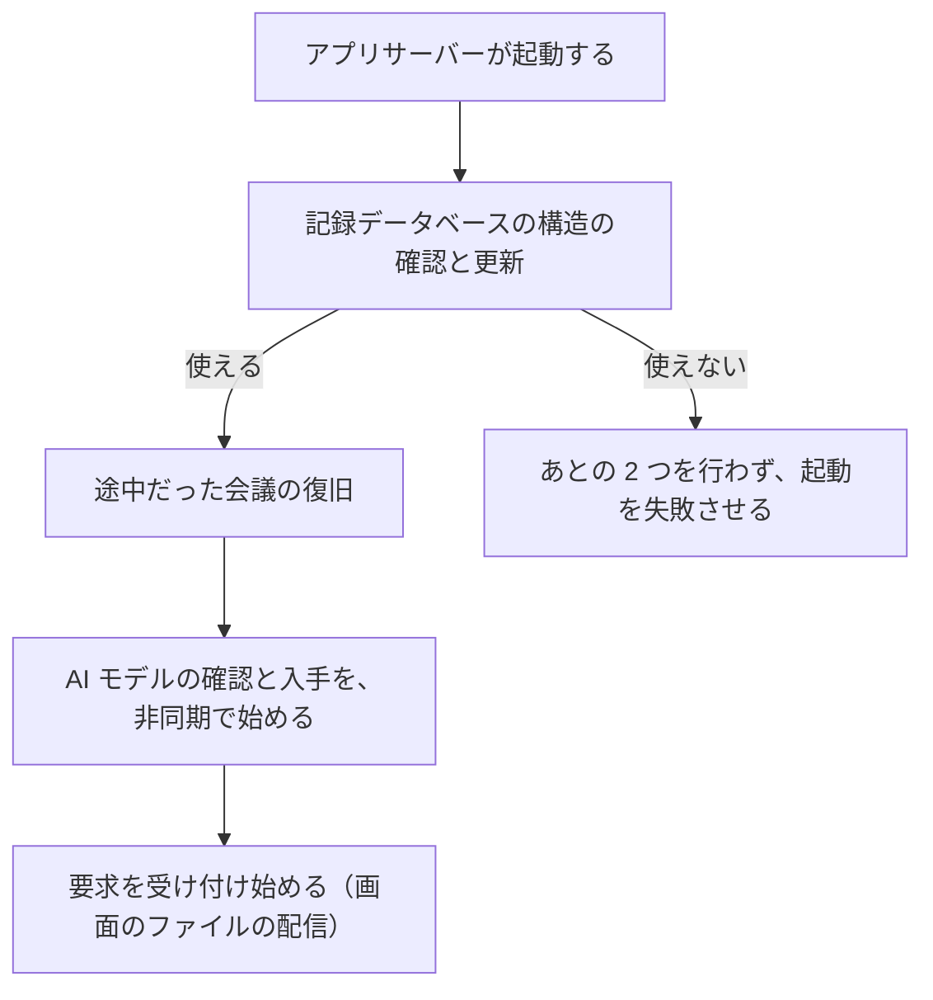
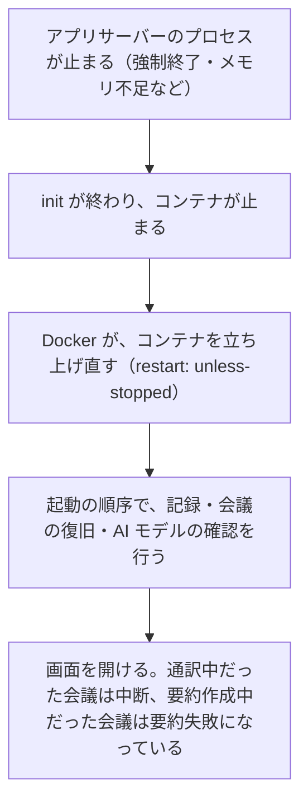

# 運用（起動の順序・自動の再起動・復旧）

アプリサーバーが起動する順序と、止まったあとの復旧の決めです。設計の根拠は、基本設計書の機能設計書 F-17「起動時の復旧」、システム構成設計書「アプリを開始できない状態」、非機能要件設計書「可用性」にあります。

## 起動の順序

アプリサーバーは、起動のたびに、次の順に 3 つの処理を行います（`backend/src/meeting_interpreter/startup.py` の `run_startup`。呼び出しは `app.py` の `_lifespan`）。

| 順 | 処理 | 受け持つ部 | 失敗したとき |
|---|---|---|---|
| 1 | 記録データベースの構造の確認と更新 | 記録保存部（`RecordDatabase.open`） | 構造の版が新しい、または版が無いのに表がある場合は、エラーログ `RECORD_SCHEMA_UNSUPPORTED` を出して、起動を失敗させる。2 と 3 は行わない |
| 2 | 途中だった会議の復旧（[docs/meetings.md](meetings.md)「起動時の復旧」） | 会議管理部（`MeetingManager.recover_on_startup`） | 記録データベースを読めないときは、起動を失敗させる。3 は行わない。ある会議の保存だけが失敗したときは、残りを直して続ける |
| 3 | AI モデルの確認と入手の開始（[docs/models.md](models.md)） | モデル管理部（`ModelManager.start`） | 確認と入手は別のタスクで動き、失敗は準備状況に出る。起動は失敗しない |

- 順序を決める理由は、1 が終わる前に記録を読み書きしないため、2 が終わる前に会議を開始できる状態にしないためです。AI モデルが準備完了になると、会議を開始できます。
- uvicorn は、起動の処理（lifespan）が終わってから、要求を受け付け始めます。そのため、最初の要求は、途中だった会議が直ったあとの記録を読みます。
- 3 は、確認と入手を始めるだけで、終わりを待ちません。画面のファイルは、AI モデルの入手の途中でも配ります。
- 1 が失敗したときに、アプリサーバーを止めずに「開始できない状態」（接続制限部と配信部だけが動き、画面にエラーコードを出す）で動かす作りは、記録データベースの構造を更新する作業が加えます。いまは、起動を失敗させます。コンテナは `restart: unless-stopped` のため、起動に失敗したあとは再起動を繰り返します。

起動のあとの停止は、進行中の会議を閉じる → 作成ジョブ管理部を止める → 通知の接続を閉じる → AI モデルの入手を中止する → 記録データベースを閉じる、の順です。

## 自動の再起動

アプリサーバーのプロセスが止まると、コンテナが自動で立ち上がり直します。

| 設定 | 場所 | 役割 |
|---|---|---|
| `restart: unless-stopped` | `docker-compose.yml` | コンテナが終わったとき、Docker が立ち上げ直す。`docker compose stop` と `docker compose down` で止めたときは立ち上げ直さない。Docker の仕様では、Docker 自体が立ち上がったときにも、止めていないコンテナを立ち上げる（この環境では確かめていない） |
| `init: true` | `docker-compose.yml` | コンテナの先頭のプロセス（PID 1）に init を置く。アプリサーバーはその子。アプリサーバーが終わると init も終わり、コンテナが止まる |
| `HEALTHCHECK` | `Dockerfile`（30 秒ごとに `GET /api/health`） | `docker compose ps` に正常かどうか（healthy）を出す。再起動のきっかけにはしない（再起動は、プロセスが終わったときだけ） |

アプリサーバーが止まってからの流れは、次のとおりです。

- 通訳ワーカーと生成ワーカーは、アプリサーバーの子のプロセスです。コンテナが止まると、一緒に終わります。
- 止まる前に画面を開いていた利用者は、通知の接続が切れ、お知らせ帯に「アプリとつながっていません」が出ます。つなぎ直しに成功すると、画面が会議の記録を読み直します。「会議中」の画面は、中断に気づいて「会議の記録」へ移ります（`useMeetingInterruption`）。「会議の記録」の画面は、状態の表示を新しくします。

## 復旧にかかる時間の測定

目標は、自動の再起動から 1 分以内に画面を開ける状態へ戻すことです（仮置き。非機能要件設計書「可用性」の目標復旧時間）。

### 測り方

出荷するコンテナ（`docker compose build` のあとに `docker compose up -d` で作り直したもの）の中で、アプリサーバーのプロセス（`python -m meeting_interpreter`）に、`kill -9` を送りました。送り終えた時点から 0.1 秒ごとに、開発用コンテナからコンテナ名の URL（`http://toshiakimamada-blip-mmd-output-system:3001`）へ要求を送り、次の 2 つの時間を測りました。

- 画面を開ける: `GET /api/health` と `GET /`（画面のファイル）の両方が 200 を返すまで
- 会議を開始できる: `GET /api/models/status` が `ready` になるまで（AI モデルの確認が終わるまで）

測定の時計は、スクリプトの単調増加時計です（日時の差ではありません）。

### 結果（2026-11-25、この開発環境）

| 場面 | 回数 | 画面を開ける | 会議を開始できる |
|---|---|---|---|
| 通訳中の会議があるとき（字幕 9 件） | 1 | 1.17 秒 | 測っていない |
| 要約作成中の会議があるとき | 1 | 1.49 秒 | 測っていない |
| 途中だった会議が無いとき | 5 回 | 1.20〜1.34 秒 | 3.19〜5.42 秒 |
| 途中だった会議が無いとき（時刻ごとの応答を記録した） | 6 回 | 0.92〜1.30 秒 | 3.07〜3.81 秒 |
| 通訳中の会議があるとき（字幕 3 件。「会議の一覧」で中断を確かめた回） | 1 | 1.13 秒 | 3.83 秒 |

- 14 回すべてで、1 分の目標に収まりました。画面を開けるまでの最大は 1.49 秒です。
- 強制終了を 14 回行い、コンテナの再起動の回数（`RestartCount`）も 14 になりました。毎回、Docker がコンテナを立ち上げ直し、アプリサーバーが新しいプロセスで起動しました。
- 1 回だけ、`GET /api/health` が 0.14 秒で 200 を返したのに、`GET /api/health` と `GET /` の両方が 200 になったのは 1.2 秒でした（上の表は、両方が 200 になった時間を使っています）。0.14 秒の応答の原因は調べていません。そのあと、時刻ごとの応答を記録して 6 回測り直しましたが、再現しませんでした。
- AI モデルの確認は、入手済みのモデルでは約 3〜5 秒です。確認の間、画面は開けますが、会議は開始できません（準備状況が「確認中」）。

### この測定が含まないもの

- 利用者の PC（Windows）での測定。目標の 1 分は仮置きのままで、実装後に利用者の PC で測り、報告します（非機能要件設計書「可用性」）
- PC の起動のあと、Docker が自動で立ち上がるまでの時間。Docker Desktop の設定に依存し、この開発環境では確かめられません。利用者の PC で確かめます。意図した測定ではありませんが、開発環境が再起動したあと（2026-11-26 08:16 JST 頃）、コンテナは自動で起動し、起動時の復旧の記録は 0 件、`GET /api/health` は 200 でした。この確認は、利用者の PC の起動とは別です
- AI モデルをまだ入手していない状態（初回の起動）。入手は約 5 分かかり、その間も画面は開けます（[docs/models.md](models.md)）
- 記録が多いときの復旧の時間。この環境の記録は 74 件で、途中だった会議 11 件を直すのに、起動の知らせから 55 ミリ秒でした（`startup_recovery` の行の時刻の差）。復旧は会議の一覧を 1 回読み、途中だった会議だけを更新するため、会議の数にほぼ比例します

## 止まった会議の確認（出荷するコンテナ）

出荷するコンテナを作り直し、`playwright-cli`（Chrome、headless、画面幅 1280）で、画面から会議を始めて確かめました。起動設定と疑似の音声は、[docs/live-screen.md](live-screen.md) の取り込み停止の確認と同じです（設定ファイルと音声ファイルはリポジトリの外）。会議は、画面の「会議の準備」から「PC で再生される音声」を選んで始めました。止めたのは、アプリサーバーのプロセスへの `kill -9` です（アプリにテスト専用の入口は足していません）。本物のモデルで動かしています。

| 場面 | 確かめたこと | 結果 | スクリーンショット（`ai_generated/screenshots/`） |
|---|---|---|---|
| 起動のとき、前の確認で残っていた要約作成中の会議 | コンテナを作り直した最初の起動の処理ログ | 要約作成中のまま残っていた会議 11 件が、要約失敗（`SUMMARY_INTERRUPTED`）になった。`startup_recovery` は、中断 0・要約失敗 11・直せなかった 0。完了 17 件・中断 46 件は変わらない | （ログと記録の確認のみ） |
| 通訳中の会議 | 「会議中」の画面（撮影の時点で字幕 5 件。止めた時点で 9 件）を開いたまま、アプリサーバーを止める | 約 1 秒後に画面を開ける状態へ戻り、開いていた「会議中」の画面が、中断に気づいて「会議の記録」へ移った。状態は中断で、お知らせ帯に `MEETING_CONNECTION_LOST`。字幕は 9 件とも残り、会議の長さは 0:00:35（終了日時 = 最後の字幕の話された時刻 `06:34:35.112`）。`startup_recovery` は、中断 1 | `pbi-7-1_01_live_before_app_stops.png`、`pbi-7-1_02_record_interrupted_after_app_restart.png` |
| 要約作成中の会議 | 会議を終了して要約作成中の「会議の記録」を開いたまま、アプリサーバーを止める | 約 1.5 秒後に画面を開ける状態へ戻り、開いていた「会議の記録」が、状態「要約失敗」と、「アプリが止まったため、要約を作れませんでした。」（`SUMMARY_INTERRUPTED`）に変わった。字幕は残り、「要約を作る」ボタンが押せる。`startup_recovery` は、要約失敗 1 | `pbi-7-1_03_record_summarizing_before_app_stops.png`、`pbi-7-1_04_record_summary_failed_after_app_restart.png` |
| 中断にした会議の一覧 | 字幕 3 件の会議を始め、アプリサーバーを止めたあと、「会議の一覧」を開く | 一覧の先頭（開始日時の新しい順）に、その会議が状態「中断」で並んだ。会議の長さは 0:00:09（最後の字幕の話された時刻まで）。「開く」と「削除」のボタンが出る | `pbi-7-1_07_meeting_list_shows_interrupted_after_app_restart.png` |
| 要約失敗にした会議から、要約を作る | 「要約を作る」を押す | 約 1 分で完了になり、要約（4 項目）ができた。要約失敗の表示と失敗理由は消えた | `pbi-7-1_05_summary_made_again_after_failure.png` |
| 中断にした会議から、要約を作る | 「要約を作る」を押す | 約 1 分で完了になり、要約ができた。終了日時は変わらない | `pbi-7-1_06_summary_made_from_interrupted_meeting.png` |

確かめていないことは次のとおりです。

- 前の要約があるときに、要約を作り直している途中で止めた場合の画面の表示。「前の要約が残ること」は、記録保存部を通す単体テストで確かめた
- 利用者の PC（Windows の Edge）での動き
- 起動時に、保存に失敗して直せない会議があるときの動き（`unrecovered_count` が 0 でない場合）。単体テストの偽の保存の失敗で確かめた
