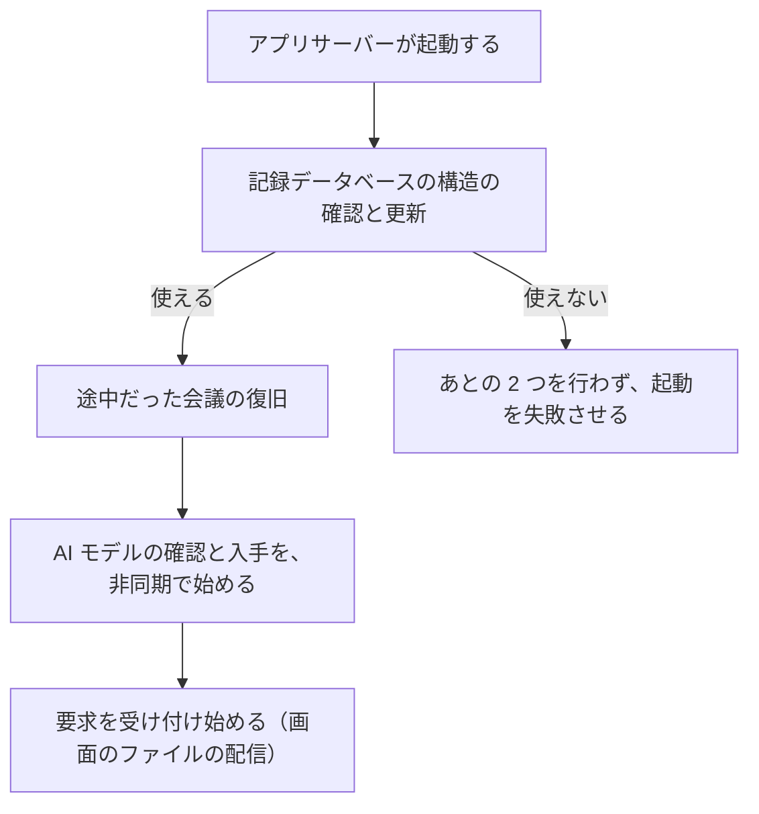

# 運用（起動の順序・自動の再起動・復旧）

アプリサーバーが起動する順序と、止まったあとの復旧の決めです。設計の根拠は、基本設計書の機能設計書 F-17「起動時の復旧」、システム構成設計書「アプリを開始できない状態」、非機能要件設計書「可用性」にあります。

## 起動の順序

アプリサーバーは、起動のたびに、次の順に 3 つの処理を行います（`backend/src/meeting_interpreter/startup.py` の `run_startup`。呼び出しは `app.py` の `_lifespan`）。

| 順 | 処理 | 受け持つ部 | 失敗したとき |
|---|---|---|---|
| 1 | 記録データベースの構造の確認と更新 | 記録保存部（`RecordDatabase.open`） | 構造の版が新しい、または版が無いのに表がある場合は、エラーログ `RECORD_SCHEMA_UNSUPPORTED` を出して、起動を失敗させる。2 と 3 は行わない |
| 2 | 途中だった会議の復旧（[docs/meetings.md](meetings.md)「起動時の復旧」） | 会議管理部（`MeetingManager.recover_on_startup`） | 記録データベースを読めないときは、起動を失敗させる。3 は行わない。ある会議の保存だけが失敗したときは、残りを直して続ける |
| 3 | AI モデルの確認と入手の開始（[docs/models.md](models.md)） | モデル管理部（`ModelManager.start`） | 確認と入手は別のタスクで動き、失敗は準備状況に出る。起動は失敗しない |

- 順序を決める理由は、1 が終わる前に記録を読み書きしないため、2 が終わる前に会議を開始できる状態にしないためです。AI モデルが準備完了になると、会議を開始できます。
- uvicorn は、起動の処理（lifespan）が終わってから、要求を受け付け始めます。そのため、最初の要求は、途中だった会議が直ったあとの記録を読みます。
- 3 は、確認と入手を始めるだけで、終わりを待ちません。画面のファイルは、AI モデルの入手の途中でも配ります。
- 1 が失敗したときに、アプリサーバーを止めずに「開始できない状態」（接続制限部と配信部だけが動き、画面にエラーコードを出す）で動かす作りは、記録データベースの構造を更新する作業が加えます。いまは、起動を失敗させます。コンテナは `restart: unless-stopped` のため、起動に失敗したあとは再起動を繰り返します。

起動のあとの停止は、進行中の会議を閉じる → 作成ジョブ管理部を止める → 通知の接続を閉じる → AI モデルの入手を中止する → 記録データベースを閉じる、の順です。
