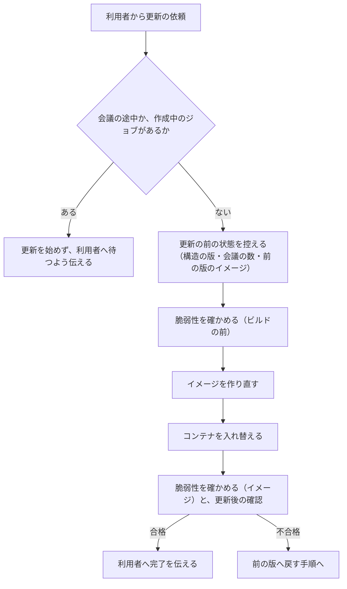
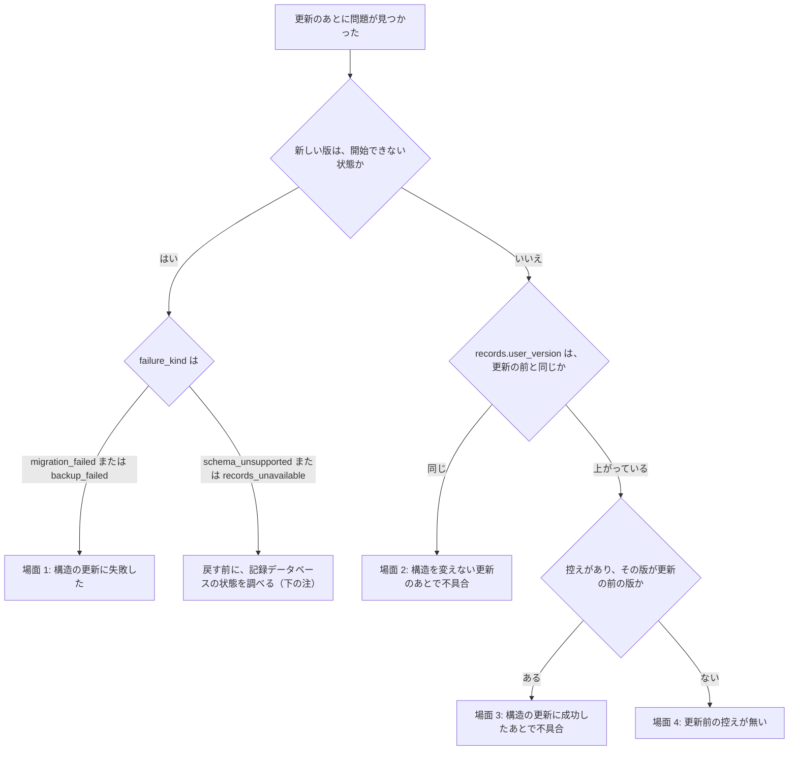
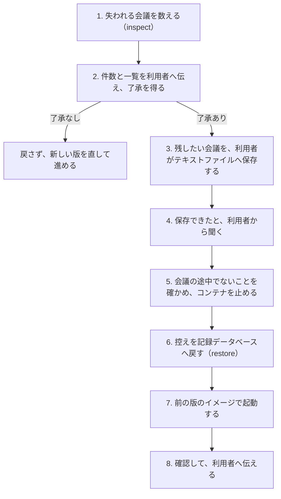
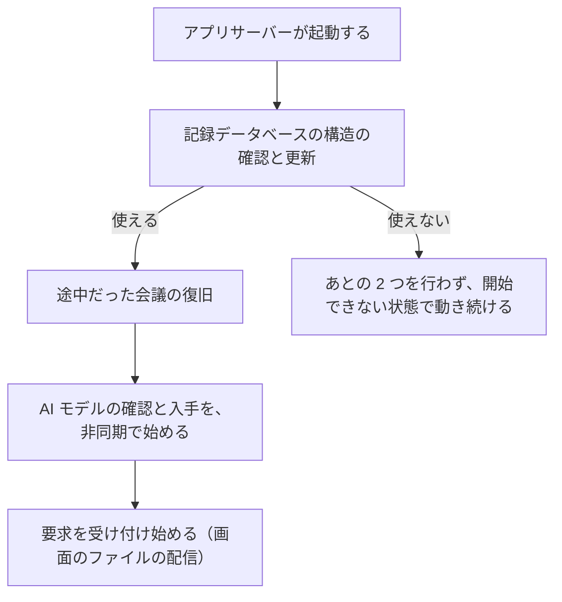
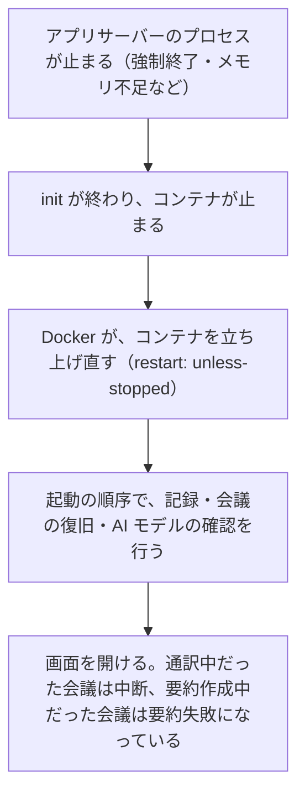

# 運用（導入・更新・前の版へ戻す・起動・ログ）

アプリの導入・更新・前の版への戻し方と、起動の順序・自動の再起動・復旧・ログの上限を書いた文書です。読む人は 2 人います。

| 読む人 | 読む節 |
|---|---|
| 利用者（導入と更新を AI に任せる人） | [利用者の方へ](#利用者の方へ) |
| 導入と更新を行う AI | [導入と更新を行う AI へ](#導入と更新を行う-ai-へ)から、[更新と戻しを試した結果](#更新と戻しを試した結果)まで |

設計の根拠は、基本設計書の非機能要件設計書「運用と保守性」「前の版へ戻すとき」「可用性」、設計判断の記録 ADR-17、機能設計書 F-17「起動時の復旧」、システム構成設計書「アプリを開始できない状態」にあります。

## 利用者の方へ

アプリの導入・更新・戻し作業は、すべて AI が行います。利用者は、コマンドの入力も、コンテナの操作もしません。

### 更新のとき

- 更新は、**会議をしていない間**に行います。AI が会議の一覧を確かめ、会議の途中か、要約や質問を作っている途中なら、更新を始めません。更新をお願いするときは、会議の画面を閉じておいてください。
- 更新の間、アプリは数分使えません（コンテナの入れ替えは 10〜20 秒で、そのあと AI モデルの確認に、10 秒から 1 分ほどかかります。画面を作り直す更新は、ビルドの時間が加わります）。
- **更新しても、保存した記録は消えません。** AI は、記録の置き場（名前付きボリューム）を消す操作を、手順に含めていません。

### 更新に問題が見つかったとき

AI が前の版へ戻します。多くの場合、記録は失われません。

| 場面 | 記録 | 利用者がすること |
|---|---|---|
| 更新に失敗して、アプリが開始できなかった | そのまま残る | なし |
| 記録の構造を変えない更新のあとで、不具合が見つかった | そのまま残る | なし |
| 記録の構造を変える更新に成功したあとで、不具合が見つかった | AI は、新しい版を直して進めます。**記録は残ります** | 直るまで待ちます（アプリを使えない期間が長くなることがあります） |
| 同じ場面で、直るまで待てない | **更新のあとに作った会議と、更新のあとに変わった会議が失われます** | AI から、失われる会議の件数と一覧を聞き、了承するかを答えます。了承するときは、残したい会議を先にファイルへ保存します |

最後の場面だけ、会議の記録を失います。このとき、AI は次のとおり進めます。

1. 失われる会議の件数と、開始日時・タイトルの一覧を、利用者へ伝えます。
2. 利用者の了承を得ます。了承が得られなければ、戻さず、新しい版を直して進めます。
3. 残したい会議は、利用者が先にテキストファイルへ保存します。ブラウザーで会議を開き、「会議の記録」画面の「取り出す」を押すと、Markdown のファイルが保存されます。
4. 保存できたと聞いてから、AI が戻します。

アプリには、記録のバックアップ機能がありません。残したい記録は、更新のときに限らず、「取り出す」でテキストファイルに保存してください。

## 導入と更新を行う AI へ

### 前提

- コマンドは、すべて `output_system/` で実行します。次の 3 つの変数を、コマンドを実行するたびに、先頭に付けます（シェルの変数は、次の呼び出しへ引き継がれません）。

```bash
NAME=toshiakimamada-blip-mmd-output-system    # docker-compose.yml の container_name
IMAGE=toshiakimamada-blip-mmd-output-system   # docker-compose.yml の image
URL=http://localhost:3001                     # 開発用コンテナからは http://$NAME:3001（localhost は使わない）
```

- 手順の中の `docker compose run` は、アプリのイメージで、使い捨てのコンテナを動かします（記録の置き場の名前付きボリュームをつなぐ）。コンテナの名前は、`container_name` ではなく、Docker が付けます。
- 利用者はコンテナを操作しません。状況の確認も、AI がコマンドで行い、結果を利用者へ伝えます。

### 用語

| 用語 | 意味 |
|---|---|
| 前の版のイメージ | 更新の前に動いていたイメージ。更新の前に、`$IMAGE:before-update` のタグを付けて残します |
| 構造の版 | 記録データベースの構造の版（`PRAGMA user_version`）。アプリが知っている最新の版より新しい記録を、アプリは開けません |
| 更新前の控え | 構造を更新する直前に、アプリが同じ名前付きボリュームへ残す記録データベースの複製（`records.before-update.sqlite3`）。1 世代だけ。詳しくは [records-update.md](records-update.md) |
| 開始できない状態 | 記録データベースを使えないときに、アプリが入る状態。画面のファイル以外は 503 `SYSTEM_STARTUP_FAILED` を返し、記録を書き換えません。`docker logs` の `failure_kind` が原因の種類です |
| 更新前の控えを調べる道具 | `tools/update_backup.py`。控えと記録データベースの状態を調べ、控えへ戻すと失われる会議を数え、控えを戻します |

### やってはいけない操作

次の操作は、記録または AI モデルを消します。手順に含めません。

- `docker compose down -v`、`docker volume rm`、`docker volume prune`、`docker system prune --volumes`
- 名前付きボリューム（`toshiakimamada-blip-mmd-records`・`toshiakimamada-blip-mmd-models`）の中のファイルを、手で消す・書き換える。更新前の控え（`records.before-update.sqlite3`）も、手で消さない
- 記録の構造が新しくなったあとで、控えへ戻さずに、前の版のイメージだけで起動し続ける（記録は書き換わりませんが、前の版は開始できない状態になります）
- ディスクの空きを作るために、ボリュームを消す操作を使う。空きが足りないときは、ビルドのキャッシュだけを消す `docker builder prune` を使います（Docker の仕様では、名前付きボリュームは消えません。この環境では実行していません）

名前付きボリュームを使う操作は、`tools/update_backup.py` が行う戻し（控えから記録データベースへ）だけです。

## 導入（初回）

導入は、記録がまだ無い状態で行います。

1. 前提を確かめます。
   - `docker version` と `docker compose version` が動く。
   - `docker network inspect toshiakimamada-blip-mmd-network` が成功する。無ければ `docker network create toshiakimamada-blip-mmd-network` で作る（`docker-compose.yml` は、このネットワークを `external: true` で使います）。
   - ディスクの空きが十分にある。導入したあとの使用量は約 6GB です（イメージ 約 2.6GB、名前付きボリューム 約 3.2GB）。ビルドのキャッシュが加わります（この開発環境では、繰り返しのビルドで 39GB に増えました）。空きは 20GB 以上を目安にします。
   - 社内の通信検査の証明書がある環境では、リポジトリ直下の `ssl-certificates/` に置く。このフォルダーが無い環境では、空のフォルダーを作り、`SSL_CERTS_DIR` で指す（[README.md](../README.md)「社内の証明書」）。
2. イメージを作ります。`docker compose build`
3. コンテナを起動します。`docker compose up -d`
4. 起動を確かめます。[更新後の確認](#更新後の確認)の 1〜6 を行います。初回は、AI モデルを入手するため、準備状況が `ready` になるまで約 5 分かかります（[models.md](models.md)）。入手の途中でも、画面は開けます。
5. 利用者へ、ブラウザーで `http://localhost:3001` を開くよう伝えます。

PC を起動したときに、アプリが自動で立ち上がるには、Docker の自動起動が要ります（[自動の再起動](#自動の再起動)）。利用者の PC で未確認のため、導入のあとに、PC を再起動して確かめます。

## 更新

更新は、イメージを作り直し、コンテナを入れ替えます。名前付きボリュームは、そのまま残ります。**会議をしていない間に行います。**



### 手順

1. **会議をしていないことを確かめます。** 一覧の API で、会議の途中（`interpreting`）、要約の作成中（`summarizing`）、作成中のジョブ（`has_active_job`）が、どれも無いことを見ます。1 件でもあれば、更新を始めません。

   ```bash
   curl -s "$URL/api/meetings" | python3 -c '
   import json, sys
   meetings = json.load(sys.stdin)["meetings"]
   busy = [m["meeting_id"] for m in meetings
           if m["status"] in ("interpreting", "summarizing") or m["has_active_job"]]
   print("会議", len(meetings), "件。使用中", len(busy), "件", busy)
   '
   ```

2. **更新の前の状態を控えます。** 構造の版と会議の数を、`tools/update_backup.py` で調べて、結果（`records.user_version` と `records.meeting_count`）をメモします。前の版へ戻れるように、イメージにタグを付けます。このタグは、**更新ごとに 1 回だけ**付けます（更新をやり直すときに付け直すと、新しい版で上書きします）。

   ```bash
   docker compose run --rm --no-deps -T --entrypoint python3 app -I - inspect < tools/update_backup.py
   docker tag "$(docker inspect -f '{{.Image}}' $NAME)" $IMAGE:before-update
   ```

3. **版の固定と、既知の脆弱性を確かめます（ビルドの前）。** 手順は[部品と AI モデルの版の固定と、脆弱性の確認](#部品と-ai-モデルの版の固定と脆弱性の確認)にあります。

4. **イメージを作り直します。** `--pull` で、土台（`ubuntu:24.04`）の最新を取り込みます。

   ```bash
   git pull
   docker compose build --pull
   ```

5. **コンテナを入れ替えます。** `docker compose up -d` は、新しいイメージと設定を見つけると、コンテナだけを作り直します。名前付きボリュームは残ります。残したいログがあれば、入れ替える前に `docker logs $NAME > <ファイル>` で控えます（[ログの上限](#ログの上限)）。

   ```bash
   docker compose up -d
   ```

6. **起動を待ちます。** Docker が `healthy` か `unhealthy` にするまで待ちます（10 秒おきに確かめ、最大 5 分）。

   ```bash
   for i in $(seq 1 30); do
     s=$(docker inspect -f '{{.State.Health.Status}}' $NAME); echo "$i $s"
     case $s in healthy|unhealthy) break;; esac
     sleep 10
   done
   ```

7. **更新後の確認を行います。** 次の節の 1〜7 です。合格したら、利用者へ完了を伝えます。不合格なら、[前の版へ戻す](#前の版へ戻す)へ進みます。

### 更新後の確認

| 番号 | 確かめること | コマンド | 合格 |
|---|---|---|---|
| 1 | コンテナの状態と再起動の回数 | `docker inspect -f '{{.State.Health.Status}} {{.RestartCount}}' $NAME` | `healthy 0` |
| 2 | 動作の確認と画面 | `curl -s -o /dev/null -w '%{http_code}\n' $URL/api/health`、`curl -s -o /dev/null -w '%{http_code}\n' $URL/` | どちらも `200` |
| 3 | 開始できない状態のログ | `docker logs $NAME 2>&1 \| grep -c SYSTEM_STARTUP_FAILED` | `0` |
| 4 | 会議の数 | `curl -s $URL/api/meetings`（手順 1 と同じ数え方） | 更新の前と同じ |
| 5 | 途中だった会議の復旧 | `docker logs $NAME 2>&1 \| grep startup_recovery` | `interrupted_count`・`summary_failed_count`・`unrecovered_count` が 0 |
| 6 | AI モデルの準備 | `curl -s $URL/api/models/status`（入手済みなら、確認に 10〜60 秒。最大 2 分待つ） | `"status":"ready"` |
| 7 | 構造の版と、更新前の控え | 手順 2 の `inspect` をもう一度 | `records.user_version` が、更新の前と同じか、上がっている。上がっていれば、`backup.user_version` が更新の前の版で、控えがある |

番号 7 の結果が、[前の版へ戻す](#前の版へ戻す)の場面の判断に使われます。更新に成功したときも、結果をメモしておきます。

## 前の版へ戻す

更新のあとに問題が見つかったとき、まず、**どの場面か**を判断します。判断に使う材料は、次の 3 つです。

- 新しい版が「開始できない状態」か（`$URL/api/health` が 503、`docker logs` に `SYSTEM_STARTUP_FAILED`）
- `docker logs` の `failure_kind`（原因の種類）
- `tools/update_backup.py inspect` の `records.user_version`（更新の前の値と比べる）と、`backup`（控えの有無と版）



注: `schema_unsupported` と `records_unavailable` は、更新が原因とは限りません。記録を書き換えていないことを `inspect` で確かめ（会議の数が更新の前と同じか）、利用者へ報告して、原因を調べます。この文書の戻し方は使いません。

| 場面 | 戻し方 | 失われる記録 |
|---|---|---|
| 1. 構造の更新に失敗した | [前の版のイメージへ戻す](#前の版のイメージへ戻す)。記録は、更新の前のまま残っています | なし |
| 2. 構造を変えない更新のあとで、不具合が見つかった | 前の版のイメージへ戻す。構造が同じため、前の版で開けます | なし。更新のあとに作った記録は残る |
| 3. 構造の更新に成功したあとで、不具合が見つかった | **既定は、新しい版を直して進める。** 直すまで使えない期間を利用者が受け入れない場合だけ、[更新前の控えへ戻す](#更新前の控えへ戻す) | 直して進めれば、なし。控えへ戻すと、更新のあとに作った会議と変わった会議 |
| 4. 構造の更新に成功したが、更新前の控えが無い | 新しい版を直して進める。前の版のイメージだけへ戻してはいけない | なし |

### 前の版のイメージへ戻す

場面 1 と場面 2 の戻し方です。場面 3 の控えへ戻す手順の最後でも使います。

```bash
docker tag $IMAGE:latest $IMAGE:failed-update      # 不具合のあった版を、調べるために残す
docker tag $IMAGE:before-update $IMAGE:latest      # 前の版を、いまの版にする
docker compose up -d --no-build                    # 作り直さず、前の版でコンテナを入れ替える
```

`--no-build` を付けます。付けないと、前の版のイメージが無いときに、いまのソース（新しい版）を黙ってビルドします。

戻したあとに、[更新後の確認](#更新後の確認)の 1〜6 を行い、番号 4 の会議の数が、更新の前と同じか、同じ以上（場面 2 は更新のあとに作った会議があるため）であることを見ます。結果を利用者へ伝えます。

### 場面 1: 構造の更新に失敗した

アプリは、記録を書き換えずに、開始できない状態で動き続けます。今回の更新で当てた変更は、すべて取り消されています。

1. 原因を確かめます。`docker logs $NAME 2>&1 | grep SYSTEM_STARTUP_FAILED` の `failure_kind` が `migration_failed`（移行の失敗）か `backup_failed`（控えを残せない。多くは、ディスクの空き不足）です。
2. `inspect` で、`records.user_version` と `records.meeting_count` が、更新の前と同じであることを確かめます。
3. [前の版のイメージへ戻します](#前の版のイメージへ戻す)。
4. 利用者へ、「更新に失敗したため前の版へ戻した。記録は残っている」と伝えます。
5. 原因を直してから、更新をやり直します。`backup_failed` なら、ディスクの空きを、記録データベースの大きさ以上にします。

### 場面 2: 構造を変えない更新のあとで、不具合が見つかった

構造の版が同じため、前の版は、更新のあとに作った記録も開けます。

1. `inspect` で、`records.user_version` が更新の前と同じであることを確かめます。
2. [前の版のイメージへ戻します](#前の版のイメージへ戻す)。
3. 利用者へ、前の版へ戻したことを伝えます。更新のあとに作った会議は、残っています。

### 場面 3: 構造の更新に成功したあとで、不具合が見つかった

**既定は、新しい版を直して進めることです。** 記録は、すべて残ります。直した版を、さらに新しい版として、[更新](#更新)の手順で入れ替えます。

利用者が、直すまで使えない期間を受け入れない場合だけ、[更新前の控えへ戻します](#更新前の控えへ戻す)。この操作は、記録を失います。**利用者の了承なしに行いません。**

前の版のイメージだけへ戻しても、動きません。前の版は、新しい構造の記録を見つけると、開始できない状態になります（記録は書き換わりません。出荷するコンテナで確かめました）。このとき、新しい版へ戻すには、`$IMAGE:failed-update` を `$IMAGE:latest` に付け直して、`docker compose up -d --no-build` を実行します。

### 場面 4: 構造の更新に成功したが、更新前の控えが無い

控えが無いと、記録を前の構造へ戻せません。新しい版を直して進めます。前の版のイメージだけへ戻してはいけません（場面 3 の最後のとおり、前の版は開始できない状態になります）。

控えが無い原因を調べ、利用者へ報告します。更新の前に `inspect` を行っていれば、更新の前の構造の版が分かります。

### 更新前の控えへ戻す

場面 3 で、利用者が、直すまで使えない期間を受け入れないときだけ行います。**記録を失う操作です。** 手順 1〜4 は、利用者とのやり取りです。コマンドは AI が実行し、利用者はコンテナを操作しません。



1. **失われる会議を数えます。** 控えを記録データベースへ戻すと失われるのは、「更新のあとに作られた会議」と「更新のあとに変わった会議」です。

   ```bash
   docker compose run --rm --no-deps -T --entrypoint python3 app -I - inspect < tools/update_backup.py
   ```

   `restore_loss` の `created_count`（作られた）・`changed_count`（変わった）・`lost_count`（合計）と、会議の一覧（会議番号・開始日時・状態）が出ます。会議のタイトルは出ません。タイトルは、会議の一覧の API（`curl -s $URL/api/meetings`）から、会議番号で引きます。

   - `backup.user_version` が、更新の前の構造の版（更新の前に控えた値）と一致することを確かめます。一致しなければ、この控えは使いません。
   - 「変わった会議」は、控えと内容が違う会議です。構造の更新が、既存の列の値の表し方を変えた場合は、内容を変えていない会議も数えます。数は、多めに出る可能性があります。

2. **件数と一覧を利用者へ伝え、了承を得ます。** 次の内容を伝えます。了承が得られなければ、戻しません。

   > 前の版へ戻すと、更新のあとに作った会議 ○ 件と、更新のあとに変わった会議 △ 件が失われます（合計 □ 件）。失われる会議は、次のとおりです（開始日時・タイトル）: …。ほかの会議は残ります。直るまでアプリを使えない期間を待てない場合だけ、この方法を使います。戻してよいですか。

3. **残したい会議を、利用者が先にファイルへ保存します。** ブラウザーで会議を開き、「会議の記録」画面の「取り出す」を押すと、Markdown のファイルが保存される、と案内します。要約・質問・字幕が入ります。失われる会議は、戻したあと、アプリでは見られません。保存したファイルだけが残ります。

4. **保存できた、または保存しない、と利用者から聞きます。** 聞くまで、次へ進みません。

5. **会議の途中でないことを、[更新](#手順)の手順 1 の方法で確かめ、コンテナを止めます。** 止めたあとで、記録を使うのは、このあとの道具だけです。

   ```bash
   docker compose stop app
   ```

6. **控えを記録データベースへ戻します。** 了承を得た件数を `--approved-lost-count` に渡します。いまの件数と違うときは、何も書き換えずに止まります（手順 2 のあとに、会議が増えた場合など）。止まったら、手順 1 からやり直し、利用者へ件数を伝え直します。

   ```bash
   docker compose run --rm --no-deps -T --entrypoint python3 app -I - restore \
     --approved-lost-count <了承を得た件数> < tools/update_backup.py
   ```

   道具は、控えの整合性を確かめ、複製を作って整合性を確かめてから、記録データベースの名前へ置き換えます。控えのファイルは、そのまま残ります。

7. **前の版のイメージで起動します。** [前の版のイメージへ戻す](#前の版のイメージへ戻す)の 3 つのコマンドです。
8. **確認します。** [更新後の確認](#更新後の確認)の 1〜6 を行い、番号 4 の会議の数が、控えの会議の数（手順 6 の出力の `records.meeting_count`）と同じであることを見ます。利用者へ、戻したことと、失われた会議（手順 2 で伝えた一覧）を伝えます。

戻したあとは、新しい版の構造の更新を、もう一度行うことになります。直した新しい版を[更新](#更新)の手順で入れ替えると、更新前の控えが作り直されます。

## 更新と戻しを試した結果

開発環境（2026-11-27 14:15〜14:30 JST 頃）で、出荷するイメージのコンテナ（コンテナ名 `toshiakimamada-blip-mmd-output-system`）を使い、上の手順のコマンドをそのまま実行しました。出荷するイメージには、版 2 の移行がありません。そこで、出荷するイメージ（前の版）の上に、試験用の層を 1 つ足した「新しい版」のイメージを作り、`$IMAGE:latest` に付けて入れ替えました（試験用の層は、リポジトリに入れていません）。記録の置き場は、試験の前に複製して SHA-256 を控え、試験のあとに戻しました。

| 試した場面 | 新しい版（試験用の層） | 結果 |
|---|---|---|
| 更新（構造を変えない）→ 場面 2 | アプリのコードにコメントを 1 行足した版 | 更新後の確認の 1〜6 が合格。前の版のイメージへ戻すと、10〜20 秒で `healthy`、会議の数は 78 件のまま、`SYSTEM_STARTUP_FAILED` は 0 件 |
| 更新（構造の更新に成功）→ 場面 3 の更新まで | 版 2 の移行（会議ごとの表を 1 つ足す）を足した版 | 更新後の `inspect` が、記録の構造の版 2・会議 78 件・控えの版 1・会議 78 件・失われる会議 0 件 |
| 戻しすぎ（場面 3 で、控えへ戻さずに前のイメージだけへ戻す） | 同上から、前の版のイメージへ戻す | 前の版は開始できない状態（`/api/health` が 503、`SYSTEM_STARTUP_FAILED`、例外の種類 `RecordSchemaError`）。記録データベースと控えの SHA-256 は、戻す前と同じ |
| 場面 3 の控えへ戻す手順（手順 1・5〜8） | 新しい版で、会議を 1 件作り、別の会議の要約を作り直してから | `inspect` が、作られた 1 件・変わった 1 件・合計 2 件を、会議番号つきで返した。タイトルは、会議の一覧の API から引けた。了承と違う件数（1）の `restore` は、何も書き換えずに終了コード 1 で止まった。件数（2）で戻すと、記録の構造の版 1・会議 78 件になり、前の版のイメージで `healthy`、会議 78 件 |
| 更新に失敗 → 場面 1 | 版 2 の移行が、途中で失敗する版 | `/api/health` が 503、`failure_kind: migration_failed`。`inspect` が、構造の版 1・会議 78 件。前の版のイメージへ戻すと `healthy`。記録の 3 ファイルの SHA-256 が、戻す前と同じ |

確かめていないことは、次のとおりです。

- 手順 2〜4（利用者への説明・了承・ファイルへの保存）。利用者とのやり取りのため、試していません。「取り出す」は、別の作業で確かめています（[record-screen.md](record-screen.md)）。
- 場面 4（控えが無い）。コマンドでは試していません。控えが無いときに `restore` が止まることは、自動テストで確かめました。
- 利用者の PC（Windows）での更新と戻し。
- 実際の版 2 以降の移行での更新。試験用の移行で代えました。

## 起動の順序

起動の順序と、止まったあとの復旧の決めです。

アプリサーバーは、起動のたびに、次の順に 3 つの処理を行います（`backend/src/meeting_interpreter/startup.py` の `run_startup`。呼び出しは `app.py` の `_lifespan`）。



| 順 | 処理 | 受け持つ部 | 失敗したとき |
|---|---|---|---|
| 1 | 記録データベースの構造の確認と更新（古ければ、更新前の控えを残してから更新） | 記録保存部（`RecordDatabase.open`） | 構造が新しい・控えを残せない・更新に失敗した・開けない場合は、エラーログ `SYSTEM_STARTUP_FAILED`（原因の種類 `failure_kind` つき）を 1 回出して、アプリサーバーを止めずに「開始できない状態」にする。2 と 3 は行わず、作成ジョブ管理部も開始しない。詳しくは [docs/records-update.md](records-update.md) |
| 2 | 途中だった会議の復旧（[docs/meetings.md](meetings.md)「起動時の復旧」） | 会議管理部（`MeetingManager.recover_on_startup`） | 会議の一覧を読めないときは、エラーログ `MEETING_RECOVERY_FAILED`（例外の種類と発生場所。文面は出さない）を出して、起動を失敗させる。3 は行わない。ある会議の字幕を読めない、または保存に失敗したときは、その会議だけを直せなかったと数え（`unrecovered_count`）、残りを直して続ける |
| 3 | AI モデルの確認と入手の開始（[docs/models.md](models.md)） | モデル管理部（`ModelManager.start`） | 確認と入手は別のタスクで動き、失敗は準備状況に出る。起動は失敗しない |

- 順序を決める理由は、1 が終わる前に記録を読み書きしないため、2 が終わる前に会議を開始できる状態にしないためです。AI モデルが準備完了になると、会議を開始できます。
- uvicorn は、起動の処理（lifespan）が終わってから、要求を受け付け始めます。そのため、最初の要求は、途中だった会議が直ったあとの記録を読みます。
- 3 は、確認と入手を始めるだけで、終わりを待ちません。画面のファイルは、AI モデルの入手の途中でも配ります。
- 1 が失敗したときは、アプリサーバーを止めずに「開始できない状態」（接続制限部と配信部だけが動き、画面にエラーコードを出す）で動かします。止めると、コンテナが `restart: unless-stopped` で再起動を繰り返し、画面へ理由を返せないためです。この状態は、アプリサーバーを起動し直すまで続きます。
- 2 が失敗したときは、開始できない状態にせず、起動を失敗させます（コンテナは再起動を繰り返します）。開始できない状態の対象は、記録データベースの構造を使えない場合だけです。

起動のあとの停止は、進行中の会議を閉じる → 作成ジョブ管理部を止める → 通知の接続を閉じる → AI モデルの入手を中止する → 記録データベースを閉じる、の順です。

## 自動の再起動

アプリサーバーのプロセスが止まると、コンテナが自動で立ち上がり直します。

| 設定 | 場所 | 役割 |
|---|---|---|
| `restart: unless-stopped` | `docker-compose.yml` | コンテナが終わったとき、Docker が立ち上げ直す。`docker compose stop` と `docker compose down` で止めたときは立ち上げ直さない。Docker の仕様では、Docker 自体が立ち上がったときにも、止めていないコンテナを立ち上げる（この環境では確かめていない） |
| `init: true` | `docker-compose.yml` | コンテナの先頭のプロセス（PID 1）に init を置く。アプリサーバーはその子。アプリサーバーが終わると init も終わり、コンテナが止まる |
| `HEALTHCHECK` | `Dockerfile`（30 秒ごとに `GET /api/health`） | `docker compose ps` に正常かどうか（healthy）を出す。再起動のきっかけにはしない（再起動は、プロセスが終わったときだけ）。開始できない状態では 503 のため、約 1.5 分で `unhealthy` になる（再起動はしない） |

アプリサーバーが止まってからの流れは、次のとおりです。



- 通訳ワーカーと生成ワーカーは、アプリサーバーの子のプロセスです。コンテナが止まると、一緒に終わります。
- 止まる前に画面を開いていた利用者は、通知の接続が切れ、お知らせ帯に「アプリとつながっていません」が出ます。つなぎ直しに成功すると、画面が会議の記録を読み直します。「会議中」の画面は、中断に気づいて「会議の記録」へ移ります（`useMeetingInterruption`）。「会議の記録」の画面は、状態の表示を新しくします。

## 復旧にかかる時間の測定

目標は、自動の再起動から 1 分以内に画面を開ける状態へ戻すことです（仮置き。非機能要件設計書「可用性」の目標復旧時間）。

### 測り方

出荷するコンテナ（`docker compose build` のあとに `docker compose up -d` で作り直したもの）の中で、アプリサーバーのプロセス（`python -m meeting_interpreter`）に、`kill -9` を送りました。送り終えた時点から 0.1 秒ごとに、開発用コンテナからコンテナ名の URL（`http://toshiakimamada-blip-mmd-output-system:3001`）へ要求を送り、次の 2 つの時間を測りました。

- 画面を開ける: `GET /api/health` と `GET /`（画面のファイル）の両方が 200 を返すまで
- 会議を開始できる: `GET /api/models/status` が `ready` になるまで（AI モデルの確認が終わるまで）

測定の時計は、スクリプトの単調増加時計です（日時の差ではありません）。

### 結果（2026-11-25、この開発環境）

| 場面 | 回数 | 画面を開ける | 会議を開始できる |
|---|---|---|---|
| 通訳中の会議があるとき（字幕 9 件） | 1 | 1.17 秒 | 測っていない |
| 要約作成中の会議があるとき | 1 | 1.49 秒 | 測っていない |
| 途中だった会議が無いとき | 5 回 | 1.20〜1.34 秒 | 3.19〜5.42 秒 |
| 途中だった会議が無いとき（時刻ごとの応答を記録した） | 6 回 | 0.92〜1.30 秒 | 3.07〜3.81 秒 |
| 通訳中の会議があるとき（字幕 3 件。「会議の一覧」で中断を確かめた回） | 1 | 1.13 秒 | 3.83 秒 |

- 14 回すべてで、1 分の目標に収まりました。画面を開けるまでの最大は 1.49 秒です。
- 強制終了を 14 回行い、コンテナの再起動の回数（`RestartCount`）も 14 になりました。毎回、Docker がコンテナを立ち上げ直し、アプリサーバーが新しいプロセスで起動しました。
- 1 回だけ、`GET /api/health` が 0.14 秒で 200 を返したのに、`GET /api/health` と `GET /` の両方が 200 になったのは 1.2 秒でした（上の表は、両方が 200 になった時間を使っています）。0.14 秒の応答の原因は調べていません。そのあと、時刻ごとの応答を記録して 6 回測り直しましたが、再現しませんでした。
- AI モデルの確認は、入手済みのモデルでは約 3〜5 秒です。確認の間、画面は開けますが、会議は開始できません（準備状況が「確認中」）。

### この測定が含まないもの

- 利用者の PC（Windows）での測定。目標の 1 分は仮置きのままで、実装後に利用者の PC で測り、報告します（非機能要件設計書「可用性」）
- PC の起動のあと、Docker が自動で立ち上がるまでの時間。Docker Desktop の設定に依存し、この開発環境では確かめられません。利用者の PC で確かめます。意図した測定ではありませんが、開発環境が再起動したあと（2026-11-26 08:16 JST 頃）、コンテナは自動で起動し、起動時の復旧の記録は 0 件、`GET /api/health` は 200 でした。この確認は、利用者の PC の起動とは別です
- AI モデルをまだ入手していない状態（初回の起動）。入手は約 5 分かかり、その間も画面は開けます（[docs/models.md](models.md)）
- 記録が多いときの復旧の時間。この環境の記録は 74 件で、途中だった会議 11 件を直すのに、起動の知らせから 55 ミリ秒でした（`startup_recovery` の行の時刻の差）。復旧は会議の一覧を 1 回読み、途中だった会議だけを更新するため、会議の数にほぼ比例します

## 止まった会議の確認（出荷するコンテナ）

出荷するコンテナを作り直し、`playwright-cli`（Chrome、headless、画面幅 1280）で、画面から会議を始めて確かめました。起動設定と疑似の音声は、[docs/live-screen.md](live-screen.md) の取り込み停止の確認と同じです（設定ファイルと音声ファイルはリポジトリの外）。会議は、画面の「会議の準備」から「PC で再生される音声」を選んで始めました。止めたのは、アプリサーバーのプロセスへの `kill -9` です（アプリにテスト専用の入口は足していません）。本物のモデルで動かしています。

| 場面 | 確かめたこと | 結果 | スクリーンショット（`ai_generated/screenshots/`） |
|---|---|---|---|
| 起動のとき、前の確認で残っていた要約作成中の会議 | コンテナを作り直した最初の起動の処理ログ | 要約作成中のまま残っていた会議 11 件が、要約失敗（`SUMMARY_INTERRUPTED`）になった。`startup_recovery` は、中断 0・要約失敗 11・直せなかった 0。完了 17 件・中断 46 件は変わらない | （ログと記録の確認のみ） |
| 通訳中の会議 | 「会議中」の画面（撮影の時点で字幕 5 件。止めた時点で 9 件）を開いたまま、アプリサーバーを止める | 約 1 秒後に画面を開ける状態へ戻り、開いていた「会議中」の画面が、中断に気づいて「会議の記録」へ移った。状態は中断で、お知らせ帯に `MEETING_CONNECTION_LOST`。字幕は 9 件とも残り、会議の長さは 0:00:35（終了日時 = 最後の字幕の話された時刻 `06:34:35.112`）。`startup_recovery` は、中断 1 | `pbi-7-1_01_live_before_app_stops.png`、`pbi-7-1_02_record_interrupted_after_app_restart.png` |
| 要約作成中の会議 | 会議を終了して要約作成中の「会議の記録」を開いたまま、アプリサーバーを止める | 約 1.5 秒後に画面を開ける状態へ戻り、開いていた「会議の記録」が、状態「要約失敗」と、「アプリが止まったため、要約を作れませんでした。」（`SUMMARY_INTERRUPTED`）に変わった。字幕は残り、「要約を作る」ボタンが押せる。`startup_recovery` は、要約失敗 1 | `pbi-7-1_03_record_summarizing_before_app_stops.png`、`pbi-7-1_04_record_summary_failed_after_app_restart.png` |
| 中断にした会議の一覧 | 字幕 3 件の会議を始め、アプリサーバーを止めたあと、「会議の一覧」を開く | 一覧の先頭（開始日時の新しい順）に、その会議が状態「中断」で並んだ。会議の長さは 0:00:09（最後の字幕の話された時刻まで）。「開く」と「削除」のボタンが出る | `pbi-7-1_07_meeting_list_shows_interrupted_after_app_restart.png` |
| 要約失敗にした会議から、要約を作る | 「要約を作る」を押す | 約 1 分で完了になり、要約（4 項目）ができた。要約失敗の表示と失敗理由は消えた | `pbi-7-1_05_summary_made_again_after_failure.png` |
| 中断にした会議から、要約を作る | 「要約を作る」を押す | 約 1 分で完了になり、要約ができた。終了日時は変わらない | `pbi-7-1_06_summary_made_from_interrupted_meeting.png` |

確かめていないことは次のとおりです。

- 前の要約があるときに、要約を作り直している途中で止めた場合の画面の表示。「前の要約が残ること」は、記録保存部を通す単体テストで確かめた
- 利用者の PC（Windows の Edge）での動き
- 起動時に、保存に失敗して直せない会議があるときの動き（`unrecovered_count` が 0 でない場合）。単体テストの偽の保存の失敗で確かめた

## ログの上限

ログは、`docker-compose.yml` の `logging` で、**1 ファイル 10MB・5 ファイルまで**に限ります。上限を超えると、古いものから消えます。確実に残る量は 40MB で、性能の測定 1 回分のログ（約 1.3MB）の約 30 倍です。

### 設定と動き

| 項目 | 値 | 意味 |
|---|---|---|
| `driver` | `json-file` | Docker が標準出力のログを、ホストのファイルに保管する（Docker の既定の方式） |
| `max-size` | `"10m"` | 1 ファイルが 10,000,000 バイトを超えたら、新しいファイルへ切り替える |
| `max-file` | `"5"` | ファイルが 6 つになったら、いちばん古いファイルを消す |

- Docker の `10m` は 10 進数です（1m = 1,000,000 バイト）。1m の設定で、ファイルが約 1,000,000 バイトで切り替わることを確かめました。
- 最大の保管量は 5 × 10MB = 50MB です。切り替えの直後は、いちばん新しいファイルがほぼ空のため、**確実に残る量は (5 − 1) × 10MB = 40MB** です。
- アプリは、ログをファイルへ書きません。標準出力へ出すだけで、保管と切り替えは Docker が行います。
- `docker logs` は、残っているファイルをまとめて読みます。集計コマンド（[measurement.md](measurement.md)）は、この出力を読みます。
- **コンテナを入れ替えると、古いコンテナのログは消えます。** 更新の前に、残したいログがあれば `docker logs <コンテナ名> > <ファイル>` で控えます。測定のログは、集計してからコンテナを入れ替えます。

設定は、次のコマンドで確かめます。

```bash
docker inspect toshiakimamada-blip-mmd-output-system --format '{{json .HostConfig.LogConfig}}'
# {"Type":"json-file","Config":{"max-file":"5","max-size":"10m"}}
```

`logging` を変えたあとは、`docker compose up -d` でコンテナを入れ替えます（イメージの作り直しは要りません）。入れ替えるまで、古い設定のままです。

### 測定 1 回分のログの見積もり

測定 1 回分は、[非機能要件設計書「実際に使う状態での測定」](../../ai_generated/basic_design/nonfunctional.md#実際に使う状態での測定)の手順（2 時間の会議・要約・質問）です。次の 3 つの手順で見積もりました。

1. **実測**: 出荷するコンテナ（本物のモデル）で、英語の音声を 150 秒流して会議を行い、質問と要約を 1 回ずつ作りました（2026-11-27 13:52 JST 頃）。コンテナのログのファイル（`json-file`）は 112 行・45,198 バイトでした。
2. **1 行の大きさ**: 行の種類ごとに、ファイルの中の大きさを測りました。字幕を 1 件送るたびに、2 行（処理ログの `subtitle_sent` と、文字起こし部品の記録）が出ます。
3. **2 時間分へ拡大**: 字幕の件数を 1,500 件（設計書の処理量の前提）にして、字幕の行の数を掛けました。字幕以外の行は、多めに 200 行と置きました。

Docker は、アプリの 1 行を `{"log":"<本文>\n","stream":"stdout","time":"<時刻>"}` の 1 行にして書きます。本文の引用符が `\"` になるため、ファイルの中の行は、アプリが出した行より約 25〜70% 大きくなります。この式で求めた大きさが、実際のファイルの 276 行すべてで一致することを確かめました。

| 行の種類 | 実測の大きさ（ファイルの中、1 行） | 測定 1 回分の行数 | 合計 |
|---|---|---|---|
| 字幕を画面へ送った記録（`subtitle_sent`） | 平均 602 バイト、最大 628 バイト | 1,500 | 約 0.92MB（見積もりは 1 行 610 バイト） |
| 文字起こし部品の記録（`faster_whisper`） | 215 バイト | 1,500 | 約 0.32MB |
| 字幕以外（会議の開始と終了、ワーカーの起動と停止、作成ジョブ、メモリの使用量、uvicorn など） | 最大 502 バイト（メモリの使用量の行） | 200 | 約 0.10MB |
| **合計** | | | **約 1.34MB** |

- 字幕以外の行は、実測で 36 行（会議の開始・終了、ワーカー、作成ジョブ、メモリの使用量）でした。測定 1 回分では、要約が 31 ブロック（生成の行が 32 行）、質問が 3 回以上、メモリの使用量が約 40 行になる見込みです（実測ではなく、生成ワーカーの測定とログの設計からの見込み）。そのため、200 行を上限に置きました。
- 見積もりに使う字幕の行は、実測より桁の多い値（遅れ 1,234,567.8 ミリ秒など）で作り、多めに出ます。

見積もりと上限の比べ方は、次のとおりです。

| 項目 | 値 |
|---|---|
| 測定 1 回分の見積もり | 約 1.34MB |
| 確実に残る量（上限） | 40MB |
| 比 | 約 30 倍 |
| テストが求める比（`HEADROOM`） | 10 倍以上 |

10 倍以上を求める理由は、測定が終わってから集計するまでの間の使用分と、調整値を変えたときの測り直しの分を残すためです。

### 確かめたこと

出荷するイメージ（コンテナ名 `toshiakimamada-blip-mmd-output-system` と同じイメージ）で、`docker compose run` の使い捨てのコンテナを使いました。`docker-compose.yml` の `logging` が、使い捨てのコンテナにも効いています。

| 確かめたこと | 方法 | 結果 |
|---|---|---|
| 上限が設定される | 入れ替えたコンテナで `docker inspect` | `{"Type":"json-file","Config":{"max-file":"5","max-size":"10m"}}` |
| 測定 1 回分が収まる | アプリの実際のログ出力の関数で、測定 1 回分（字幕 1,500 件の 2 行ずつ・メモリの使用量 200 行）を出す | 3,200 行がすべて `docker logs` で読めた。ログのファイルは 1,337,546 バイトで、見積もり（1,337,900 バイト）と 0.03% の差。ファイルは 1 つのまま |
| 古いものから消える | 字幕の行を 100,000 件（約 61MB）出す | ファイルは 5 つ（約 1MB が 1 つ、約 10MB が 4 つ）。`docker logs` は 67,206 行で、残ったいちばん古い行は 32,795 件目。いちばん新しい行（100,000 件目）は残った |
| 上限を小さくするとテストが落ちる | `max-size` を 1m、`max-file` を 2 に変えて `test_log_limit.py` を実行 | `test_should_keep_one_measurement_of_logs_with_headroom` が失敗した |
| 設定が無いとテストが落ちる | `logging` を消して実行 | 失敗した（`logging の driver がありません`） |

自動テストは、`backend/test/deployment/test_log_limit.py` です。行の項目を足してログが長くなると、見積もりが増え、上限が足りなくなればテストが落ちます。

### 確かめていないこと

- 実際の 2 時間の会議でのログの量。実測は 150 秒の会議までです。字幕の件数は、設計書の前提（1,500 件）から見積もりました。実際に使う状態での測定（利用者の PC）のあとに、`docker logs` の行数と大きさを、この見積もりと突き合わせます。
- 利用者の PC の Docker（Docker Desktop）での切り替え。Docker のログの仕組みは、コンテナごとの設定（`logging`）が優先されるため、Docker の既定の設定が違っても同じ動きになる見込みです。

### 利用者に確認すること

確認事項 8「不具合の調査のために、ログをどのくらいの期間残したいか」は、まだ利用者に確認していません。次の目安で、仮の値を決めました。

- 会議 1 時間を毎日 1 回使うと、1 日に約 0.67MB のログが出ます（字幕 750 件と、字幕以外 100 行で見積もり）。確実に残る 40MB は、約 2 か月分です。
- もっと長く残したいときは、`max-file` を増やします（例: `"10"` なら確実に残る量が 90MB で、約 4 か月分）。増やしたあとも、テストが測定 1 回分の 10 倍の余裕を確かめます。
