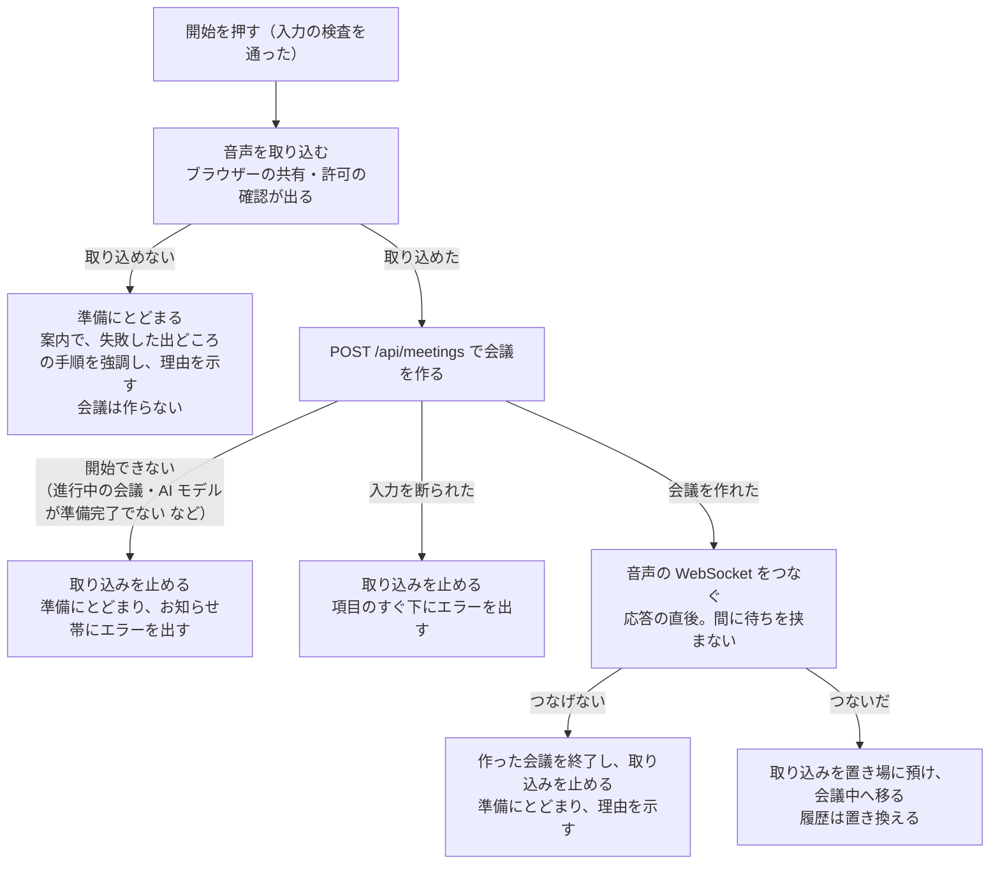

# 「会議の準備」の画面

「会議の準備」の画面（S-02）の作りと、動作の確認です。設計の根拠は、基本設計書の画面設計書「S-02 会議の準備の領域」「S-02 会議の準備の項目と操作」「画面遷移」「入力チェック方針」、機能設計書 F-01・F-02・F-03・F-14・F-16、ADR-09・ADR-13 にあります。

## 画面の作り

上から順に、入力 → 案内 → AI モデルの準備状況 → 操作の順に並べます。

| 領域 | 中身 | 部品 |
|---|---|---|
| 入力 | タイトル（任意・100 文字まで・1 行）、音声の出どころ（必須・初期は未選択）。エラーは項目のすぐ下 | `screens/prepare/PrepareForm.tsx`、検査は `meetings/meetingInput.ts` |
| 案内 | 選んだ音声の出どころの取り込み手順。常に出す注意書き 3 つ。取り込みに失敗したら、失敗した出どころの手順を強調して理由を添える | `screens/prepare/PrepareGuidance.tsx`、文言は `meetings/guidanceTexts.ts` の 1 か所 |
| AI モデルの準備状況 | 準備状況（確認中・入手中・変換中・準備完了・入手失敗）、入手の進み具合、入手失敗の原因と次の操作、「入手をやり直す」 | `screens/prepare/ModelStatusPanel.tsx`、取得と更新は `models/useModelStatus.ts` |
| 操作 | 「会議を開始する」（準備完了まで押せない見た目で残す）、「取りやめる」 | `PrepareForm.tsx` |

組み立ては `screens/MeetingPrepareScreen.tsx` です。「会議の一覧」（S-01）には、いまは「新しい会議を始める」だけを置いています。

## 入力の検査

画面が入力の時点で確かめ、アプリサーバーが受け取った時点でもう一度確かめます。決めは、アプリサーバーの `meetings/inputs.py` と同じにそろえています。

- タイトル: 前後の空白（改行を含む）を取り除く。空と空白だけは未入力として、画面が PC の時刻から「会議 2026-11-10 09:05」の形で作って送る。100 文字（文字の数。絵文字は 1 文字）を超えたら、入力した時点でエラー。途中の改行と NUL 文字は受け付けない。記号は文字として送る
- 音声の出どころ: 選ばずに開始すると、音声の出どころのすぐ下にエラーを出し、ブラウザーの共有と許可の確認は出さない
- アプリサーバーの再検査のエラー（`MEETING_TITLE_INVALID`・`MEETING_AUDIO_SOURCE_INVALID`）も、同じ場所に出す
- 開始のボタンは、応答が返るまで押せない（二度押しで開始が 2 回呼ばれない）。取りやめるも、その間は押せない

## 開始の流れ

`meetings/startMeeting.ts` が、次の順で進めます。結果は例外ではなく、見せ方が決まる種類で返します。

- 会議の記録は、音声を取り込めたあとで作ります（ADR-09）。取りやめた会議の記録を残しません
- 会議を作る応答を受け取ったら、すぐ音声の WebSocket をつなぎます。開始から 30 秒のうちにつながらないと、アプリサーバーが会議を中断にします
- どの失敗でも、入力したタイトルと選んだ音声の出どころは残ります
- 「取りやめる」は「会議の一覧」へ移ります。入力は残しません（開き直すと初期の状態）

## 取り込みの預け先と止め方

取り込み中の音声（`AudioCaptureSession`）は、「会議の準備」で始まり、「会議中」で終わります。2 つの画面をまたいで持つため、`meetings/MeetingCaptureProvider.tsx`（共通の枠 `AppFrame` が 1 つ置く）に預けます。

| 場面 | 動き |
|---|---|
| 「会議を終了する」→「終了する」 | 取り込みを止める（残りの音声を送りきる）→ 終了の要求（`POST /api/meetings/{会議番号}/end`）→ 音声の接続を閉じる → 「会議の記録」へ移る。先に閉じると、アプリサーバーが接続切れとみなして、会議を中断にするため、この順にしている |
| 終了せずに「会議中」から離れる（戻る操作など） | 音声の接続を閉じる。会議は中断になる（画面設計書の画面遷移）。見えない会議へ音声を送り続けない |
| 取り込みの接続が切れた | 預かりをやめる（接続は閉じ済み）。会議の中断の表示は、後続の作業（Epic 4）で足す |

## 動作の確認（出荷するコンテナ）

2026-11-10 に、`docker compose build` で作り直したイメージのコンテナ（準備状況が `ready`、本物のモデル）を、開発用コンテナから `playwright-cli`（Chromium 1248、画面幅 1280）でコンテナ名の URL で開いて確かめました。ブラウザーは ADR-13 の起動設定（`--headless=new`・`--unsafely-treat-insecure-origin-as-secure`・`--use-fake-ui-for-media-stream`・`--use-fake-device-for-media-stream`・`--use-file-for-fake-audio-capture`）で起動し、設定ファイルと音声ファイルはリポジトリの外（`/tmp`）に置きました。音声は、英語の演説（faster-whisper の `tests/data/jfk.flac`。SHA-256 の先頭 `63a4b1e4`）を 48kHz・ステレオの WAV にして、前に 1 秒、後ろに 2 秒の無音を足したものです。リポジトリには入れていません。アプリにテスト専用の入口はありません。

| 確かめたこと | 結果 | スクリーンショット（`ai_generated/screenshots/`） |
|---|---|---|
| 「会議の一覧」の「新しい会議を始める」から「会議の準備」へ移る | 合格 | `task-72_meeting-list-entry.png`、`task-72_prepare-initial.png` |
| 初期表示: タイトルは空、音声の出どころはどちらも未選択、案内は「選ぶと表示される」、注意書き 3 つ、準備状況は準備完了、「入手をやり直す」は押せない | 合格 | `task-72_prepare-initial.png` |
| タイトル 101 文字でエラーが欄の下に出る。音声の出どころを選ばずに開始すると、そのすぐ下にエラーが出る（共有の確認は出ない） | 合格 | `task-72_prepare-input-errors.png` |
| PC で再生される音声を選ぶと、画面全体を選ぶこと・音声の共有をオンにすることの手順に切り替わる | 合格 | `task-72_prepare-system-audio-guidance.png` |
| 準備 → 開始 → 字幕: タイトル（`<b>週次</b> & 定例`）を入れて PC で再生される音声を選び、開始する。「会議中」へ移り、音声の接続が会議の開始の 6 ミリ秒後に張られた（`meeting_started` と接続のログ）。最初の字幕は、開始の 8.0 秒後（`subtitle_sent` のログ。コンテナを作り直して約 2 分後の最初の会議）。字幕が原文・日本語訳つきで並び、タイトルは文字のまま出る | 合格 | `task-72_live-after-start-subtitles.png` |
| 終了: 「会議を終了する」→「終了する」で「会議の記録」へ移る。アプリサーバーのログは `meeting_ended`（字幕 17 件が保存済み）で、`meeting_interrupted` ではない | 合格 | `task-72_live-end-confirm.png`、`task-72_record-after-end.png` |
| マイクで開始: 「会議中」へ移り、音声の出どころが「マイク」と出て、字幕が出る | 合格 | `task-72_live-microphone.png` |
| 進行中の会議があるときの開始: 取り込んだ音声を止め、お知らせ帯に `MEETING_ALREADY_RUNNING` が出る。「会議の準備」にとどまり、入力したタイトルと選んだ音声の出どころが残る | 合格 | `task-72_start-refused-already-running.png` |
| 音声を取り込めないときの開始: 安全な接続として扱わせない設定のブラウザーで開始すると、`AUDIO_CAPTURE_FAILED` になる。案内に「取り込めませんでした」の札と理由が出て、入力が残る。会議は作られない（`meeting_started` が増えない） | 合格 | `task-72_capture-failed-guidance.png` |
| 終了せずに「戻る」で「会議中」から離れる: 約 4 秒後にアプリサーバーが会議を中断にした（`meeting_interrupted`。音声の接続を待つ 30 秒の見張りではない） | 合格 | — |
| 「会議中」のままブラウザーを閉じる: 同じ瞬間にアプリサーバーが会議を中断にした（`meeting_interrupted`。字幕 26 件は保存済み） | 合格 | — |

気になったことが 1 つあります。1 回目の会議で、開始の約 25 秒後に画面の様子を読んだとき、経過時間が `0:00:00`、字幕が 0 件のままでした（アプリサーバーには、その時点で字幕が 3 件以上保存されていました）。数十秒後の次の読み取りでは、経過時間も字幕も正しく更新されていました。同じ手順を、あとの会議で 2 回繰り返しましたが、再現しませんでした（5 秒ごとの読み取りでも、30 秒間何も操作しない読み取りでも、経過時間と字幕は追いついていました）。原因は特定できていません。コンテナを作り直した直後の最初の会議で、開発用コンテナの CPU が通訳ワーカーの読み込みで埋まり、ブラウザーの描画が遅れた可能性がありますが、確かめていません。利用者の PC で、最初の会議の画面の更新が遅れないかを見てください。

確かめていないことは次のとおりです。

- 共有の取りやめ（`AUDIO_PERMISSION_DENIED`）と、共有に音声が含まれないとき（`AUDIO_NO_AUDIO_SHARED`）、マイクが無いとき（`AUDIO_MIC_NOT_FOUND`）の、実ブラウザーでの表示。疑似の入力は常に許可されて音声が付くため、再現できません。Vitest（偽のブラウザー部品）で、4 種類すべての流れを確かめました
- AI モデルの入手失敗の表示と、「入手をやり直す」の、出荷するコンテナでの動き。モデルのボリュームを消さない限り失敗を起こせないため、実機では確かめていません。Vitest で、6 種類の原因の文言と、やり直しの操作（キーボードだけの操作を含む）を確かめました
- 開始を断られたときに、ブラウザーの取り込み（画面共有のインジケーター）が実際に消えること。Vitest で、取り込んだ音声のトラックが止まることを確かめました
- 利用者の Windows の Edge と、実際の PC の音声（ADR-13）
- 画面を読み上げるソフトでの読み上げ
