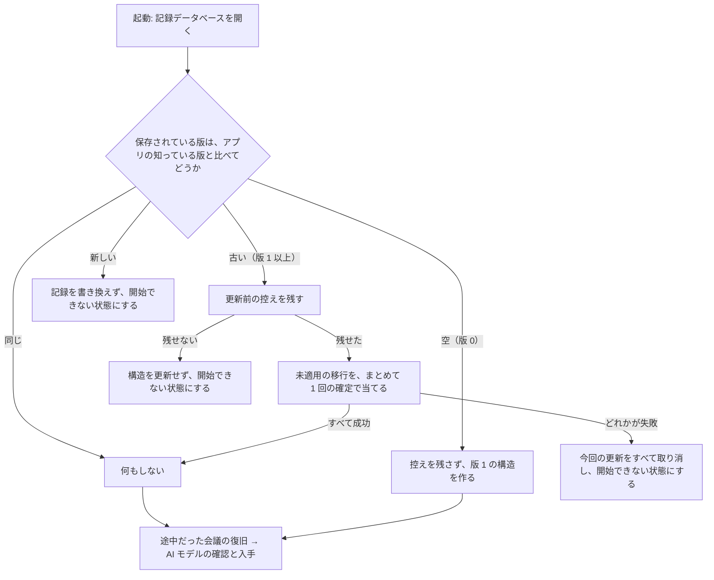

# 記録データベースの構造の更新・更新前の控え・開始できない状態

アプリを更新しても、これまでの記録が残るようにする仕組みです。設計の根拠は、基本設計書の設計判断の記録 ADR-17、システム構成設計書「アプリを開始できない状態」、非機能要件設計書「前の版へ戻すとき」、機能設計書 F-11「記録の削除」と F-17「起動時の復旧」にあります。

## 全体の流れ

アプリサーバーは、起動のたびに、記録データベースの構造の版を確かめます（`RecordDatabase.open`）。



| 保存されている版 | アプリの動き | 失敗したとき |
|---|---|---|
| 同じ | 何もしない | なし |
| 0（空）で、表も無い | 版 1 の構造を作る。控えは残さない（残すと、前の控えを空の複製で置き換えてしまう） | 開始できない状態 |
| 0 で、表がある | このアプリが作ったものではないため、書き換えず、開始できない状態にする | 開始できない状態 |
| 古い（1 以上） | 更新前の控えを残してから、未適用の移行を、まとめて 1 回の確定で当てる | 開始できない状態 |
| 新しい | 記録を書き換えず、開始できない状態にする。構造を更新した版から、前の版のイメージへ戻した場合に起きる | 開始できない状態 |

- 未適用の移行は、すべてまとめて 1 回の確定（`BEGIN IMMEDIATE` から `COMMIT`）で当てます。SQLite は、表の作成や変更も取り消せるため、どれかの移行が失敗したら、今回当てた変更はすべて取り消され、構造の版は更新の前のまま残ります。版 1 から版 3 へ更新して版 3 が失敗したときも、記録は版 1 のままです（版 2 だけが当たった構造にはなりません）。失敗した起動で、控えを版 2 の複製で置き換えることもありません。失敗したあとの記録データベースは更新の前のままで、更新前の控えにも同じ内容があります。
- 構造の版は、SQLite の `PRAGMA user_version` に記録します。表の変更と同じ確定で書き換わるため、構造と版が食い違いません。
- 出荷する移行の一覧（`MIGRATIONS`）は、版 1 だけです。版 2 を想定した移行は、テストコード（`backend/test/schema_fakes.py`）にだけあります。

## 更新前の控え

構造を更新する前の、記録データベースの複製です（`backend/src/meeting_interpreter/records/backup.py`）。バックアップの機能ではなく、アプリ内部の安全策です。

| 項目 | 内容 |
|---|---|
| 置き場所 | 記録データベースと同じ名前付きボリューム（`MMD_RECORDS_DIR`）の直下 |
| ファイル名 | `records.before-update.sqlite3`（記録データベースは `records.sqlite3`） |
| 世代 | 1 世代。次の更新で、新しい控えに置き換える |
| 作り方 | SQLite のオンラインバックアップ（`Connection.backup`）で、一貫した複製を作る |
| 書きかけ | `records.before-update.sqlite3.unfinished` の名前で作る。ディスクへ書き出してから、控えの名前へ置き換える。置き換えは途中の状態が見えない。起動のたびに、前の起動の書きかけを消す |
| 前の控えの `-journal` | 置き換える前に、前の控えの `records.before-update.sqlite3-journal` を消す。`erase_meeting` の確定の途中で止まって残った古い `-journal` が、新しい控えに当てられると、新しい控えが壊れるため（[SQLite: How To Corrupt An SQLite Database File の 1.4 節](https://www.sqlite.org/howtocorrupt.html)） |
| 権限 | 書きかけも控えも、0600（作った利用者だけが読み書きできる）。空の 0600 のファイルを先に作ってから、SQLite に複製させる |
| 空きの確認 | 作る前に、ディスクの空きが、記録データベースの大きさ以上あることを確かめる。足りなければ、何も作らず、構造を更新しない。エラーログには、空きと大きさのバイト数が出る |
| 構造の版 | 更新前の構造のまま。控えの `user_version` が、更新前の版を示す |
| 見られない・取り出せない | 控えを返す API も画面も無い。配信部が配る場所（`/app/static`）は、記録の置き場とは別。控えのファイル名を HTTP で要求しても、404 になる |

削除した会議の内容が、ディスクの生のブロックに残る範囲は、次のとおりです。

- 控えの `erase_meeting` は、控えのファイルの中の領域を、`secure_delete` で 0 に上書きします。上書きの設定が効いていなければ（`PRAGMA secure_delete` が 1 を返さなければ）、消さずに失敗にします。
- 確定の間、SQLite は、消す前のページ（会議の内容を含む）を、控えの `-journal` に一時的に書きます。確定が終わると、SQLite が `-journal` を消します。消した `-journal` と、置き換えて不要になった前の控え、書きかけのファイルが使っていたディスクのブロックは、アプリが上書きしません。記録データベースの `-journal` と、削除で解放されたブロックも同じです。
- ディスクの生のブロックまでは、アプリは保証しません。PC のディスクの暗号化（非機能要件設計書「保存する記録の暗号化」の「PC のロックと、ディスクの保護に頼ります」）に任せます。控えのファイルの権限 0600 は、同じ PC の別の利用者に読ませないための措置です。

控えを記録データベースへ戻す操作は、アプリは行いません。導入と更新を担う AI が手順として行います（非機能要件設計書「前の版へ戻すとき」）。戻すと、更新後に作られた記録と、更新後に変わった記録が失われます。手順と、失われる会議を数えて戻す道具（`tools/update_backup.py`）は、[docs/operations.md](operations.md)の「前の版へ戻す」にあります。

## 開始できない状態

起動で記録データベースを使えなかったとき、アプリサーバーは止まらず、「開始できない状態」で動き続けます（`backend/src/meeting_interpreter/startup_gate.py`）。止めると、コンテナが再起動を繰り返し、画面へ理由を返せないためです。

| 原因の種類（エラーログの `failure_kind`） | 当てはまる場合 | 記録の状態 |
|---|---|---|
| `schema_unsupported` | 構造の版が新しい。または、版が 0 で表がある | 書き換えない |
| `backup_failed` | 更新前の控えを残せない（ディスクの空きが足りない・書き込みの失敗・書きかけを消せない） | 更新前のまま |
| `migration_failed` | 構造の更新（移行）に失敗した | 今回の更新をすべて取り消す（更新の前のまま） |
| `records_unavailable` | 上のどれでもなく、記録データベースを開けない（ファイルが壊れている・置き場に書けない など） | 書き換えない |

開始できない状態では、次のとおりに動きます。

| 部 | 動き |
|---|---|
| 接続制限部 | 通常どおり、すべての要求の宛先と送り元を確かめる。断った要求は接続ログに残る |
| 配信部 | 画面のファイル（`GET` と `HEAD` で、`/api` と `/ws` 以外）を返す |
| 上記以外の HTTP の要求 | 経路の処理に渡さず、`SYSTEM_STARTUP_FAILED`（HTTP 503）を共通の形で返す。存在しない経路も同じ |
| WebSocket の接続 | 受け付ける前に閉じる。サーバーは、接続要求に HTTP 403 を返して断る（アプリが指定する符号 1011 と理由 `SYSTEM_STARTUP_FAILED` は、相手に届かない） |
| 会議管理部・通知部・作成ジョブ管理部・記録保存部・モデル管理部 | 開始しない。途中だった会議の復旧と、AI モデルの確認・入手も行わない |
| 通訳ワーカー・生成ワーカー・翻訳モデルの変換プロセス | 起動しない |
| 記録データベース | 書き換えない |

- 開始できない状態は、アプリサーバーを起動し直すまで続きます。途中で通常の状態へ戻りません。
- エラーログは、原因の種類（`failure_kind`）・例外の種類・発生場所を、1 回だけ出します（要求のたびには出しません）。版・大きさの数値を含む起動の知らせも 1 行出ます。会議の内容と、データベースの例外の文面は出しません。
- 画面は、どの API の応答でも `SYSTEM_STARTUP_FAILED` を受け取ったら、画面全体にエラーを表示します（[docs/notices.md](notices.md)）。
- コンテナの `HEALTHCHECK`（`GET /api/health`）は 503 を受けるため、約 1.5 分で `unhealthy` になります。コンテナは再起動しません（再起動は、プロセスが終わったときだけ）。導入と更新を担う AI は、`docker compose ps` の `unhealthy` と、`docker logs` の `SYSTEM_STARTUP_FAILED` で気づけます。

利用者が画面で見たエラーコード（`SYSTEM_STARTUP_FAILED`）を受け取ったときの調べ方は、次のとおりです。

```bash
docker logs <コンテナ名> 2>&1 | grep SYSTEM_STARTUP_FAILED
# failure_kind が原因の種類。直後の startup の知らせに、版やバイト数が出る場合がある
```

途中だった会議の復旧（F-17 の後半）の失敗は、開始できない状態にしません。これまでどおり、エラーログ `MEETING_RECOVERY_FAILED` を出して、起動を失敗させます（[docs/operations.md](operations.md)）。基本設計書が「開始できない状態」の対象にするのは、記録データベースの構造を使えない場合だけのためです。

## 記録の削除と控え

利用者が記録を削除すると、記録保存部は、控えがあれば、先に控えから会議を消します（`FileUpdateBackup.erase_meeting`）。消せたときだけ、記録データベースから消します。

| 場面 | 動き |
|---|---|
| 控えがある | 控えから、その会議と、字幕・要約・質問のまとまり・質問を、1 回の確定で消す。続けて、記録データベースから同じものを消す |
| 控えが無い | 記録データベースから消すだけ。控えのファイルは作らない |
| 控えから消せない（壊れている・版の表を知らない・削除に失敗） | 記録データベースから 1 件も消さず、`RECORD_DELETE_FAILED` を返す。控えは変わらない |
| 控えから消したあとで、記録データベースから消せない | `RECORD_DELETE_FAILED` を返す。控えから消した会議は戻さない。削除をやり直せる |
| 会議がすでに無い（2 回目の要求） | 成功。何も消さない |
| 控えにだけ会議が無い（前の削除が、記録データベースの削除で失敗した） | 控えの削除を済んだものとして、記録データベースから消す |

- 控えは更新前の構造のままです。控えの `user_version` から、移行の一覧（`Migration.meeting_tables`）に書いた表の名前を引き、子の表から順に消します。控えの版を一覧に持たないときは、どの表から消すか分からないため、消さずに失敗にします。
- 消した内容を、控えのファイルに残しません（`secure_delete`。記録データベースと同じ設定）。
- 記録保存部へ控えを渡し忘れると、警告も出ずに、記録データベースだけを消します（削除した会議が控えに残ります）。`create_app` が、記録データベースと記録保存部の両方に、同じ控え（`app.state.update_backup`）を渡します。控えを持つアプリで削除して、控えからも消えることを、`test_app_delete_with_backup.py` が確かめます。

## 版 2 以降の移行を足す手順

1. `backend/src/meeting_interpreter/records/migrations.py` の `MIGRATIONS` の末尾へ、`Migration` を足します。既存の移行は書き換えません。
2. 会議ごとの行（`meeting_id` の列）を持つ表が変わるときは、その `Migration` に `meeting_tables` を書きます（子の表が先、会議の表が最後）。変わらないときは省略します（前の版と同じ）。
3. 更新前の控えは、仕組みが自動で残します。移行の中で控えを作る必要はありません。
4. `backend/test/schema_fakes.py` を参考に、版 1 の記録を持つ置き場を版 2 へ更新するテストを足します。出荷の一覧にテスト用の移行を入れません。`test_record_schema_update.py` の `TestMeetingTablesMatchTheActualStructure` が、`meeting_tables` と、移行を当てた実際の表（`meeting_id` の列を持つ表）が一致することを確かめます。
5. 表を作り直す（`DROP TABLE` してから作る）移行を書くときは、外部キーに注意します。
   - 移行は、外部キーが有効な接続（`PRAGMA foreign_keys = ON`）の、1 回の確定の中で当たります。
   - SQLite は、外部キーが有効なとき、`DROP TABLE` の前に、その表の全行を消す `DELETE FROM` を暗黙に行い、そのとき外部キーの動作（`ON DELETE CASCADE`）も働きます（[DROP TABLE](https://www.sqlite.org/lang_droptable.html)）。この構造では、`meetings` を作り直すと、字幕・要約・質問のまとまり・質問が消えます。`question_sets` を作り直すと、質問が消えます。
   - 外部キーの有効と無効を切り替える `PRAGMA foreign_keys` は、確定の中では何もしません（[PRAGMA foreign_keys](https://www.sqlite.org/pragma.html#pragma_foreign_keys)）。移行の文の中で外部キーを無効にして、作り直すことはできません。
   - 表を作り直さずに済む `ALTER TABLE`（`ADD COLUMN`・`RENAME COLUMN`・`DROP COLUMN`・`RENAME TO`）で書けるなら、そちらにします。
   - 作り直しが要るときは、SQLite の手順（[Making Other Kinds Of Table Schema Changes](https://www.sqlite.org/lang_altertable.html#otheralter)）に従います。外部キーを無効にしてから確定を始め、新しい表（`new_X`）へ行を写し、古い表を `DROP TABLE` して、`ALTER TABLE new_X RENAME TO X` で名前を戻します。確定の前に `PRAGMA foreign_key_check` で、外部キーが壊れていないことを確かめ、確定してから外部キーを有効に戻します。
   - いまの `apply_migrations` は、確定の前に外部キーを無効にしません。この手順を使う移行を足すときは、先に `apply_migrations` へ、その前後の処理を足す作業が要ります（いまは足していません）。足すまで、`meetings` と `question_sets` を作り直す移行は書かないでください。
6. 控えへ戻す道具（`tools/update_backup.py`）の比べ方を、見直します。道具は、控えにある列だけで、会議の行を比べます。
   - 移行が、利用者の書く値を持つ列を足すなら（例: 会議のメモ）、その値だけが変わった会議を、道具は数えません。失われる会議の件数が少なく出るため、比べ方を直します。
   - 移行が、既存の列の値の表し方を変えるなら、内容を変えていない会議も「変わった会議」に数えます。件数が多く出ることを、手順（[docs/operations.md](operations.md)）の利用者への説明に足します。
   - `backend/test/operations_tools/test_update_backup_tool.py` に、その移行の更新を足して確かめます。

## 出荷するコンテナでの確認（2026-11-26）

コンテナを作り直し（`docker compose build` → `up -d`）、`playwright-cli`（Chrome、headless、画面幅 1280）で、コンテナ名の URL（`http://toshiakimamada-blip-mmd-output-system:3001`）を開いて確かめました。確認の前に、記録の置き場（`records.sqlite3` と `persist-check.txt`）を複製して SHA-256 を控え、確認のあとに、複製から戻しました（戻したあとの SHA-256 は、確認前と一致）。

出荷するイメージには版 2 の移行が無いため、記録データベースの更新（古い構造）と、ディスクの空き不足は、コンテナでは作れません（テスト用の仕掛けを出荷物に入れないため）。この 2 つは、テストで確かめました（下の「テスト」）。コンテナで作れた状態は、次のとおりです。

| 状態 | 作り方（出荷物に仕掛けを足さない） | 結果 |
|---|---|---|
| 通常（作り直した直後） | 記録の置き場は、そのまま | 起動の知らせに復旧 0 件。`/api/health` が 200。記録の SHA-256 は変わらない |
| 構造が新しい（`schema_unsupported`） | 停止して、記録データベースの `PRAGMA user_version` を 2 にしてから起動 | `/` は 200（画面のファイル）。`/api/health`・`/api/meetings`・`/api/models/status`・`/api/system/alerts`・`POST /api/meetings` は、すべて 503 の `SYSTEM_STARTUP_FAILED`。宛先が `evil.example` の要求は、API も画面のファイルも 403（`ACCESS_HOST_NOT_ALLOWED`）。送り元の無い・別の送り元の `POST` は、403（`ACCESS_ORIGIN_MISSING`・`ACCESS_ORIGIN_MISMATCH`）。エラーログ `SYSTEM_STARTUP_FAILED` は 1 件（`failure_kind: schema_unsupported`）。コンテナの中のプロセスは、`python -m meeting_interpreter` と init だけ（ワーカーなし）。記録の SHA-256 は、起動の前後で同じ。再起動の回数は 0 |
| 控えを残す操作ができない（`backup_failed`） | 書きかけの控えの場所（`records.before-update.sqlite3.unfinished`）に、空でないフォルダーを置いて起動（消せない） | `/api/health` が 503。エラーログは `failure_kind: backup_failed`、例外は `UpdateBackupError`。記録の SHA-256 は同じ。再起動 0 |
| 記録データベースが壊れている（`records_unavailable`） | 停止して、`records.sqlite3` を SQLite ではない内容のファイルに置き換えて起動（確認後に元のファイルへ戻した） | `/api/health` が 503。エラーログは `failure_kind: records_unavailable`、例外は `DatabaseError`。ファイルは起動の前後で同じ。再起動 0 |
| 開始できない状態の持続 | 構造が新しい状態を 2 分続けた | 約 1.5 分で Docker の表示が `unhealthy` になり、`restarts` は 0 のまま。コンテナは動き続けた |
| 通常の状態へ戻る | 画面を開いたまま、コンテナを止め（表示は残った）、版を 1 に戻して起動し直した | 起動し直しから約 25 秒以内に、開いていた画面が自動で読み込み直され、「会議の一覧」になった |
| 控えがあるときの削除 | 記録データベースの複製を、控え（`records.before-update.sqlite3`）として置いて起動し、画面の「削除」から会議 1 件を削除 | 204。記録データベースと控えの、どちらからも、その会議の行が消えた（両方とも 76 件。もう 1 件の会議の行は残る）。両方のファイルに、削除した会議のタイトルの文字列が残らない。同じ削除を再度送っても 204 |
| 控えを取り出せない | 控えのファイル名・記録データベースのファイル名・`..` を含む経路・`/api/backup` などを HTTP で要求 | すべて 404。SQLite のファイルは返らない |

スクリーンショット（`ai_generated/screenshots/`）:

| ファイル | 内容 |
|---|---|
| `pbi-7-2_01_normal_state_after_rebuild.png` | 作り直した直後の通常の状態（「会議の一覧」） |
| `pbi-7-2_02_blocked_schema_newer_full_screen.png` | 構造が新しい記録データベースで起動した、開始できない状態の画面全体のエラー |
| `pbi-7-2_03_recovered_after_restart_in_normal_state.png` | 通常の状態で起動し直したあと、開いたままの画面が戻った「会議の一覧」 |
| `pbi-7-2_04_list_after_delete_with_backup_present.png` | 控えがあるときに、画面から削除した直後の「会議の一覧」 |

確かめていないことは次のとおりです。

- 利用者の PC（Windows の Edge）での表示
- 実際に版 2 の移行を当てた更新（出荷物に移行が無いため）。テストで代えた
- ディスクの空きが足りないときの、控えの失敗。テストで代えた
- 開始できない状態の画面の、画面を読み上げるソフトでの読み上げ。見出し（h1）と `role="alert"` の構造は、Vitest と `playwright-cli` のスナップショットで確かめた

## テスト

| ファイル | 確かめること |
|---|---|
| `backend/test/meeting_interpreter/records/test_record_schema_update.py` | 古い・同じ・新しい・空の判定。控えを移行の前に残すこと。版 1 から版 3 への更新で版 3 が失敗したとき、すべて取り消して版 1 のまま残り、2 回起動しても控えが版 1 のままであること。控えの失敗で更新しないこと。書きかけの掃除。控えの版の表の引き方。`meeting_tables` と実際の表の一致 |
| `backend/test/meeting_interpreter/records/test_update_backup.py` | 控えの内容の一致。1 世代。書きかけを控えの名前にしないこと。ディスク不足（境界を含む）で更新しないこと。控えを返す経路が無いこと。古い `-journal` を新しい控えに当てないこと。権限 0600 |
| `backend/test/meeting_interpreter/records/test_update_backup_erase.py` | 控えから先に消すこと。控えが無い・控えから消せない・記録データベースから消せない・2 回目の要求。版 1 と版 2 の控え。消した本文を残さないこと。控えが無くなった競合と、`secure_delete` が効かないときに消さないこと |
| `backend/test/meeting_interpreter/test_app_delete_with_backup.py` | 控えを持つアプリで、HTTP で削除して、控えからも消えること。渡し忘れで落ちること |
| `backend/test/meeting_interpreter/test_startup_blocked.py` | 開始できない状態（4 つの原因）の応答・接続制限・ワーカー無し・記録を書き換えない・ログ 1 回 |
| `backend/test/meeting_interpreter/test_startup.py` | 起動の順序。記録データベースの失敗の合図（原因の種類）。復旧の失敗は合図にしないこと |
| `backend/test/operations_tools/test_update_backup_tool.py` | 控えへ戻す道具（`tools/update_backup.py`）。更新の直後は 0 件。作られた会議と変わった会議（控えに無い表の行・字幕の追加）を数えること。削除した会議・控えに無い列を数えないこと。書き換えないこと・会議の内容を出さないこと。了承した件数との不一致・控えが無い・壊れた控え・版の逆転で止まること。戻したあとに前の版が開けること |
| `frontend/test/system/StartupGate.test.tsx` | 画面全体の表示。API の応答での切り替え。表示を残すこと。通常の状態へ戻ったときの読み込み直し |
